**Menu:** 1101 - Calculadora V2

A **Calculadora** forma o preço de venda de um ou vários produtos a partir do custo de compra, dos impostos da rota (origem e destino), das despesas e da margem desejada. É usada pela equipe de precificação e pelo comercial para simular preços antes de negociar. Esta página descreve a aba **Calculadora** e os controles do topo. A tela tem ainda as abas **Comparativo UF**, **Cenários e sensibilidade**, **Preço por estado** e **Indústria**, que são tratadas à parte.

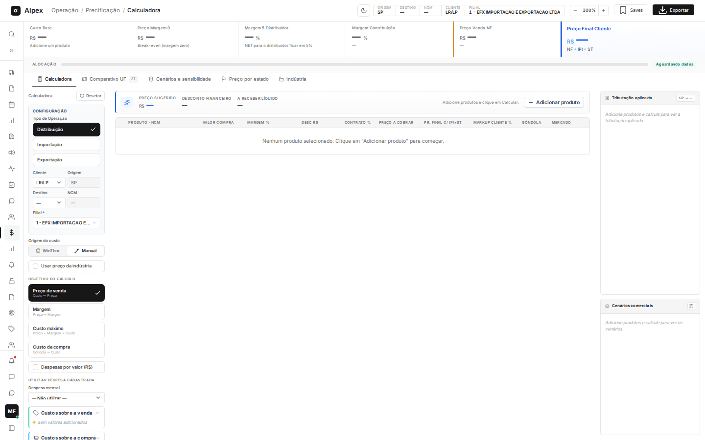

A tela se divide em quatro áreas: a barra do topo (contexto, zoom, **Saves** e **Exportar**), os cartões de resultado com a barra de **Alocação**, o painel de configuração à esquerda e, no centro, a tabela de produtos. À direita ficam os painéis **Tributação aplicada** e **Cenários comerciais**.

## Entender a barra do topo e o zoom

<Steps>
  <Step title="Ler o contexto">
    No alto da tela, a faixa mostra **Origem**, **Destino**, **NCM**, **Cliente** e **Filial** da simulação atual. Ela apenas reflete o que foi escolhido no painel à esquerda e nos produtos; não é editável. No modo WinThor, o campo **NCM** pode exibir o código do produto em foco.

    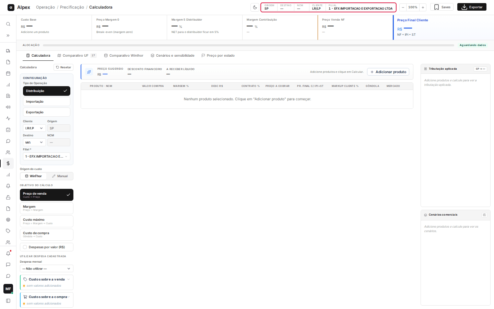
  </Step>
  <Step title="Ajustar o zoom">
    Use **-** e **+** (ao lado do percentual) para reduzir ou ampliar o conteúdo da aba de 50% a 200%, em passos de 10%. Clicar no percentual volta a 100%. O zoom é lembrado no seu navegador.

    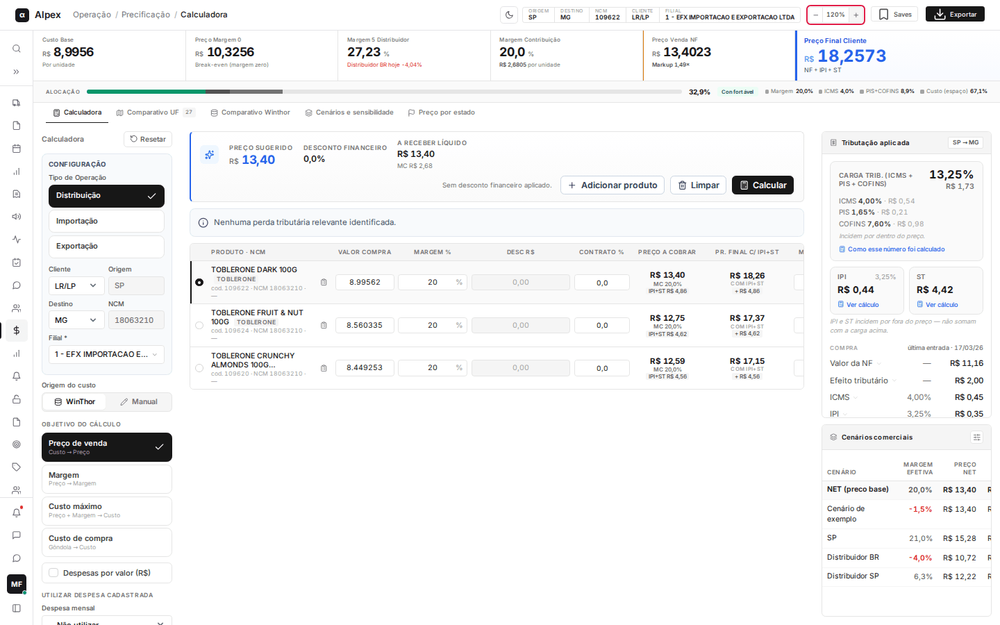
  </Step>
</Steps>

<Note>
A origem é definida automaticamente pela filial escolhida. O nome do save aberto, quando houver, aparece à esquerda da faixa.
</Note>

## Definir tipo de operação, cliente, destino e filial

<Steps>
  <Step title="Escolher o tipo de operação">
    Em **Tipo de Operação**, selecione **Distribuição** (compra para revenda no mercado interno), **Importação** ou **Exportação**. Trocar o tipo mantém os produtos já lançados e os recalcula; os custos percentuais voltam aos padrões do novo tipo.

    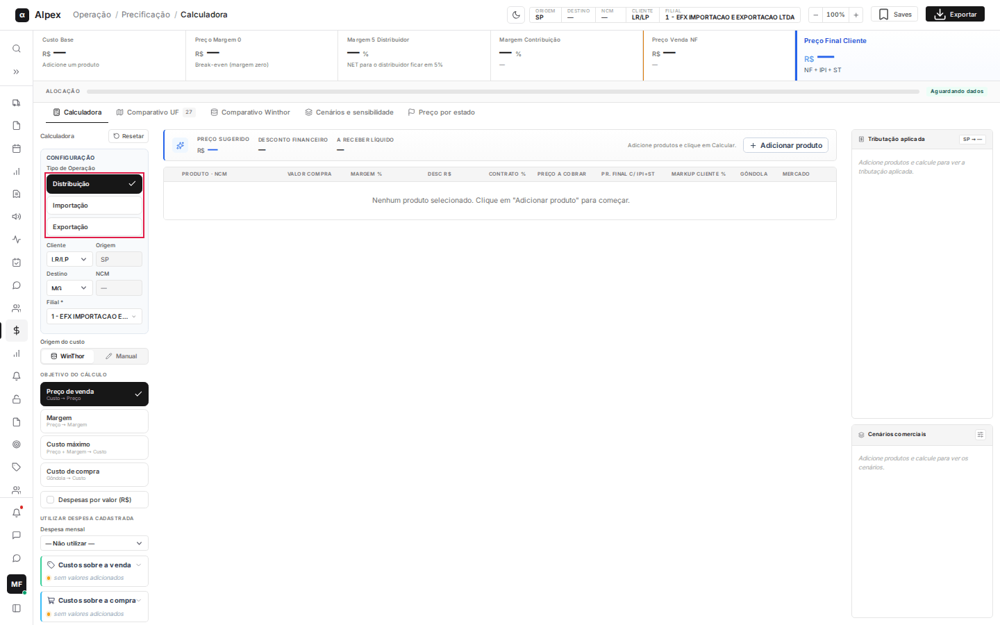
  </Step>
  <Step title="Escolher o tipo de cliente e o destino">
    Em **Cliente**, escolha **LR/LP** (lucro real ou presumido) ou **SN** (Simples Nacional). Em **Destino**, escolha a UF para onde a mercadoria será vendida. O **frete de saída** da UF escolhida é preenchido sozinho, se estiver cadastrado.

    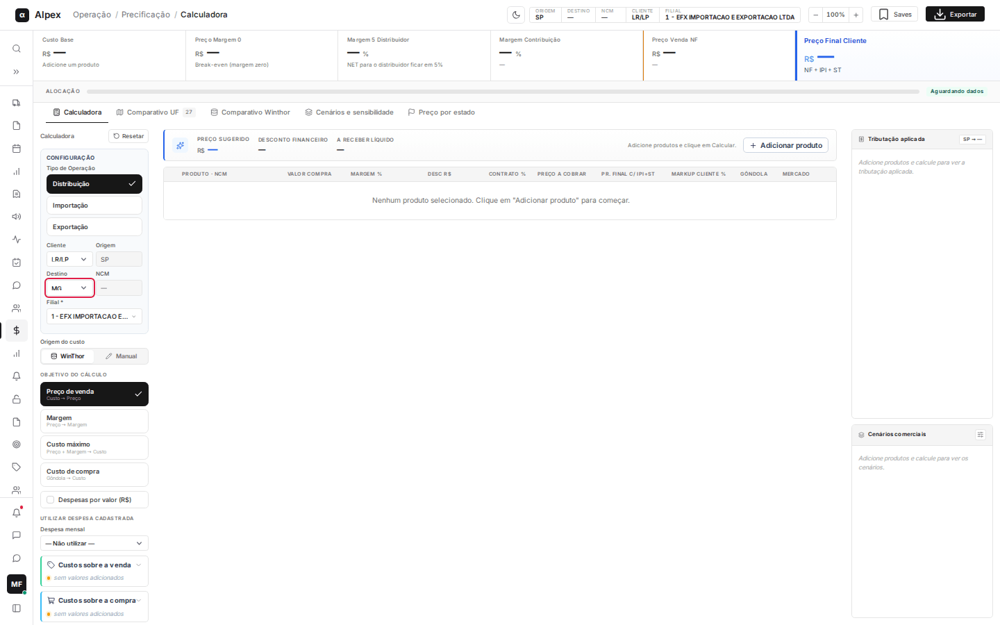
  </Step>
  <Step title="Escolher a filial">
    Clique em **Filial**, pesquise pelo código, nome ou UF e selecione. A **Origem** (UF) vem da filial e não é editável. O campo **NCM** é preenchido pelos produtos adicionados.

    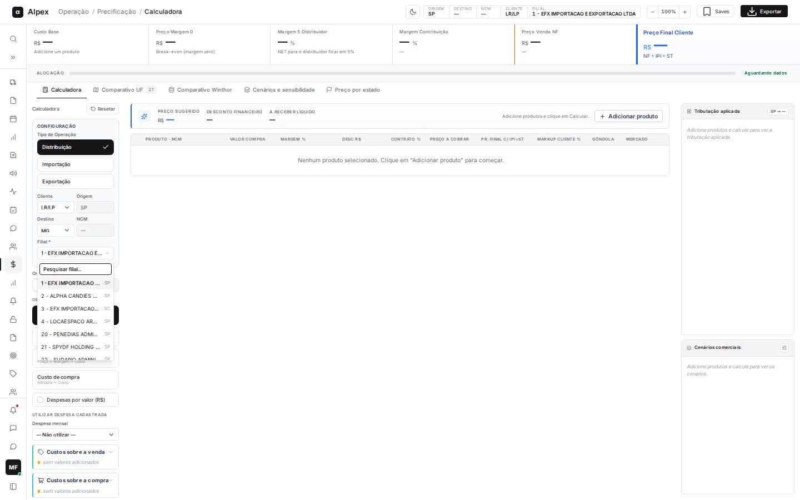
  </Step>
</Steps>

<Note>
A filial é obrigatória. Sem destino escolhido, os impostos da rota não são calculados.
</Note>

## Escolher a origem do custo (WinThor ou Manual)

<Steps>
  <Step title="Selecionar a origem">
    Em **Origem do custo**, escolha **WinThor** (o custo do produto vem do ERP) ou **Manual** (você digita o valor de compra na tabela, ou usa o preço da indústria).

    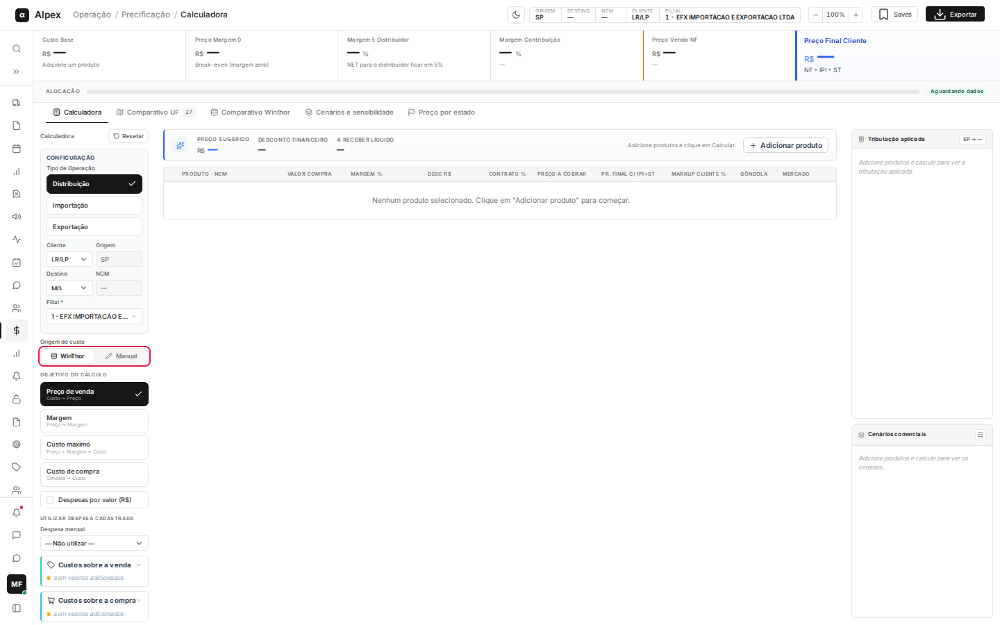
  </Step>
  <Step title="Confirmar a troca, se houver produtos">
    Se já existirem produtos na tabela, o sistema pergunta **Trocar a origem do custo?**. Clique em **Sim, trocar** para continuar (os itens são removidos) ou em **Cancelar** para manter tudo como está.

    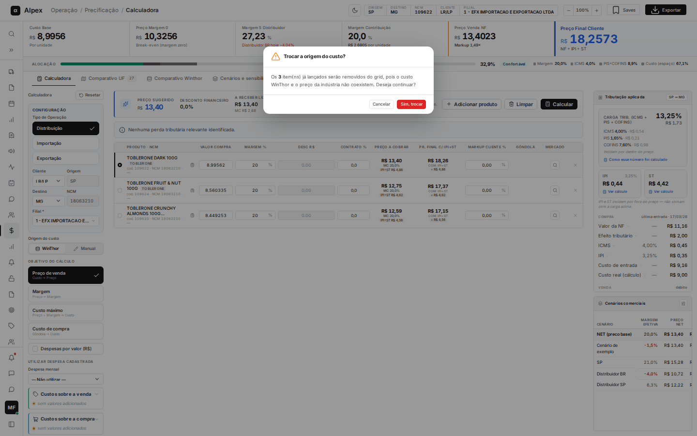
  </Step>
  <Step title="Usar o preço da indústria (origem Manual)">
    Na origem **Manual**, marque **Usar preço da indústria** para que o valor de compra (ou FOB, na importação) seja preenchido automaticamente ao adicionar produtos da indústria. Desmarcada, você preenche o valor em cada linha. A opção não aparece no modo WinThor nem na exportação.

    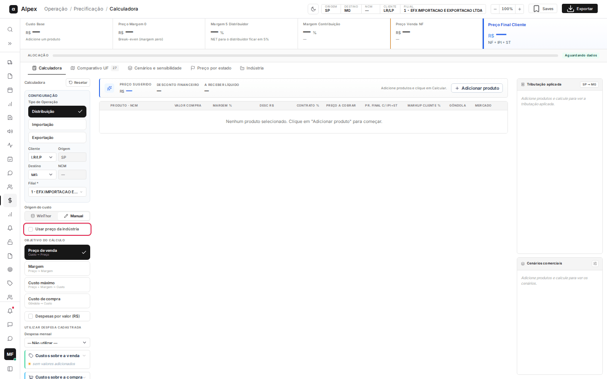
  </Step>
</Steps>

<Warning>
Trocar a origem do custo com produtos lançados remove todos eles da tabela. WinThor e Manual não convivem na mesma simulação.
</Warning>

## Escolher o objetivo do cálculo

<Steps>
  <Step title="Selecionar o objetivo">
    Em **Objetivo do cálculo**, escolha o que você quer descobrir: **Preço de venda** (Custo → Preço), **Margem** (Preço → Margem), **Custo máximo** (Preço + Margem → Custo) ou **Custo de compra** (Gôndola → Custo). Os campos da tabela mudam conforme o objetivo.

    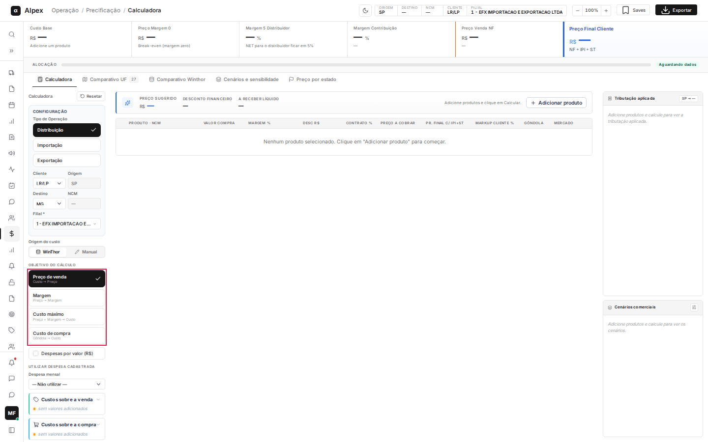
  </Step>
  <Step title="Margem">
    Informe o **Preço alvo** de cada produto e indique se ele já inclui IPI e ST (**c/ IPI+ST**) ou não (**s/ IPI+ST**). A **Margem (calc.)** é calculada pelo sistema.

    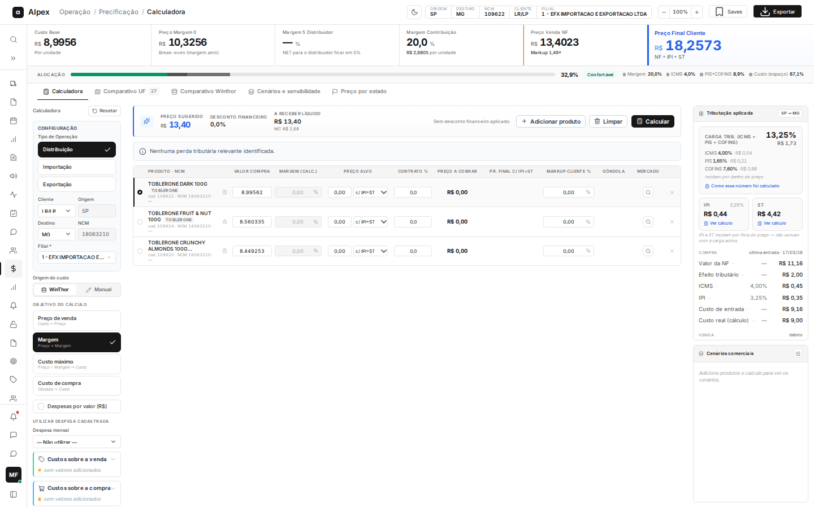
  </Step>
  <Step title="Custo máximo">
    Informe o **Preço alvo** e a **Margem %** desejada. O sistema calcula o maior custo de compra que ainda respeita essa margem (o campo de valor de compra fica bloqueado).

    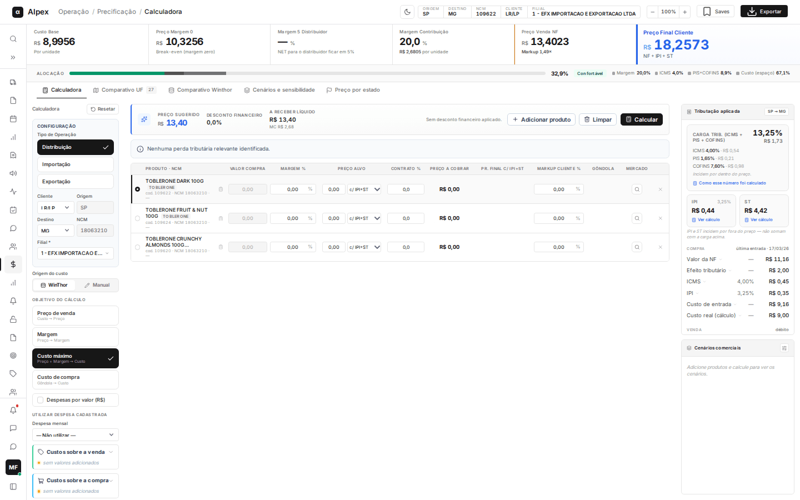
  </Step>
  <Step title="Custo de compra">
    Informe o preço de **Gôndola** que o cliente praticará e o **Markup cliente %**. O sistema devolve o custo de compra compatível.

    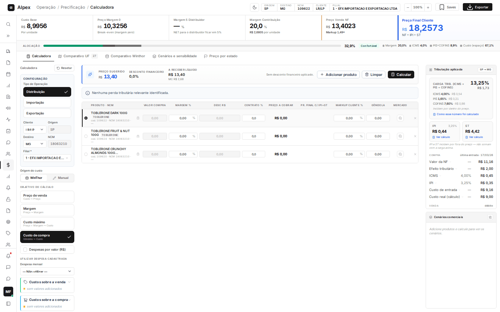
  </Step>
</Steps>

<Note>
Trocar o objetivo limpa os resultados já calculados e esvazia os campos que passam a ser o resultado (por exemplo, o valor de compra em **Custo máximo**). Clique em **Calcular** depois de trocar.
</Note>

## Adicionar um ou vários produtos

<Steps>
  <Step title="Abrir o seletor">
    Clique em **Adicionar produto**, acima da tabela.

    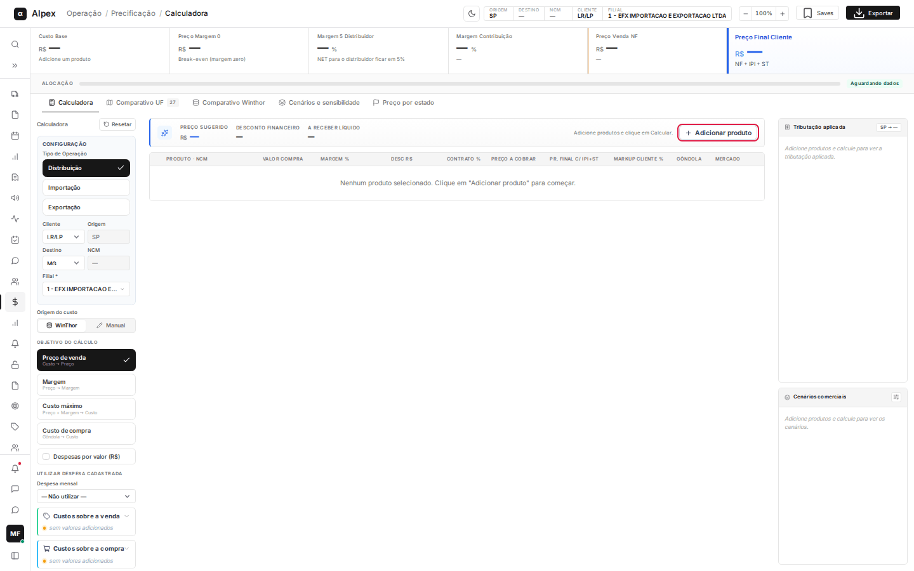
  </Step>
  <Step title="Buscar e marcar">
    Na janela **Adicionar produtos por NCM cadastrado**, digite no campo de busca (por código, descrição, fornecedor, marca, seção ou categoria no modo WinThor; por NCM, descrição ou indústria no modo Manual) e marque a caixa de cada produto desejado. A seleção vale também entre páginas. Use **Selecionar todos** para marcar tudo o que a busca encontrou e **Limpar seleção** para desmarcar.

    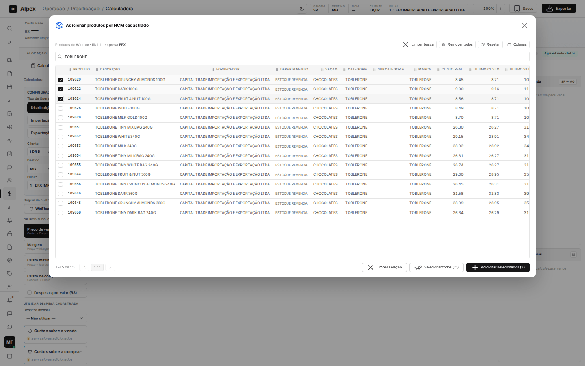
  </Step>
  <Step title="Ajustar as colunas (opcional)">
    **Colunas** mostra ou esconde colunas da lista; arraste o título de uma coluna para mudar a ordem. **Resetar** restaura as colunas padrão. **Remover todos** descarta a escolha inteira e volta ao catálogo completo.

    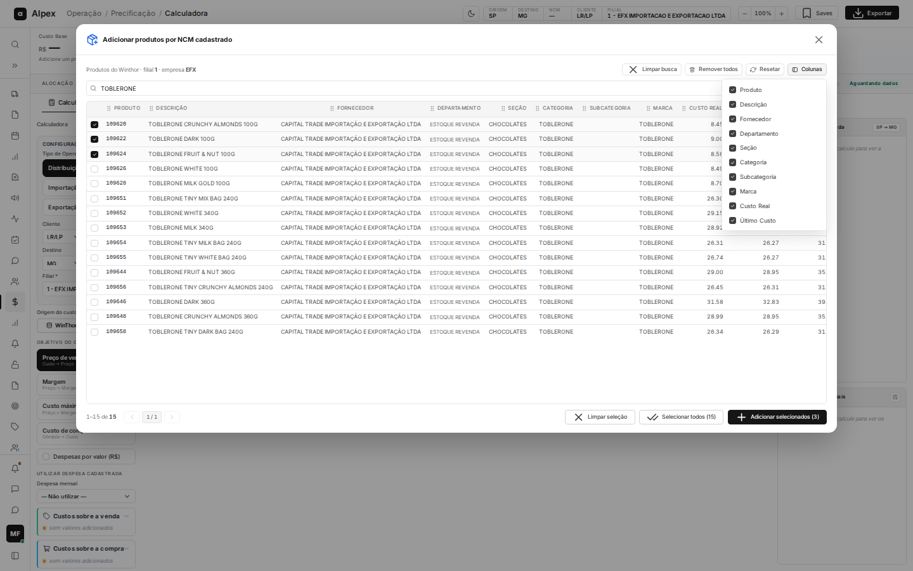
  </Step>
  <Step title="Adicionar à calculadora">
    Clique em **Adicionar selecionados (n)**. A janela fecha e os produtos entram na tabela, um por linha.

    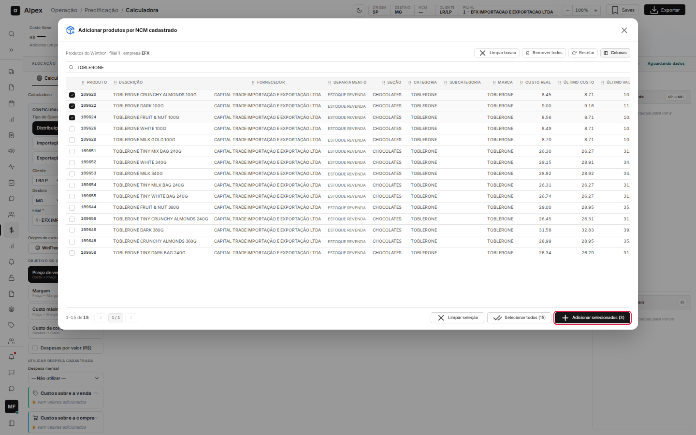
  </Step>
</Steps>

<Note>
O botão **Adicionar selecionados** só fica ativo com pelo menos um produto marcado. No modo WinThor a lista traz os produtos da filial escolhida.
</Note>

## Editar os valores de cada linha e calcular

<Steps>
  <Step title="Preencher a linha">
    Em cada linha, preencha o **Valor compra** (no modo WinThor já vem do ERP; na importação o campo é **FOB USD**) e a **Margem %** desejada. **Contrato %** é o desconto financeiro da linha (se vazio, vale o global de **Custos sobre a venda**). **Markup cliente %** é o markup que o cliente aplica sobre o preço final e gera o preço de **Gôndola**.

    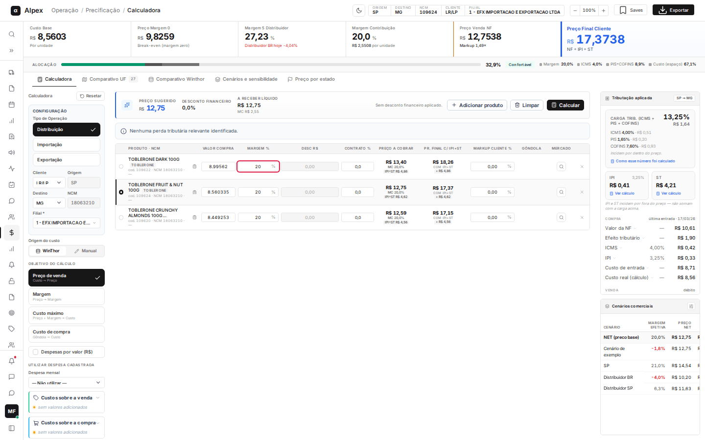
  </Step>
  <Step title="Aplicar o valor a toda a coluna">
    Digite o valor numa linha e pressione **Ctrl+D** para copiá-lo para todas as linhas da coluna.
  </Step>
  <Step title="Calcular">
    Clique em **Calcular**. Cada linha passa a mostrar **Preço a Cobrar** (preço de venda na nota), **Pr. Final c/ IPI+ST** e **Gôndola**. Linhas sem valor de compra ou margem mostram o aviso em vermelho "Preencha valor de compra e margem".

    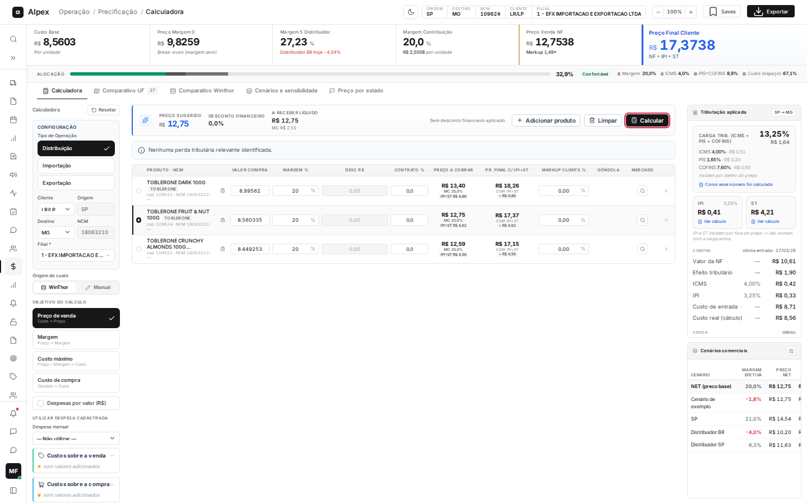
  </Step>
  <Step title="Ver o resultado">
    Os cartões do topo, o **Preço sugerido** e os painéis da direita passam a refletir o produto em foco.

    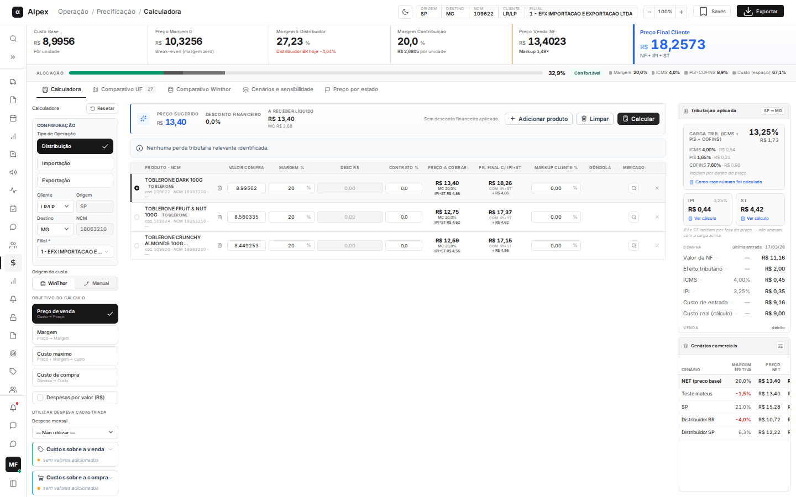
  </Step>
</Steps>

<Note>
**Limpar** remove todos os produtos da tabela. O **x** no fim da linha remove só aquele produto.
</Note>

## Escolher o produto em foco e ver a composição do preço

<Steps>
  <Step title="Selecionar a linha">
    Clique na bolinha à esquerda do produto. Os cartões do topo, a **Alocação**, a **Tributação aplicada** e os **Cenários comerciais** passam a mostrar os números daquele produto.

    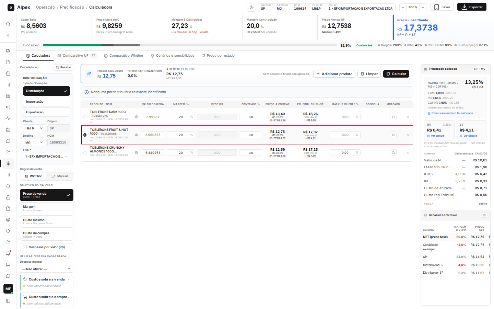
  </Step>
  <Step title="Abrir a composição do preço">
    Clique no ícone de prancheta ao lado do nome (dica **Composição do preço**). A janela mostra, passo a passo: custo base, fator divisor (margem e tributos de venda), decomposição do preço da nota (ICMS, PIS, COFINS, margem líquida) e preço final com IPI e ST.

    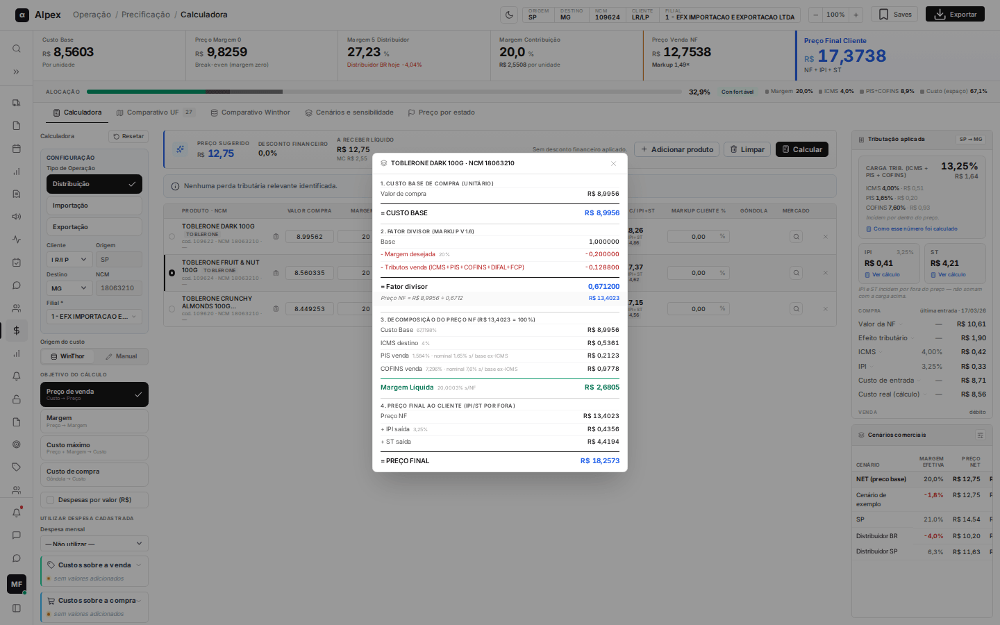
  </Step>
</Steps>

<Note>
A composição só fica disponível depois de calcular. Feche a janela pelo **x** ou clicando fora dela.
</Note>

## Ler os cartões de resultado e a barra de Alocação

<Steps>
  <Step title="Ler os cartões">
    Os seis cartões do alto mostram o resultado do produto em foco:

    - **Custo Base**: custo unitário de entrada, já líquido dos créditos de imposto.
    - **Preço Margem 0**: preço de equilíbrio (break-even), no qual a margem é zero.
    - **Margem 5 Distribuidor**: o preço NET (base) que deixa o distribuidor com 5% de margem; abaixo, a margem que o distribuidor tem hoje (em vermelho quando negativa).
    - **Margem Contribuição**: percentual da margem sobre o preço de venda e o valor por unidade.
    - **Preço Venda NF**: preço de venda na nota fiscal, com o markup sobre o custo base.
    - **Preço Final Cliente** (destaque): preço da nota somado a IPI e ST.

    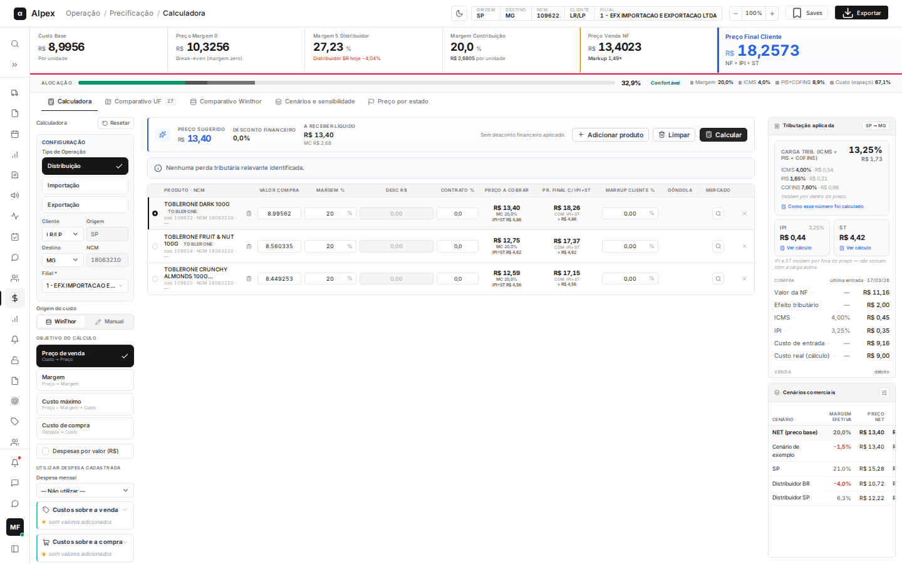
  </Step>
  <Step title="Ler a barra de Alocação">
    A barra **Alocação** divide o preço de venda em fatias: margem, ICMS, PIS+COFINS, despesas, desconto e o espaço que sobra para o custo. À direita aparecem a soma das alíquotas e a situação: **Confortável**, **Apertado**, **No limite** ou **Inviável**. A legenda traz o percentual de cada fatia.

    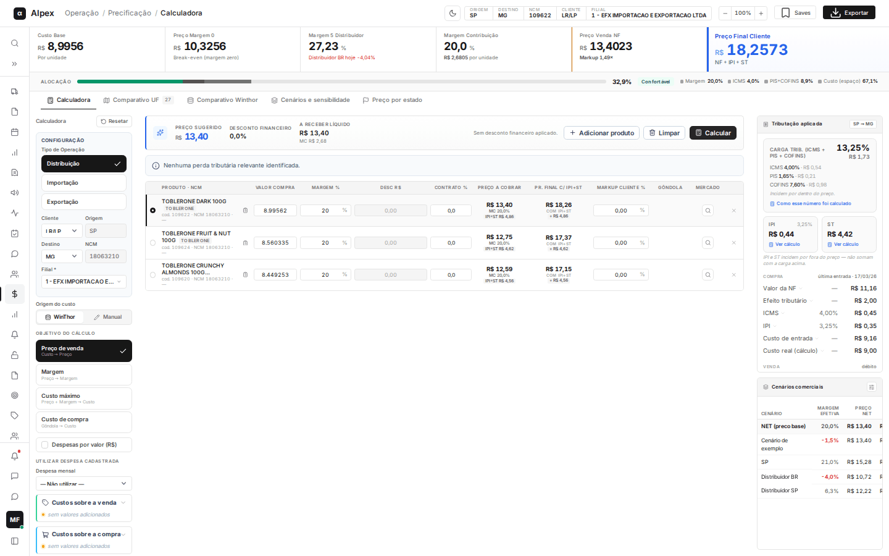
  </Step>
  <Step title="Ler o Preço sugerido">
    Acima da tabela, o painel **Preço sugerido** mostra o preço, o **Desconto financeiro** e o valor **A receber líquido** (com a margem de contribuição por unidade).
  </Step>
</Steps>

<Note>
Antes de calcular, os cartões mostram "—". Quando há perda tributária relevante, uma faixa vermelha aparece acima da tabela; sem perda, ela mostra "Nenhuma perda tributária relevante identificada".
</Note>

## Informar custos sobre a venda e sobre a compra

<Steps>
  <Step title="Abrir os custos sobre a venda">
    No painel à esquerda, clique em **Custos sobre a venda**. Preencha, em percentual do preço de venda, **Custo operac.**, **Comissão**, **Marketing**, **Frete saída**, **Merchandising**, **Custo financ.** e **Outros**, e o **Contrato** (desconto financeiro). O resumo fechado da seção lista os valores informados.

    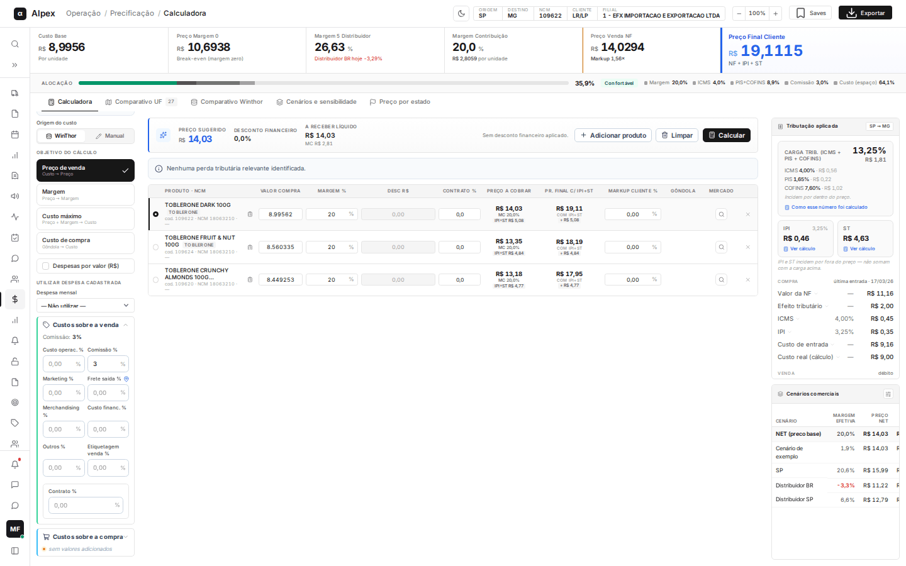
  </Step>
  <Step title="Definir o frete de saída por UF">
    O ícone de mapa ao lado de **Frete saída %** abre **Frete saída padrão por UF**, com um percentual por estado. **Salvar** grava esses percentuais como padrão para todos os usuários; **Cancelar** descarta.

    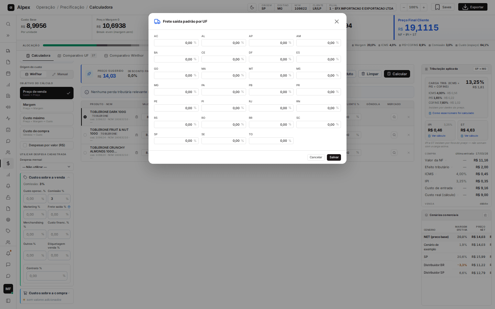
  </Step>
  <Step title="Abrir os custos sobre a compra">
    Clique em **Custos sobre a compra**. Há **Frete compra %** e **Custos diversos %**, além do custo de etiquetagem (**Sim** ou **Não**). Na importação aparecem também as despesas percentuais sobre o FOB (frete internacional, seguro, AFRMM, Siscomex, THC e outras).

    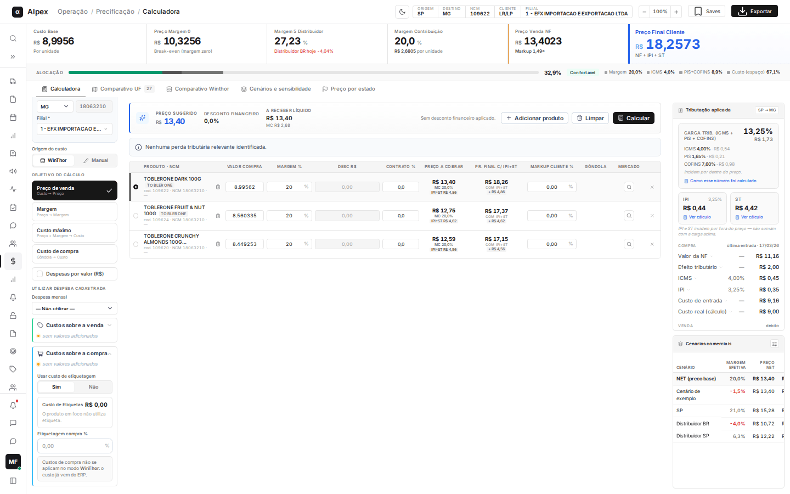
  </Step>
  <Step title="Parâmetros da importação">
    Na importação com origem Manual, a seção **Avançado** traz **Moeda FOB**, **Câmbio**, **Modal** (marítimo, aéreo ou terrestre), os itens que entram na base do ICMS (IPI, PIS, COFINS, AFRMM) e **Mercosul**.

    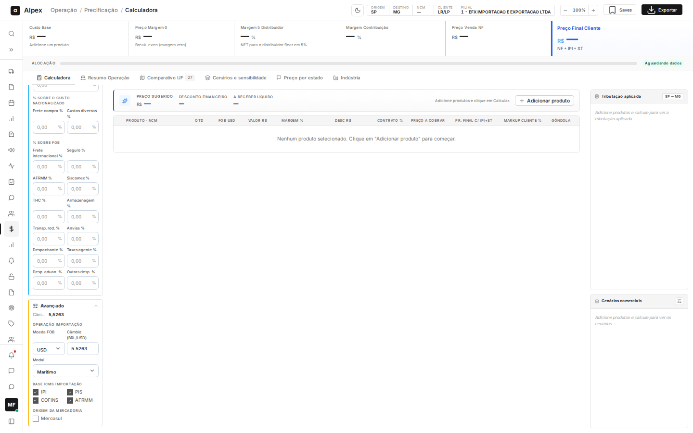
  </Step>
  <Step title="Exportação">
    Na exportação, escolha a **Moeda** de saída e a **Cotação**, além da moeda das despesas (valor de compra e frete).

    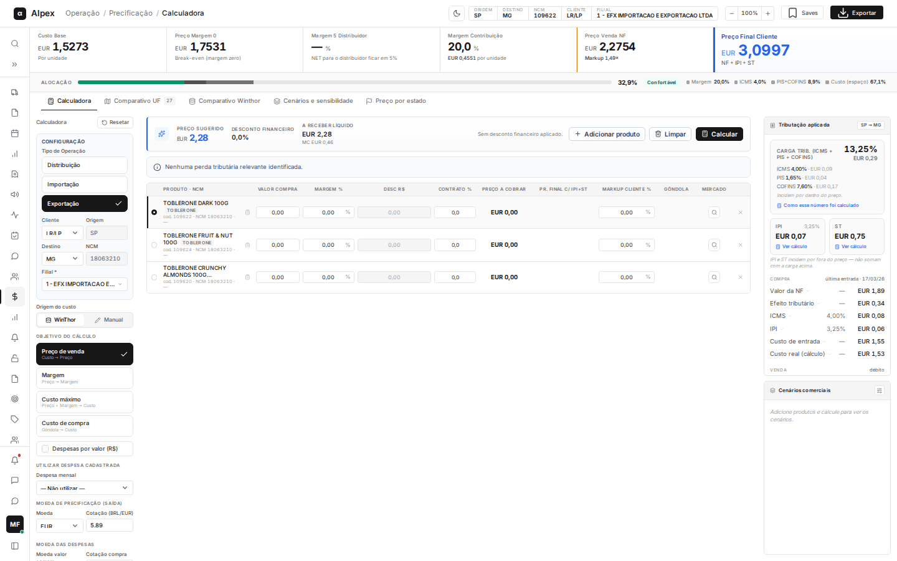
  </Step>
</Steps>

<Note>
Os valores digitados são aplicados ao sair do campo. No modo WinThor os custos de compra manuais não se aplicam, pois o custo já vem do ERP; o sistema avisa na própria seção. Na importação com WinThor a conversão para FOB usa a moeda e o câmbio.
</Note>

## Informar despesas por valor (R$)

<Steps>
  <Step title="Ativar o modo">
    Marque **Despesas por valor (R$)** no painel à esquerda. Em vez de percentuais, as seções de custo passam a pedir o valor em reais da operação inteira.

    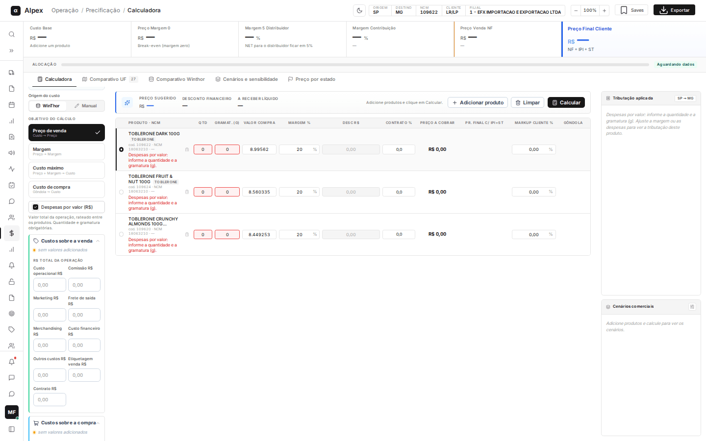
  </Step>
  <Step title="Preencher quantidade e gramatura">
    A tabela ganha as colunas **Qtd** e **Gramat. (g)**. O valor total informado é rateado entre os produtos (frete internacional e seguro por peso, as demais despesas por valor) e dividido pela quantidade. Quantidade é obrigatória; gramatura é obrigatória quando há mais de um produto.
  </Step>
</Steps>

<Note>
Campos obrigatórios vazios ficam em vermelho e a linha mostra "informe a quantidade e a gramatura (g)". Desmarcar a opção volta aos percentuais.
</Note>

## Usar uma despesa mensal cadastrada

<Steps>
  <Step title="Escolher a despesa">
    Em **Utilizar despesa cadastrada**, abra **Despesa mensal** e escolha uma **média anual** ou um mês específico. A opção **— Não utilizar —** desfaz.

    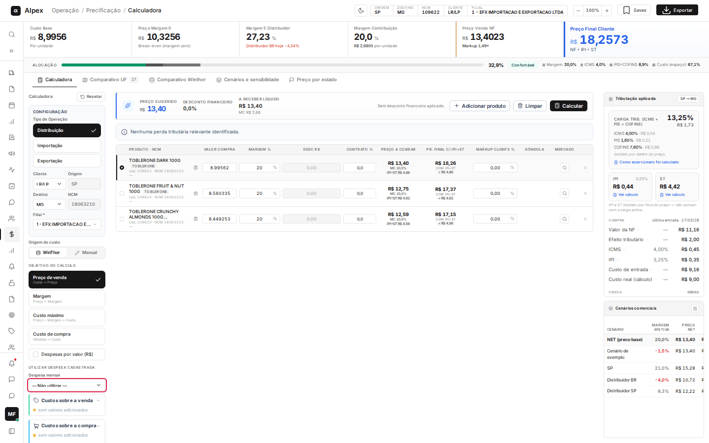
  </Step>
  <Step title="Conferir os campos">
    Os percentuais de **Custos sobre a venda** e **Custos sobre a compra** são preenchidos com os valores cadastrados e podem ser ajustados à mão.
  </Step>
</Steps>

<Note>
A lista só aparece se houver despesas mensais cadastradas e o modo **Despesas por valor (R$)** estiver desligado.
</Note>

## Ler Tributação aplicada e Cenários comerciais

<Steps>
  <Step title="Tributação aplicada">
    O painel mostra a rota (por exemplo SP → MG), a **Carga trib.** (ICMS + PIS + COFINS) com o detalhamento, os cartões de **IPI** e **ST** (que incidem por fora do preço e não entram na carga) e, abaixo, as seções **Compra** (valor da NF, efeito tributário, ICMS, IPI, custo de entrada e custo real) e **Venda**. **Ver cálculo** e **Como esse número foi calculado** abrem a memória do cálculo.

    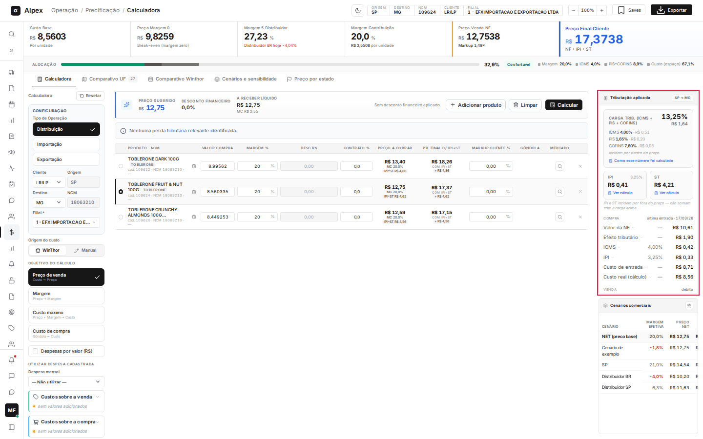
  </Step>
  <Step title="Cenários comerciais">
    A tabela lista cada cenário (o **NET (preço base)** e os demais cadastrados) com **Margem efetiva**, **Preço NET** e **Preço final c/ IPI+ST**. Margens negativas aparecem em vermelho.

    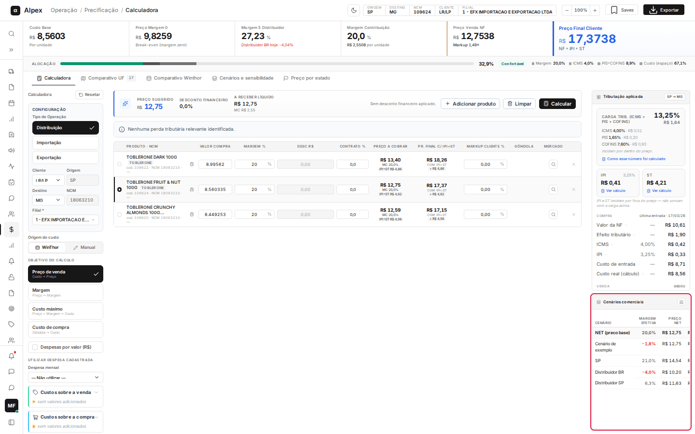
  </Step>
  <Step title="Configurar os cenários">
    O ícone no canto do painel (**Configurar cenários**) abre a janela de cadastro: busque, filtre por **Todos**, **Ativos** ou **Inativos**, ative ou desative cada cenário e crie um novo em **Novo**, definindo nome, regra de preço (**Aumento**, **Desconto**, **Margem fixa** ou **Margem de outro**), UF de destino e despesas próprias.

    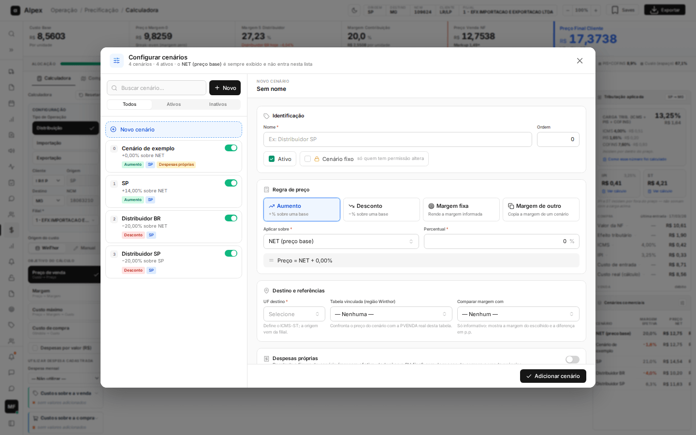
  </Step>
</Steps>

<Warning>
**Adicionar cenário** e a troca de ativo e inativo gravam o cenário para os demais usuários. Só confirme se a mudança for intencional.
</Warning>

## Salvar e reabrir um cálculo (Saves)

<Steps>
  <Step title="Abrir o menu Saves">
    Clique em **Saves**, na barra do topo. A lista mostra os saves existentes com nome e data; quando não há nenhum, aparece "Nenhum save ainda".

    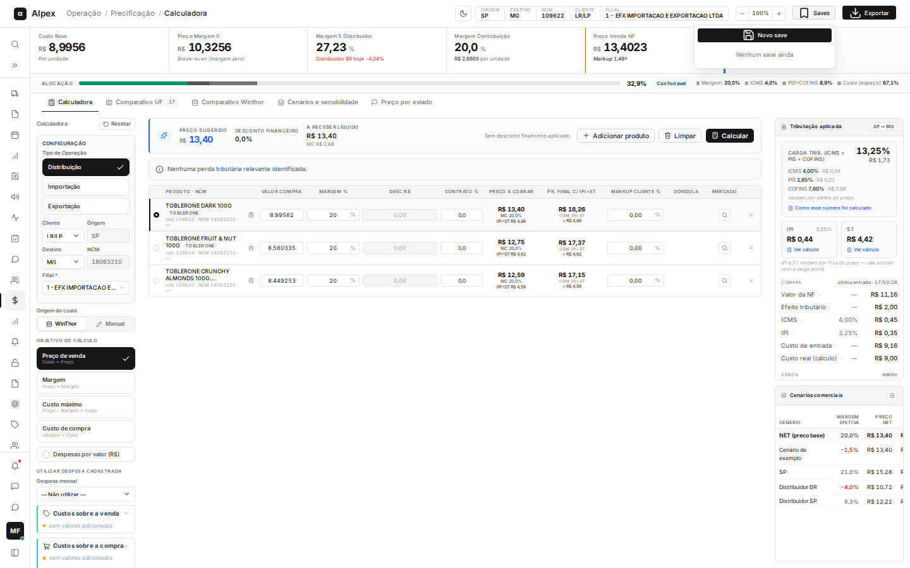
  </Step>
  <Step title="Criar um save">
    Clique em **Novo save**, digite o **Nome do save** (por exemplo, "Cotação Cliente Exemplo") e clique em **Salvar**. São guardados o contexto fiscal, o modo, os produtos e os custos atuais. **Cancelar** fecha sem gravar.

    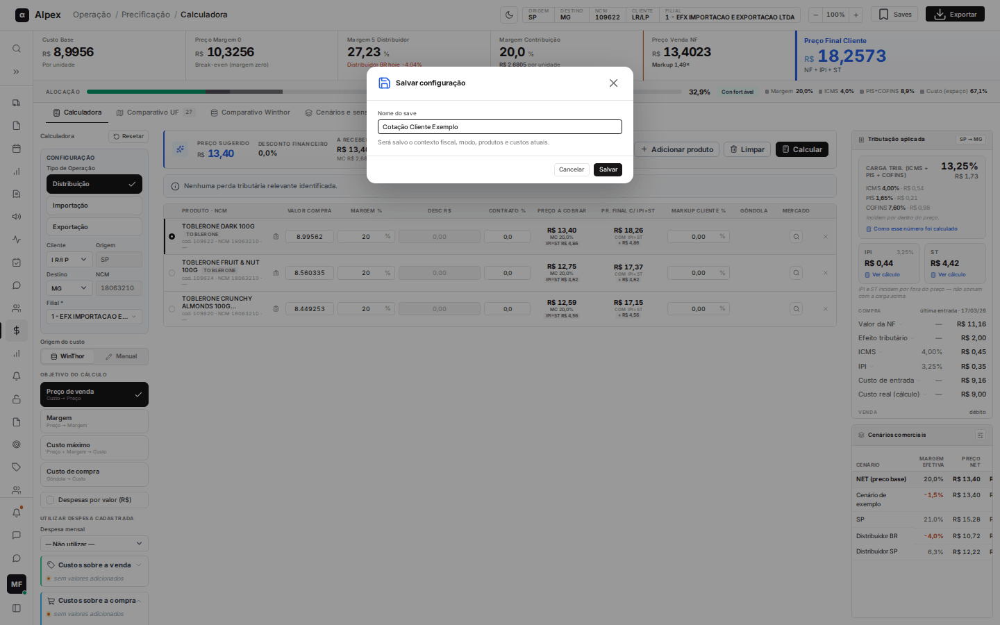
  </Step>
  <Step title="Reabrir ou excluir">
    Para reabrir, clique no nome do save na lista: a tela volta ao estado guardado e o nome do save aparece na barra do topo. Para excluir, clique na lixeira ao lado do nome e confirme.
  </Step>
</Steps>

<Note>
Cada save é sua própria cópia: reabri-lo substitui a simulação atual, então salve antes o que quiser manter. A tela também lembra, neste navegador, o último estado de trabalho.
</Note>

## Exportar os resultados

<Steps>
  <Step title="Abrir o menu Exportar">
    Calcule os produtos e clique em **Exportar**.

    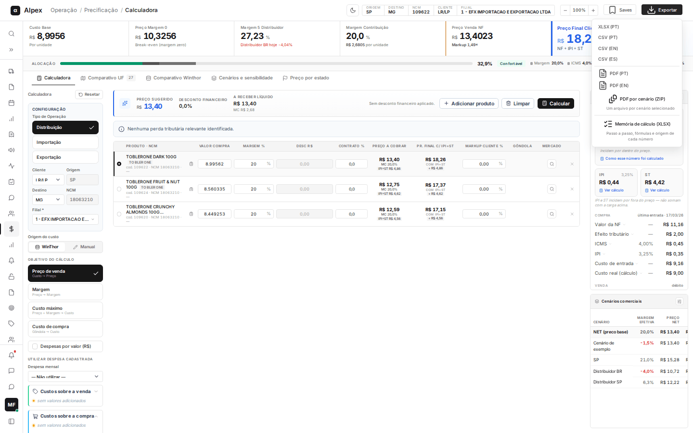
  </Step>
  <Step title="Escolher o formato">
    Opções: **XLSX (PT)**, **CSV (PT)**, **CSV (EN)**, **CSV (ES)**, **PDF (PT)**, **PDF (EN)** (um PDF único com visão geral e uma página por item), **PDF por cenário (ZIP)** e **Memória de cálculo (XLSX)** (passo a passo, fórmulas e origem de cada número). O arquivo é baixado pelo navegador.
  </Step>
  <Step title="PDF por cenário">
    Em **PDF por cenário (ZIP)**, marque os cenários desejados (**Todos** ou **Nenhum** ajudam), escolha o **Idioma** (**PT** ou **EN**) e clique em **Gerar ZIP**. Sai um PDF por cenário marcado.

    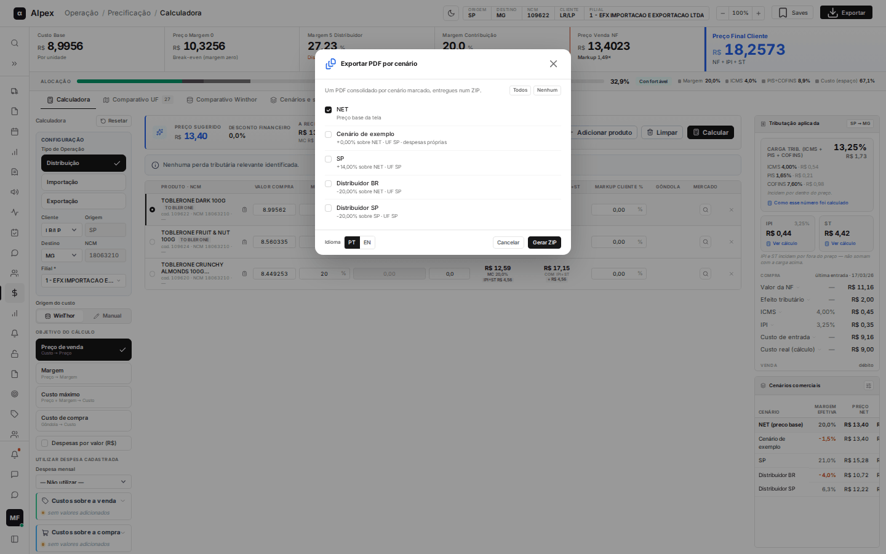
  </Step>
</Steps>

<Note>
Sem resultado calculado aparece o aviso "Nada para exportar". Exportar não altera nenhum dado.
</Note>

## Resetar a calculadora

<Steps>
  <Step title="Clicar em Resetar">
    No topo do painel à esquerda, clique em **Resetar**.

    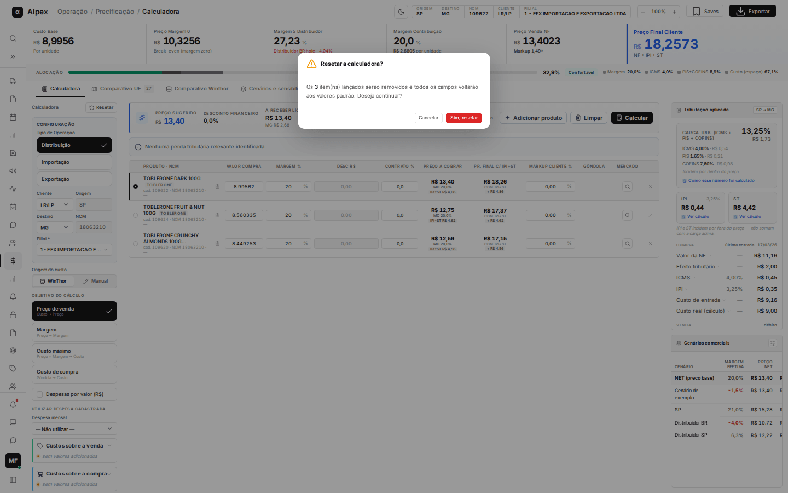
  </Step>
  <Step title="Confirmar">
    Se houver itens, a janela **Resetar a calculadora?** informa quantos serão removidos. **Sim, resetar** limpa os itens e devolve todos os campos aos padrões (filial 1, distribuição, cliente LR/LP, sem destino); **Cancelar** mantém tudo.
  </Step>
</Steps>

<Warning>
O reset descarta a simulação em andamento. Salve em **Saves** antes, se quiser guardá-la.
</Warning>
