**Menu:** 1101 - Calculadora V2, aba Cenários e sensibilidade

Esta aba compara o preço do produto em vários cenários comerciais (por exemplo, distribuidor ou venda para outro estado) e mostra como o preço e a margem mudam quando a margem desejada sobe ou desce. Serve para negociar preço sabendo exatamente quanto se ganha em cada condição.

É preciso ter produtos calculados na aba **Calculadora** (veja a página "Calculadora"). Quando há dois ou mais produtos, aparece também uma matriz comparando todos eles.

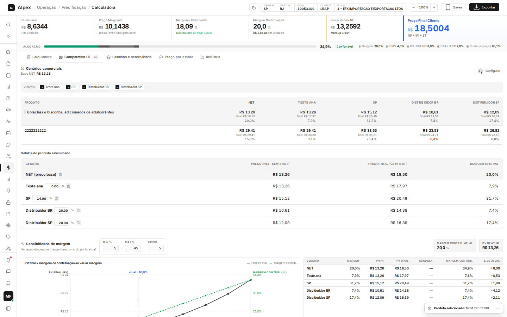

## Ler os cenários comerciais

Um **cenário** é uma regra de preço pré-cadastrada que parte do preço **NET** (o preço base calculado com a margem que você pediu, sem IPI nem ST) e aplica um acréscimo, um desconto ou uma margem fixa. O NET aparece sempre, em destaque.

<Steps>
  <Step title="Ver a matriz de produtos">
    Com 2 ou mais produtos calculados, a tabela do topo mostra uma linha por produto e uma coluna por cenário (**NET**, e os demais). Em cada célula:
    - O número grande é o preço NET do cenário (sem IPI e ST).
    - **final R$ ...** é o preço final com IPI e ST.
    - A linha de baixo é a margem efetiva. Se for negativa, aparece em vermelho.

    Clique em uma linha para escolher o produto cujo detalhe aparece logo abaixo.

    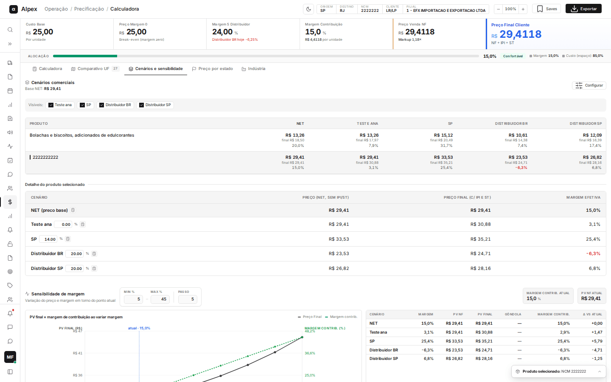
  </Step>
  <Step title="Ler o detalhe do produto selecionado">
    Em **Detalhe do produto selecionado**, cada linha é um cenário e as colunas são:
    - **Cenário**: nome do cenário. **NET (preço base)** é a referência.
    - **Preço (NET, sem IPI/ST)**: preço do cenário antes de IPI e ST.
    - **Preço final (c/ IPI e ST)**: preço que o cliente paga.
    - **Margem efetiva**: margem que sobra a esse preço. Vermelho indica margem negativa (prejuízo).
    - **FOB**: só aparece em operações de importação, com o valor FOB do produto como âncora de custo.
    - **Margem comparada** e **Δ margem**: aparecem quando o cenário foi configurado para comparar sua margem com a de outro. O Δ vem em pontos percentuais (p.p.), verde quando maior e vermelho quando menor.
    - **Praticado (Winthor)** e **Δ vs praticado**: aparecem quando o cenário está vinculado a uma tabela de preço do Winthor. Mostram o preço hoje cadastrado nessa tabela e a diferença percentual do sugerido contra ele.
  </Step>
</Steps>

<Note>
O cabeçalho mostra **Base NET** com o preço NET do produto selecionado. Em cada cenário de acréscimo ou desconto, a porcentagem sempre incide sobre o NET da tela.
</Note>

## Mostrar ou ocultar cenários

<Steps>
  <Step title="Desmarcar o cenário">
    Na faixa **Visíveis**, desmarque o cenário que você não quer ver. Ele some da matriz e do detalhe do produto.

    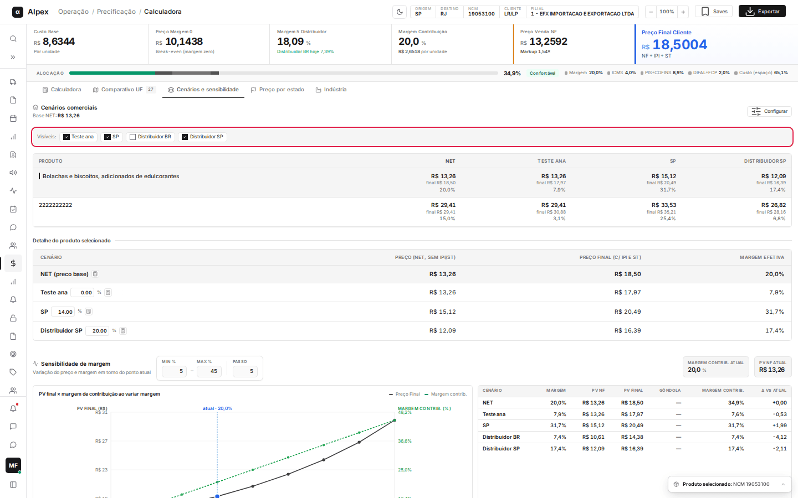
  </Step>
  <Step title="Marcar de novo">
    Marque a caixa novamente para o cenário voltar.
  </Step>
</Steps>

<Note>
Isso só muda o que você vê na tela, não altera o cadastro do cenário. A tabela de sensibilidade, mais abaixo, continua listando todos os cenários.
</Note>

## Testar outra porcentagem num cenário

<Steps>
  <Step title="Editar o percentual">
    No **Detalhe do produto selecionado**, os cenários de acréscimo, desconto ou margem fixa têm um campo pequeno com a porcentagem ao lado do nome. Digite outro valor e saia do campo.
  </Step>
  <Step title="Ver o resultado">
    O preço e a margem do cenário são recalculados na hora.
  </Step>
</Steps>

<Note>
A passagem do mouse sobre o campo avisa: **Edição temporária — use Configurar para salvar**. O valor vale só para esta tela; para mudar o cenário de forma definitiva, use **Configurar** (veja "Criar um cenário" e "Editar um cenário" mais adiante).
</Note>

## Ver a memória de cálculo de um cenário

<Steps>
  <Step title="Abrir a memória">
    Na linha do cenário, clique no ícone de calculadora ao lado do nome (dica **Ver memória de cálculo deste cenário**).
  </Step>
  <Step title="Ler as quatro partes">
    A janela explica passo a passo como chegou ao preço: **1. Custo base de compra**, **2. Fator divisor (markup)**, **3. Decomposição do preço NF** e **4. Preço final ao cliente (IPI/ST por fora)**, com a **Margem líquida** destacada em verde.

    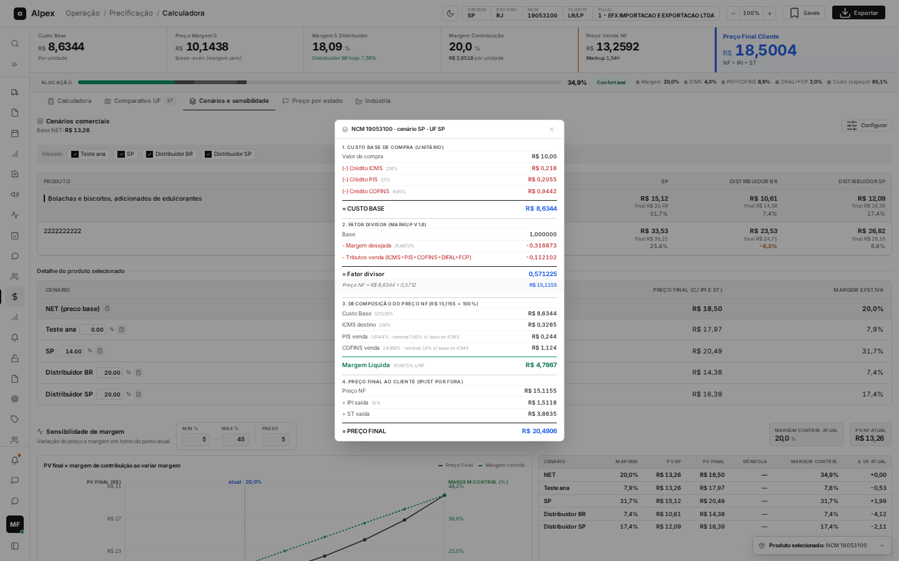
  </Step>
  <Step title="Fechar">
    Clique no **X** no canto da janela.
  </Step>
</Steps>

<Note>
O cenário **NET (preço base)** abre a memória completa do produto. Em cenários com UF e despesas próprias, a memória já considera esses valores.
</Note>

## Usar a sensibilidade de margem

<Steps>
  <Step title="Definir a faixa">
    Na seção **Sensibilidade de margem**, preencha **Min %** e **Max %** (menor e maior margem desejada a testar) e **Passo** (de quanto em quanto subir). O gráfico e a tabela se atualizam ao sair do campo.

    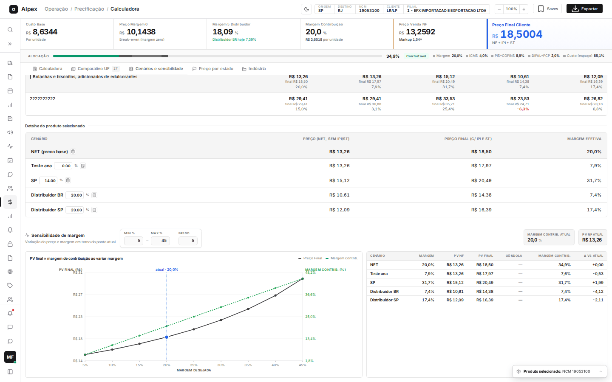
  </Step>
  <Step title="Ler o gráfico">
    - Linha escura contínua: **Preço Final**, com a escala em **PV Final (R$)** à esquerda.
    - Linha verde tracejada: **Margem contrib.**, com a escala em **Margem contrib. (%)** à direita.
    - Eixo de baixo: **Margem desejada**.
    - Linha azul vertical com o rótulo **atual**: o ponto em que o produto está agora.
  </Step>
  <Step title="Ler a tabela ao lado">
    As colunas são **Cenário**, **Margem**, **PV NF**, **PV Final**, **Gôndola**, **Margem contrib.** e **Δ vs atual**. O **Δ vs atual** é a diferença em reais do preço final contra o preço final atual. **Gôndola** é o preço estimado na prateleira e só aparece quando o produto tem **Markup cliente %** informado na Calculadora; sem isso mostra **—**.
  </Step>
  <Step title="Conferir os números de referência">
    Os quadros **Margem contrib. atual** e **PV NF atual** resumem o ponto em que você está.
  </Step>
</Steps>

<Note>
O ponto azul do gráfico é a margem que você digitou na Calculadora. Se o preço sobe pouco e a margem sobe bastante entre dois pontos, vale ver o ganho antes de baixar o preço.
</Note>

## Abrir a configuração de cenários

<Steps>
  <Step title="Clicar em Configurar">
    No canto superior direito de **Cenários comerciais**, clique em **Configurar**.

    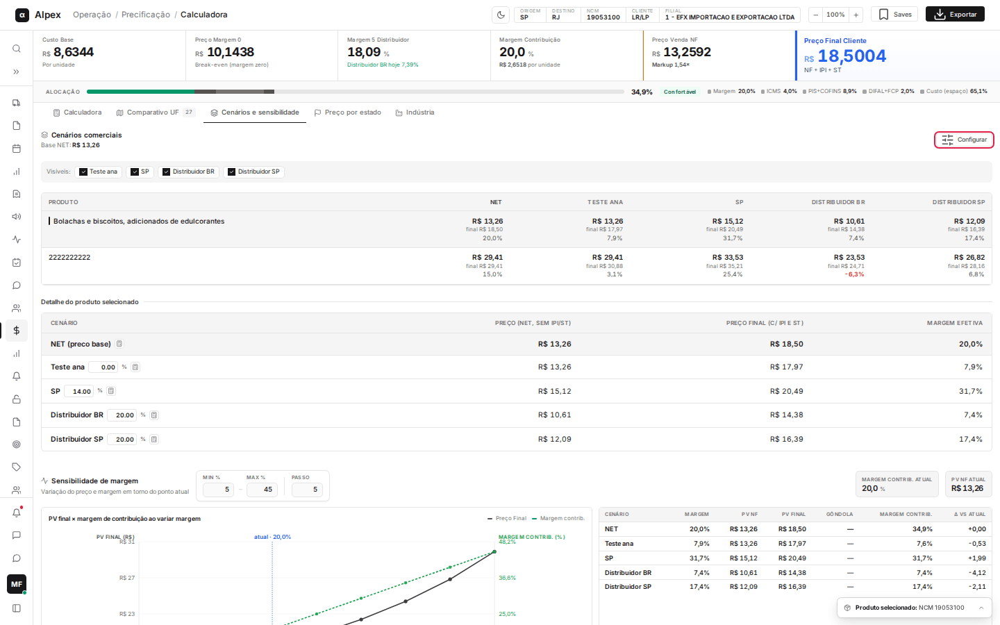
  </Step>
  <Step title="Conhecer a janela">
    A janela **Configurar cenários** traz à esquerda a lista de cenários cadastrados (com a ordem, o nome, a regra e etiquetas como o tipo, a UF e **Despesas próprias**) e à direita o formulário. O cabeçalho mostra o total de cenários, quantos estão ativos e quantos estão **sem UF destino**.

    
  </Step>
  <Step title="Fechar">
    Clique no **X** no canto da janela ou pressione **Esc**.
  </Step>
</Steps>

<Note>
O NET (preço base) é sempre exibido e não aparece nesta lista. Os cenários valem para todos os usuários: o que você cadastra aqui aparece para toda a equipe.
</Note>

## Buscar e filtrar a lista de cenários

<Steps>
  <Step title="Buscar pelo nome">
    No campo **Buscar cenário…**, digite parte do nome. A lista é filtrada enquanto você digita, sem diferenciar maiúsculas e acentos.
  </Step>
  <Step title="Filtrar por situação">
    Use os botões **Todos**, **Ativos** ou **Inativos** abaixo da busca. Cenários inativos aparecem mais claros na lista.

    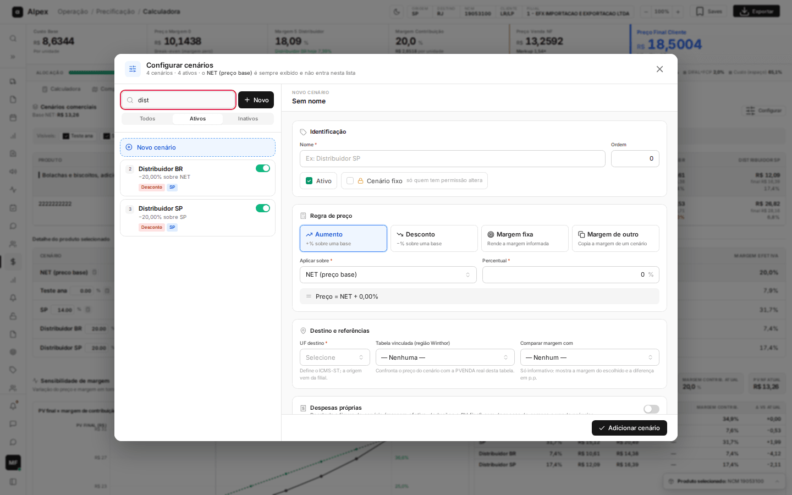
  </Step>
</Steps>

## Criar um cenário

<Steps>
  <Step title="Começar um cenário novo">
    Na janela **Configurar cenários**, clique em **Novo** (ou em **Novo cenário**, na lista). O formulário abre vazio com o título **Novo cenário**.
  </Step>
  <Step title="Identificar">
    Em **Identificação**, preencha o **Nome** (obrigatório, até 100 caracteres) e, se quiser, a **Ordem** (posição do cenário nas telas; o sistema sugere o próximo número). Deixe **Ativo** marcado para o cenário aparecer na Calculadora.
  </Step>
  <Step title="Escolher a regra de preço">
    Em **Regra de preço**, escolha um dos quatro tipos:
    - **Aumento**: soma uma porcentagem sobre uma base. Ex.: NET + 8%.
    - **Desconto**: tira uma porcentagem de uma base. Ex.: NET − 20%.
    - **Margem fixa**: recalcula o preço para render exatamente a margem informada.
    - **Margem de outro**: recalcula o preço para render a mesma margem de outro cenário.

    Em **Aplicar sobre** (ou **Copiar margem de**), escolha **NET (preço base)** ou outro cenário ativo. Em **Percentual** (ou **Margem desejada**), digite o valor. A frase cinza logo abaixo confirma a regra, por exemplo **Preço = NET + 8,00%**.
  </Step>
  <Step title="Informar o destino">
    Em **Destino e referências**, escolha a **UF destino** (obrigatória). Você pode digitar para buscar na lista.

    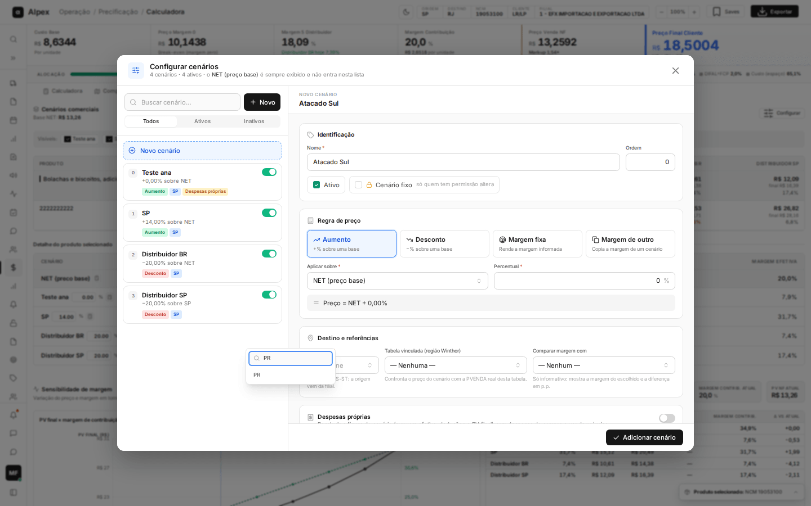

    Opcionalmente, defina a **Tabela vinculada (região Winthor)** para confrontar o preço do cenário com o preço real dessa tabela, e **Comparar margem com** para exibir a margem de outro cenário ao lado e a diferença em p.p.
  </Step>
  <Step title="Conferir e salvar">
    Com o formulário preenchido, o botão **Adicionar cenário** (rodapé da janela) grava o cenário.

    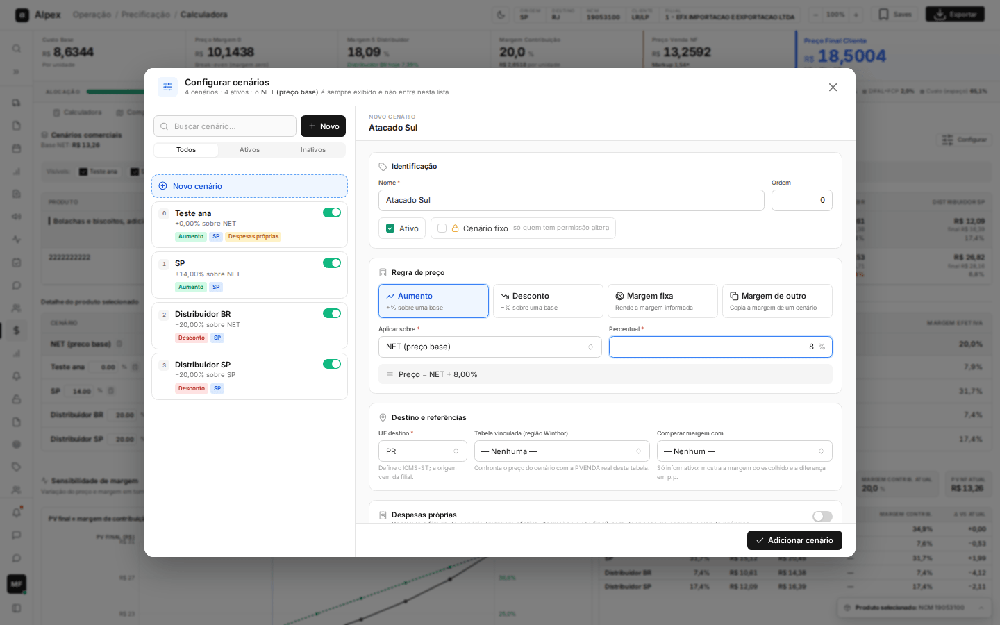
  </Step>
</Steps>

<Note>
Campos obrigatórios: **Nome**, **Aplicar sobre**, **Percentual** (não se aplica a **Margem de outro**) e **UF destino**. Sem **UF destino**, o cenário aparece com a etiqueta **UF pendente** e o cálculo em massa não roda para ele. Ao salvar, a lista é atualizada e o formulário volta ao estado vazio.
</Note>

## Criar um cenário que copia a margem de outro

<Steps>
  <Step title="Escolher o tipo">
    No formulário, clique em **Margem de outro**. O campo **Percentual** desaparece e o rótulo muda para **Copiar margem de**.

    
  </Step>
  <Step title="Escolher o cenário de referência">
    Em **Copiar margem de**, selecione o cenário cuja margem deve ser reproduzida. A frase de conferência confirma: **Preço recalculado para render a mesma margem de ...**.
  </Step>
</Steps>

<Note>
Use quando uma condição comercial precisa render o mesmo resultado de outra, por exemplo vender para outro estado sem perder margem. A margem de **Margem fixa** é informada por você; a de **Margem de outro** acompanha o cenário escolhido.
</Note>

## Criar um cenário com despesas próprias

<Steps>
  <Step title="Ligar Despesas próprias">
    No formulário, role até o quadro **Despesas próprias** e ligue a chave. Ele recalcula a figura do cenário (margem efetiva, deduções e PV final) com despesas de compra e de venda próprias, e não as da tela.

    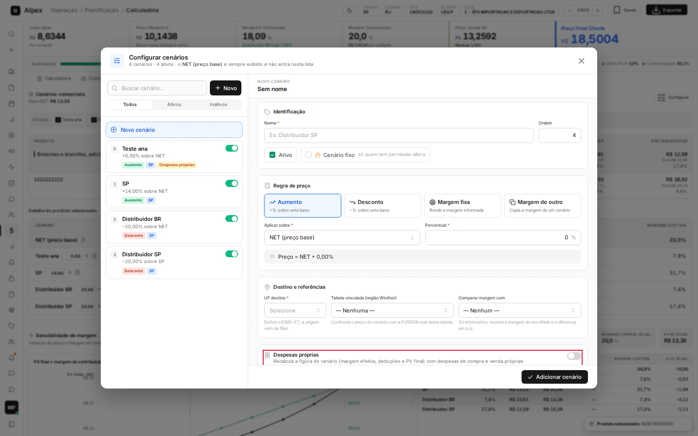
  </Step>
  <Step title="Preencher com uma despesa cadastrada (opcional)">
    Em **Filial das despesas**, escolha a filial para restringir a busca (ou deixe **Somente padrões gerais**). Em **Preencher com despesa cadastrada**, escolha um mês, a média anual ou a média de 12 meses. Os valores abaixo são preenchidos e podem ser ajustados.
  </Step>
  <Step title="Ajustar as despesas">
    Preencha, em porcentagem, os grupos:
    - **Custos sobre a venda**: custo operacional, comissão, marketing, merchandising, frete saída, etiquetagem venda, custo financeiro, custo comercial, outros custos e desc. financeiro.
    - **Custos sobre a compra**: etiquetagem (R$ por unidade), etiquetagem compra, frete compra e custos diversos.
    - **Importação · operação** e **Importação · % sobre FOB**: moeda FOB, câmbio, modal e as despesas de importação, mais as opções de **Base ICMS inclui**.

    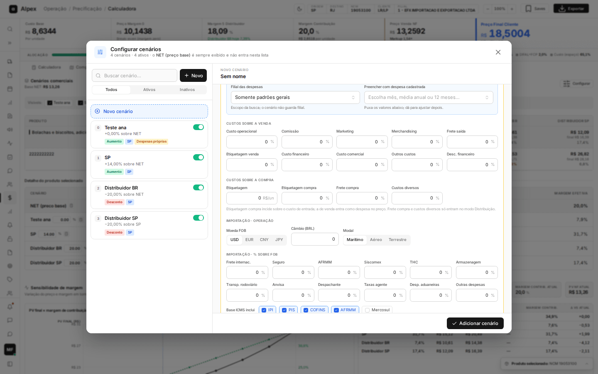
  </Step>
  <Step title="Salvar">
    Clique em **Adicionar cenário** (ou **Salvar alterações**, se estiver editando). Na lista, o cenário ganha a etiqueta **Despesas próprias**.
  </Step>
</Steps>

<Note>
**Aumento** e **Desconto** continuam incidindo sobre o NET da tela; **Margem fixa** e **Margem de outro** são resolvidas usando as despesas do cenário. Etiquetagem de compra incide sobre o custo de entrada; a de venda entra como despesa no preço. Frete compra e custos diversos só entram no modo Distribuição.
</Note>

## Bloquear um cenário (Cenário fixo)

<Steps>
  <Step title="Marcar Cenário fixo">
    Na linha **Identificação** do formulário, marque **Cenário fixo** (**só quem tem permissão altera**). Essa caixa só aparece para quem tem a permissão de alterar cenários bloqueados.

    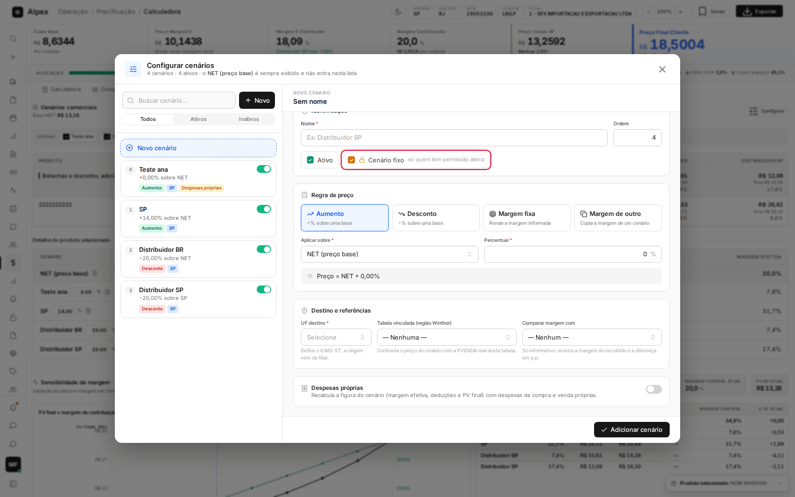
  </Step>
  <Step title="Salvar">
    Clique em **Adicionar cenário** ou **Salvar alterações**. O cenário passa a mostrar um cadeado na lista.
  </Step>
</Steps>

<Note>
Para quem não tem a permissão, o cenário bloqueado fica com o cadeado, não abre para edição, e a chave de ativar/desativar fica travada (dica **Bloqueado — sem permissão para alterar**) e o botão de remover não aparece. Só quem tem a permissão de alterar cenários bloqueados consegue editá-lo, desativá-lo ou removê-lo; o sistema também recusa a ação se tentada de outra forma.
</Note>

## Editar um cenário

<Steps>
  <Step title="Abrir o cenário">
    Na lista da janela **Configurar cenários**, clique no cenário. Ele fica com contorno azul e o formulário mostra **Editando cenário** com o nome dele.

    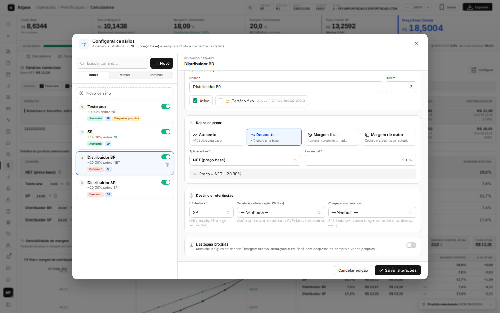
  </Step>
  <Step title="Alterar os campos">
    Mude o que precisar (nome, regra, percentual, UF, despesas próprias etc.).
  </Step>
  <Step title="Salvar ou desistir">
    Clique em **Salvar alterações** para gravar ou em **Cancelar edição** para descartar e voltar ao formulário vazio.
  </Step>
</Steps>

<Note>
Se você renomear um cenário, os outros cenários que o usam como base ou como comparação passam a apontar para o novo nome automaticamente.
</Note>

## Ativar ou desativar um cenário

<Steps>
  <Step title="Usar a chave">
    Na linha do cenário, clique na chave verde à direita (dica **Desativar** ou **Ativar**).
  </Step>
</Steps>

<Warning>
A chave grava na hora, sem pedir confirmação, e não precisa de **Salvar alterações**. Cenário desativado deixa de aparecer na Calculadora para todos.
</Warning>

## Excluir um cenário

<Steps>
  <Step title="Pedir a remoção">
    Passe o mouse sobre o cenário e clique no ícone de lixeira (dica **Remover**).
  </Step>
  <Step title="Confirmar ou cancelar">
    Aparece a pergunta **Remover cenário?** com o aviso de que cenários que o usam como base voltam para o NET. Clique em **Sim, remover** para excluir ou em **Cancelar** para manter.

    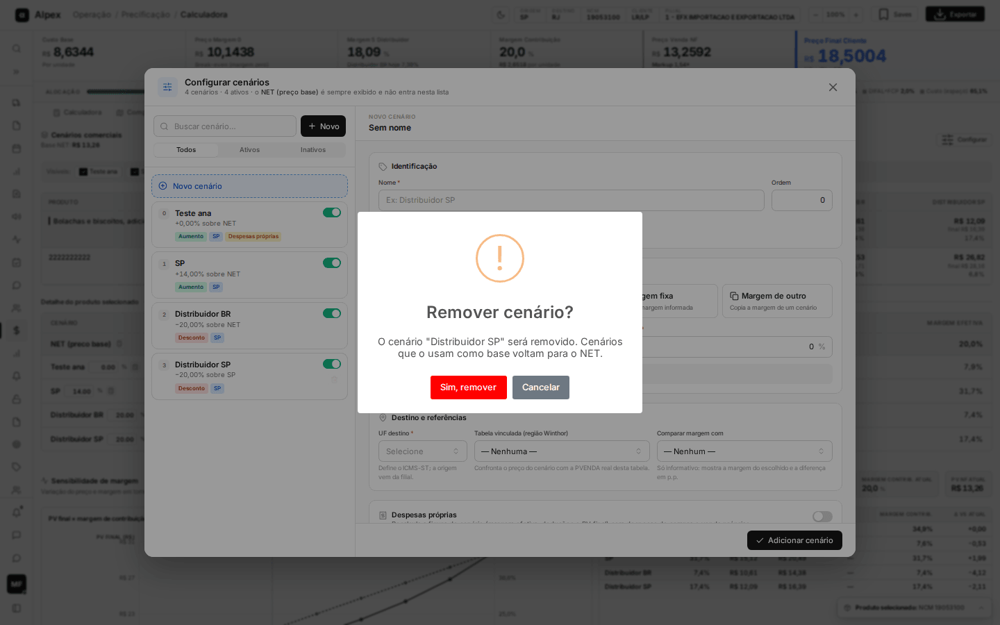
  </Step>
</Steps>

<Warning>
Excluir é definitivo. Se o cenário era base de outros, eles passam a usar o NET como base. Cenários bloqueados só podem ser removidos por quem tem a permissão de alterar bloqueados.
</Warning>
