**Menu:** 1107 - Comparativo em massa

Tela para reprecificar muitos produtos de uma vez. Para cada produto e cada tabela de preço (região), ela mostra o preço sugerido pelo cálculo ao lado do preço que está valendo no ERP (Winthor). Quem usa é a equipe de precificação, para decidir reajustes, aplicar preços e enviar o lote para aprovação.

Como a tela funciona, em resumo:

1. Você escolhe a **Filial**, os filtros e pelo menos uma **Região** (tabela de preço), e clica em **Buscar**.
2. Você lê a grade, seleciona os produtos e usa **Aplicar**. Isso guarda o novo preço no Alpex, sem mexer no ERP.
3. Você envia os produtos aplicados para aprovação com **Enviar para aprovação**. O lote nasce com uma data de vigência.
4. Depois de aprovado, o lote vira preço futuro. O ERP só recebe o preço na data de vigência (veja a tela "Lotes de preço").

## Escolher filial, filtros e buscar

<Steps>
  <Step title="Escolher a filial">
    Em **Filial**, abra a lista, digite parte do código ou do nome para pesquisar e clique na filial. A filial define a empresa e o estado de origem do cálculo.

    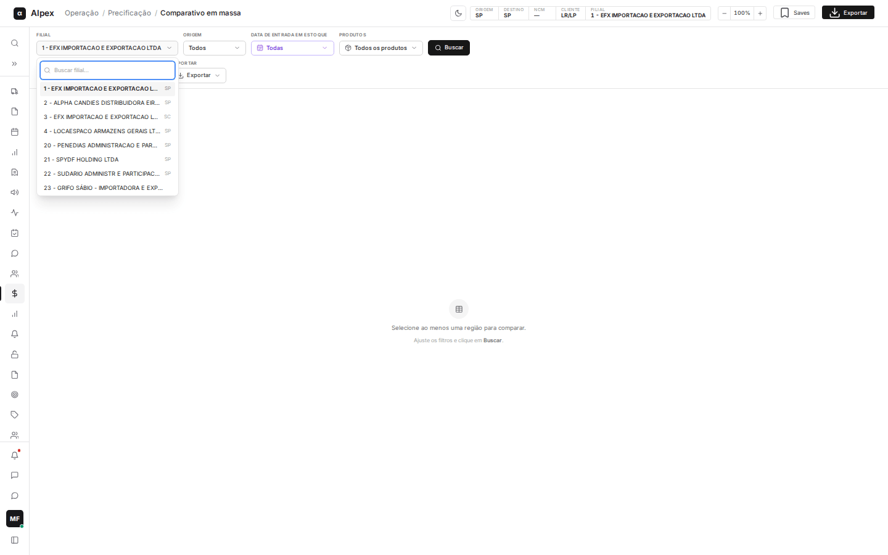
  </Step>
  <Step title="Filtrar pela origem do produto">
    Em **Origem**, escolha **Todos**, **Nacional** ou **Importado**.

    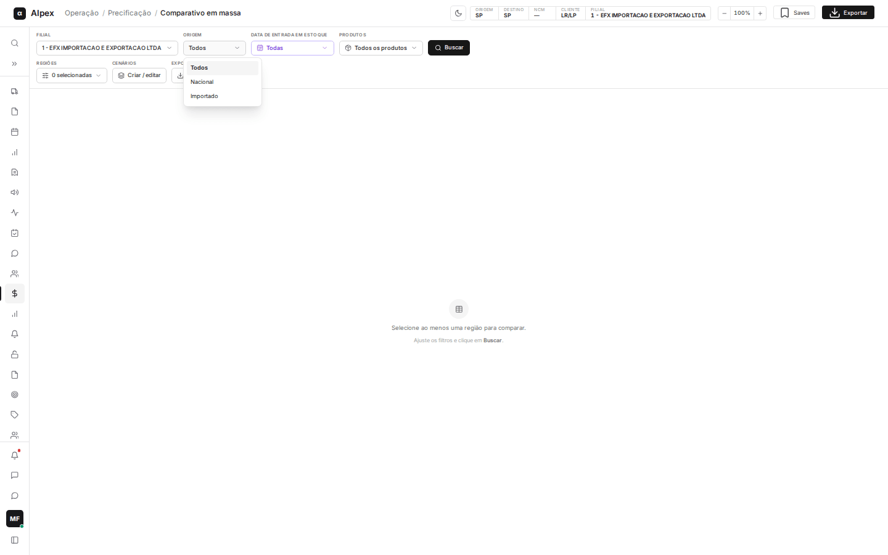
  </Step>
  <Step title="Filtrar pela data de entrada em estoque">
    Em **Data de entrada em estoque**, use os atalhos **7 dias**, **15 dias**, **30 dias** ou **Este mês**, ou informe as datas em **De** e **Até**. Clique em **Aplicar** para fechar o quadro e em **Limpar** para voltar a **Todas**. O filtro traz os produtos que entraram em estoque no período, que são os candidatos a ter custo alterado.

    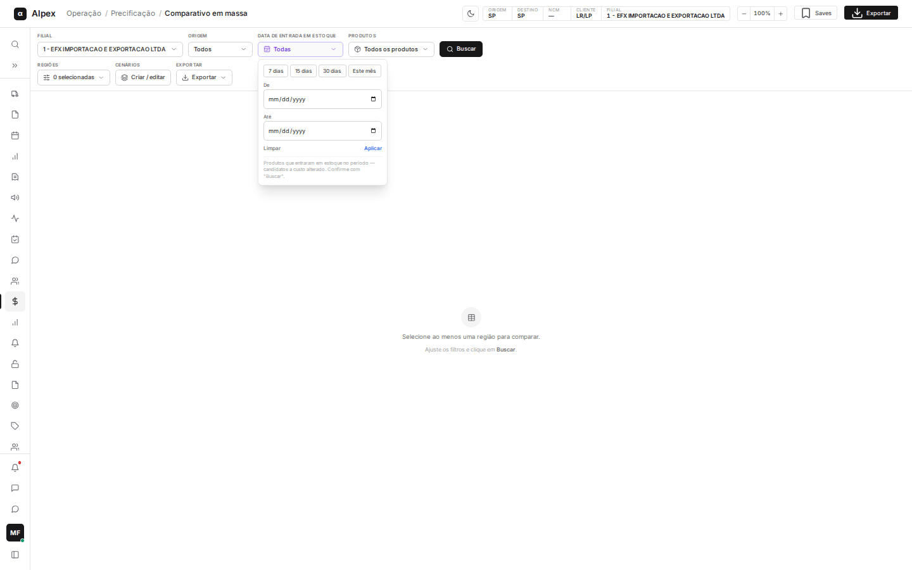
  </Step>
  <Step title="Escolher os produtos (opcional)">
    Por padrão a tela usa **Todos os produtos** da filial. Para trabalhar com alguns, clique em **Todos os produtos**. Abre a janela **Adicionar produtos do Winthor**: pesquise por código, descrição, fornecedor, marca ou categoria, marque os produtos e clique em **Adicionar selecionados**. Use **Selecionar todos** para marcar tudo o que a busca trouxe e **Limpar seleção** para desmarcar.

    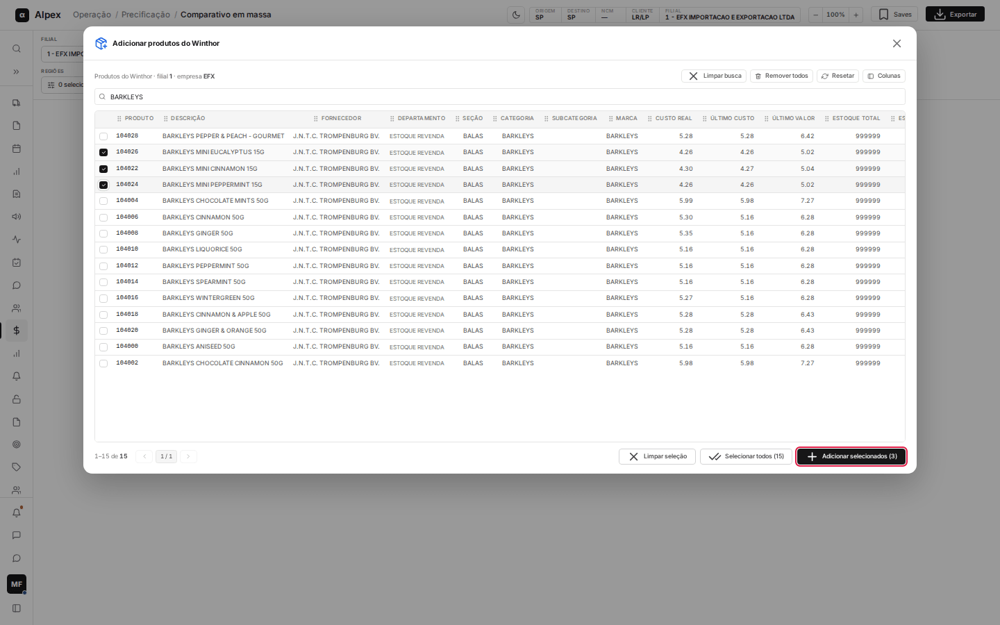

    Depois de escolher, o botão passa a mostrar a quantidade (por exemplo, "3 produtos"). Para voltar a todos os produtos, clique no **X** ao lado do botão.
  </Step>
  <Step title="Escolher as regiões">
    Em **Regiões**, marque as tabelas de preço que quer comparar. A lista tem pesquisa e mostra, à direita de cada tabela, quantos produtos ela tem. A tela só calcula com pelo menos uma região marcada.

    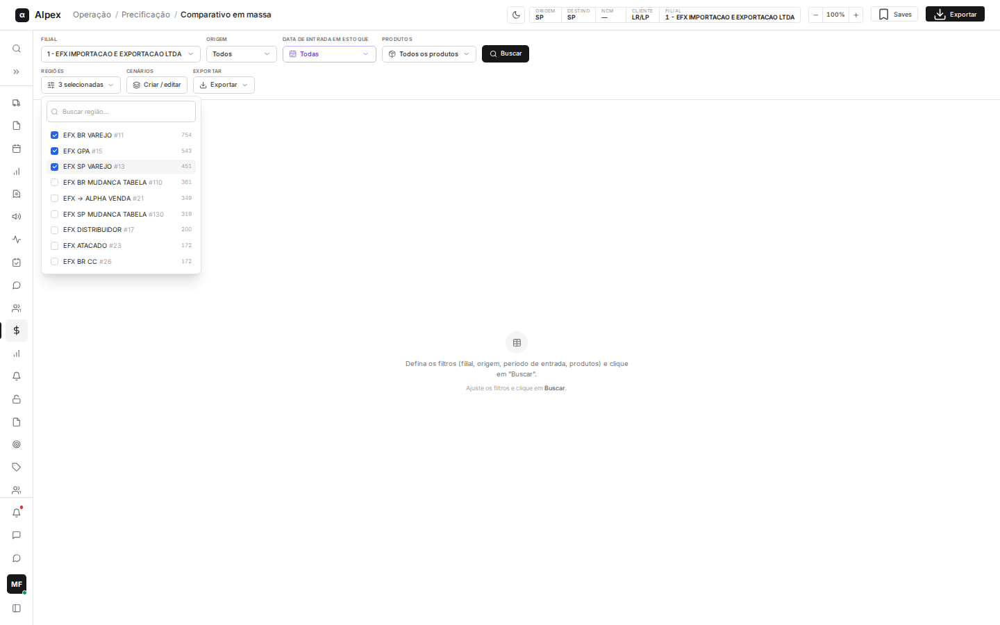
  </Step>
  <Step title="Buscar">
    Clique em **Buscar**. A tela consulta o ERP e recalcula a tributação de cada produto, o que pode levar alguns segundos. O total aparece no canto direito (por exemplo, "147 produtos na comparação").

    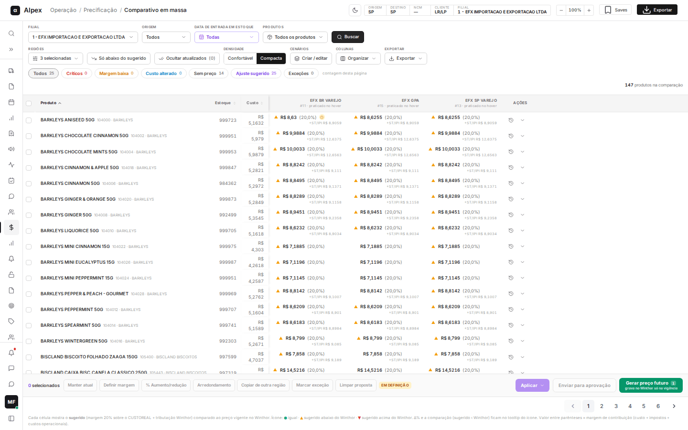
  </Step>
</Steps>

<Note>
Sem região marcada a tela mostra "Selecione ao menos uma região para comparar." Seus filtros, regiões e produtos ficam guardados neste navegador e voltam na próxima vez que você abrir a tela.
</Note>

## Ler a grade

<Steps>
  <Step title="Entender as colunas">
    Cada linha é um produto (nome, código e marca). Depois dele vêm **Estoque**, **Custo** (custo real do ERP) e uma coluna por região escolhida. Os produtos aparecem 25 por página; use a paginação no rodapé.

    Em cada região a célula mostra o preço sugerido (NF) calculado com a margem de referência, a margem entre parênteses e, quando há ST ou IPI, uma segunda linha **+ST/IPI** com o preço final com esses impostos.

    
  </Step>
  <Step title="Ler o ícone de comparação">
    O ícone ao lado do preço compara o sugerido com o preço que vale hoje no ERP:

    - **círculo verde**: o sugerido é igual ao praticado;
    - **triângulo para cima, âmbar**: o sugerido está abaixo do praticado;
    - **triângulo para baixo, vermelho**: o sugerido está acima do praticado;
    - **sem ícone**: a tabela não tem preço praticado no ERP.

    Passe o mouse sobre o ícone ou sobre o preço para ver a diferença em % e os dois valores. O rodapé da tela repete essa legenda.
  </Step>
  <Step title="Ver o status do preço aplicado">
    Quando um preço já foi aplicado naquela célula, aparece um selo redondo ao lado da margem (na imagem, o selo destacado). **Verde com check** significa que o preço aplicado já é o que está na tabela do ERP. **Âmbar com relógio** significa que foi aplicado só no Alpex e ainda não chegou ao ERP. Passe o mouse para ver o valor, a função usada, a data, quem aplicou e a situação no ERP.

    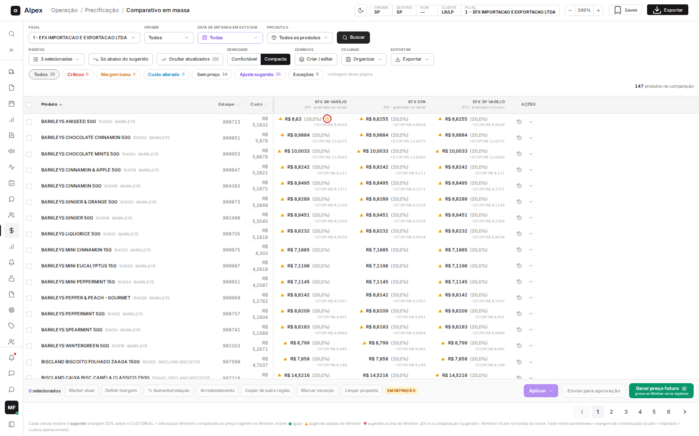

    Um **lápis** ao lado do preço indica preço definido manualmente. O pequeno **x** ao lado do lápis remove o preço manual.
  </Step>
  <Step title="Ver o custo alterado">
    Se o custo do produto mudou, aparece um triângulo de alerta ao lado do valor em **Custo**. Passe o mouse para ver a variação em %, a data e os valores anterior e atual. A fonte é o histórico de custo do ERP.
  </Step>
  <Step title="Abrir a formação do preço">
    Passe o mouse sobre a célula e clique no ícone de formação do preço (tooltip "Ver formação do preço"). Abre uma janela que mostra, passo a passo, como o sugerido foi calculado: custo base, impostos embutidos (ICMS, PIS e COFINS), margem, preço sugerido (NF), acréscimos por fora (como o IPI) e o preço com ST/IPI.

    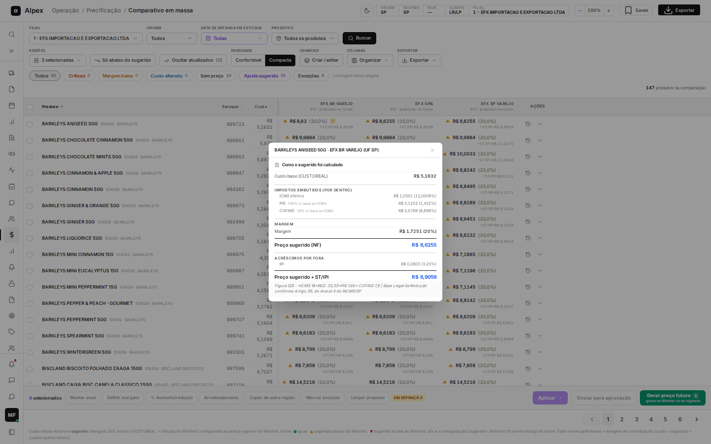
  </Step>
  <Step title="Definir um preço manual (opcional)">
    Na célula, clique no ícone de lápis (tooltip "Definir preço manualmente"), digite o valor e tecle Enter. A margem correspondente aparece enquanto você digita. Esc cancela. O valor precisa ser um número maior que zero.
  </Step>
</Steps>

<Note>
O ícone de histórico (tooltip "Ver histórico") na coluna **Ações** abre o histórico de custo e de preço do produto no ERP. Se o ERP não responder, a janela mostra "Não foi possível carregar o histórico das tabelas do Winthor."
</Note>

## Usar os filtros rápidos, ordenar e organizar colunas

<Steps>
  <Step title="Filtrar pelos botões de situação">
    Abaixo dos filtros ficam os botões **Todos**, **Críticos**, **Margem baixa**, **Custo alterado**, **Sem preço**, **Ajuste sugerido** e **Exceções**. O número em cada um é a contagem da página atual. Clique para ver só aquele grupo e clique em **Todos** para voltar. Passe o mouse para ver a regra de cada um. Os limites de "crítico", "margem baixa" e "ajuste" vêm do cadastro de Políticas Comerciais.

    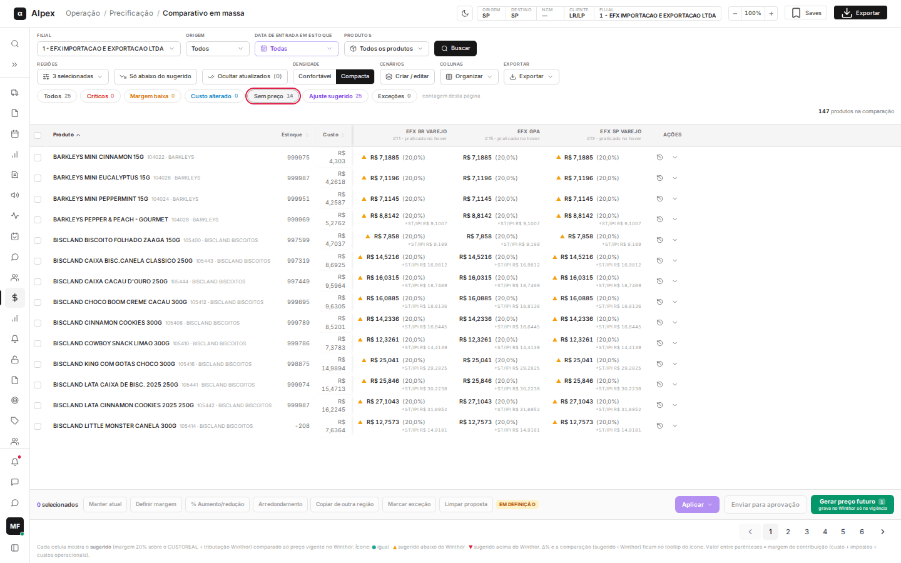
  </Step>
  <Step title="Mostrar só quem está abaixo do sugerido">
    O botão **Só abaixo do sugerido** esconde os produtos que não têm nenhuma região com preço praticado abaixo do sugerido.
  </Step>
  <Step title="Ocultar atualizados">
    **Ocultar atualizados** esconde as linhas em que todas as tabelas escolhidas já têm preço aplicado e conferido no ERP. O número entre parênteses é quantas linhas isso esconderia.
  </Step>
  <Step title="Mudar a densidade">
    **Confortável** deixa as linhas mais espaçadas e **Compacta** mostra mais linhas na tela.
  </Step>
  <Step title="Ordenar">
    Clique no título **Produto**, **Estoque** ou **Custo** para ordenar. Clique de novo para inverter a ordem.

    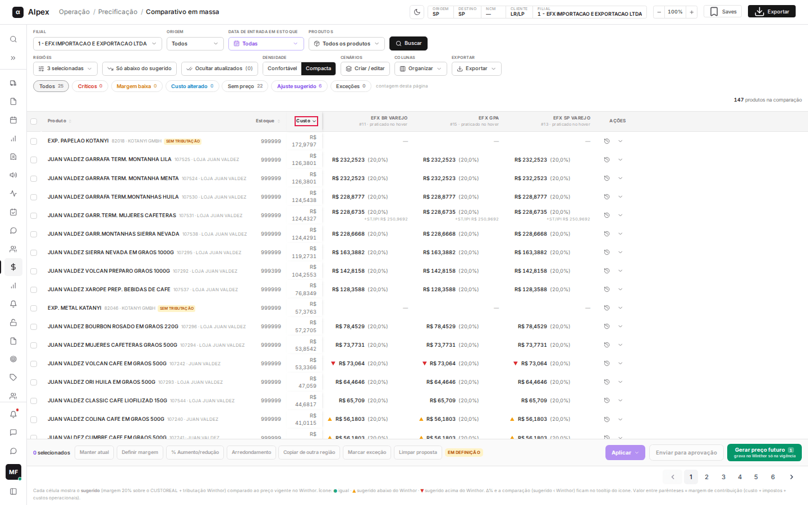
  </Step>
  <Step title="Escolher e reordenar colunas">
    Clique em **Organizar**, em **Colunas**. Marque ou desmarque para mostrar ou ocultar uma região, arraste pelo ícone de pontos para mudar a ordem e clique em **Restaurar** para voltar ao padrão. Sua escolha fica guardada neste navegador.

    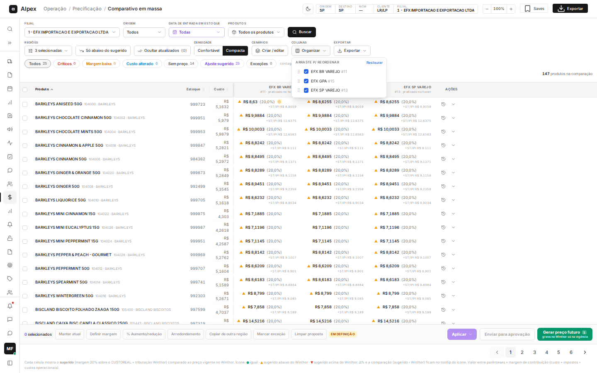
  </Step>
</Steps>

## Cenários e margem fixa

Cenário é uma regra de preço que você cadastra e reaproveita. Na comparação em massa, só entram como colunas os cenários ativos do tipo **Margem fixa**: eles recalculam o preço para render a margem informada. Essas colunas aparecem em roxo, com o preço e a margem de contribuição (MC) abaixo. O primeiro cenário de margem fixa com margem maior que zero também define a margem de referência usada no preço sugerido (o rodapé mostra, por exemplo, "margem 20%").

<Steps>
  <Step title="Abrir a configuração">
    Em **Cenários**, clique em **Criar / editar**. Abre a janela **Configurar cenários**, com a lista dos cenários à esquerda (com busca e as abas **Todos**, **Ativos** e **Inativos**) e o formulário à direita.

    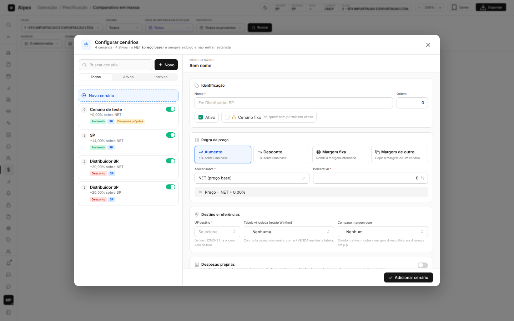
  </Step>
  <Step title="Criar um cenário de margem fixa">
    Clique em **Novo**, digite o **Nome**, escolha a regra **Margem fixa** ("Rende a margem informada") e preencha **Margem desejada**. Em **UF destino** escolha o estado do cliente e, em **Tabela vinculada (região Winthor)**, a tabela de preço do ERP com a qual o preço do cenário será confrontado (a coluna do cenário passa a ser comparada com essa tabela). Se o cenário tiver despesas próprias, ligue **Despesas próprias** e informe os percentuais. Para gravar, clique em **Adicionar cenário**.

    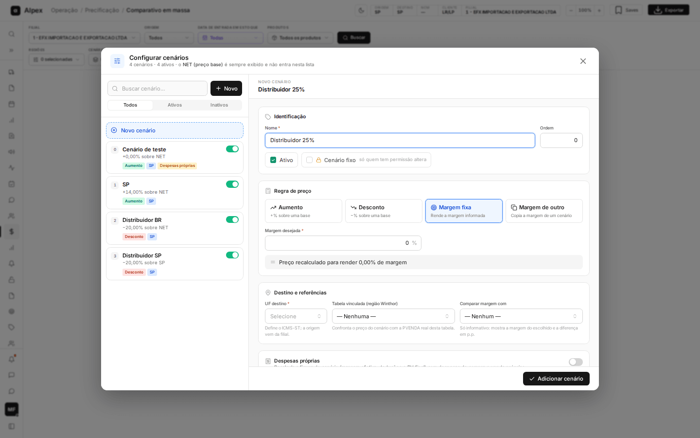
  </Step>
  <Step title="Ver o resultado na grade">
    Ao fechar a janela, a tela recarrega os cenários e a nova coluna aparece na grade depois de **Buscar**.
  </Step>
</Steps>

<Note>
Os cenários de acréscimo, desconto e "margem de outro cenário" existem no cadastro, mas não viram coluna aqui. Um cenário ligado a uma tabela de outra filial não aparece na filial atual. Cenários marcados como fixos só podem ser alterados por quem tem permissão.
</Note>

## Selecionar produtos e aplicar em massa

<Steps>
  <Step title="Selecionar os produtos">
    Marque a caixa no começo de cada linha. A caixa do cabeçalho seleciona todos os produtos da página. O contador no rodapé mostra quantos estão selecionados, e **limpar** desmarca tudo.

    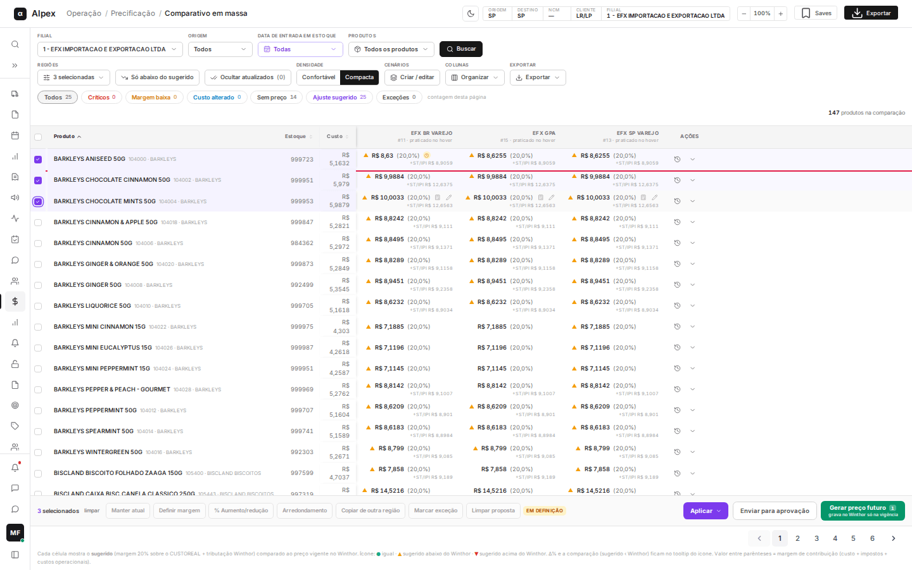
  </Step>
  <Step title="Abrir o menu Aplicar">
    Clique em **Aplicar** (roxo, no rodapé). O botão fica desabilitado enquanto nenhum produto estiver marcado. O menu **O que deseja aplicar?** tem quatro funções:

    - **Correção para o preço sugerido**: leva o preço ao valor calculado pelo cenário;
    - **Margem zero**: repassa só a variação de custo e preserva a margem atual;
    - **Elevar até o piso**: só mexe em quem está abaixo da margem mínima e leva exatamente até o piso;
    - **Teto de variação por rodada**: limita a alta da rodada e represa o excedente para revisão manual. Está marcada **em definição** e ainda não executa.

    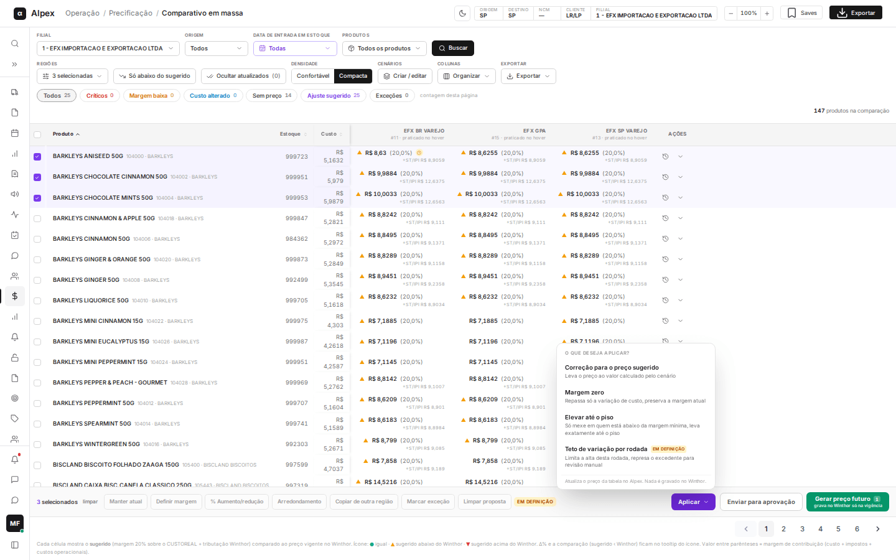
  </Step>
  <Step title="Confirmar em duas etapas">
    Ao escolher a função, a tela pergunta **Deseja aplicar?** e mostra a função e a quantidade de produtos. Clique em **Continuar**. Na segunda etapa, **Tem certeza?**, escreva a **Justificativa (obrigatória)**, com pelo menos 5 caracteres, e clique em **Sim, aplicar**. **Cancelar** fecha sem aplicar.

    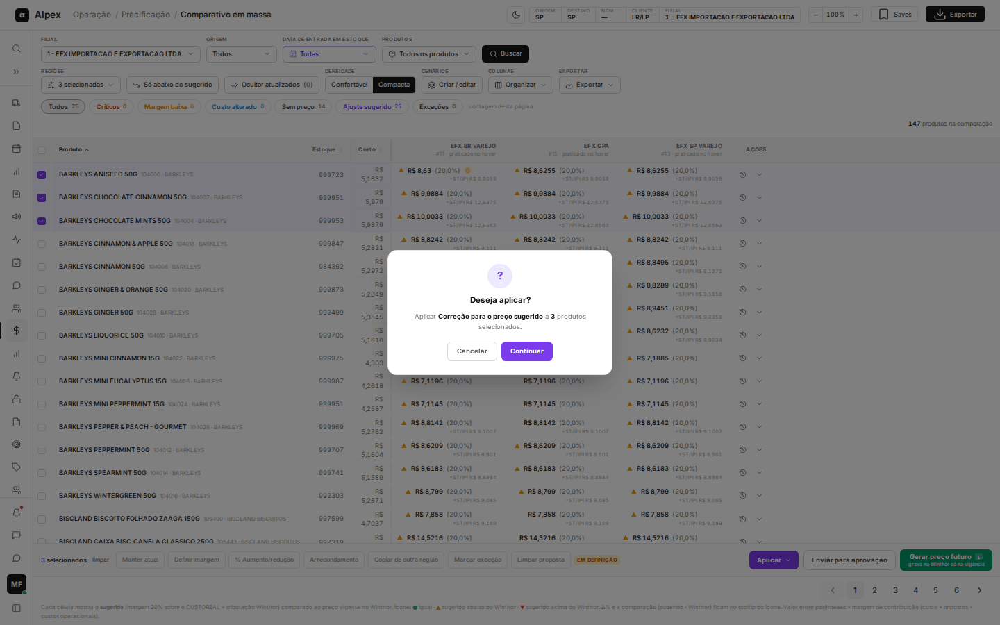

    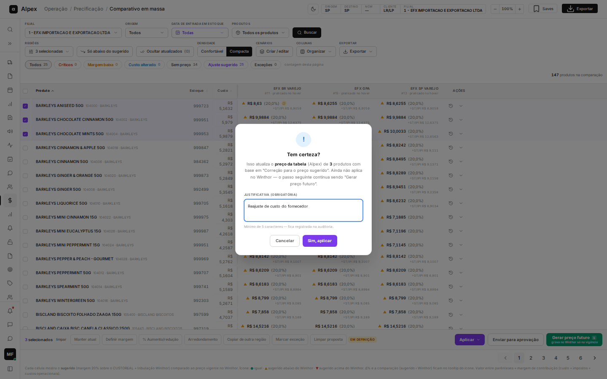
  </Step>
  <Step title="Aplicar a um produto só">
    Na coluna **Ações** de cada linha, o chevron (tooltip "Aplicar a este produto") abre o menu **Aplicar só a este produto** com as mesmas quatro funções e a mesma confirmação.

    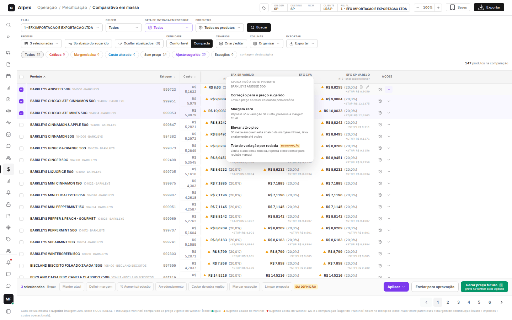
  </Step>
</Steps>

<Warning>
Aplicar atualiza o preço da tabela no Alpex. Nada é gravado no ERP (Winthor) neste passo, mas o preço aplicado fica registrado com a justificativa, o seu nome e a data. Se algum produto tiver **Exceção aprovada**, a confirmação avisa que o preço estratégico atual será sobrescrito. Células sem base para a função escolhida (por exemplo, sem preço praticado em "Elevar até o piso") são ignoradas.
</Warning>

<Note>
Na barra inferior, os botões cinzas **Manter atual**, **Definir margem**, **% Aumento/redução**, **Arredondamento**, **Copiar de outra região**, **Marcar exceção** e **Limpar proposta** estão marcados **em definição** e ainda não fazem nada.
</Note>

## Exportar a comparação

<Steps>
  <Step title="Escolher o formato">
    Em **Exportar**, clique no botão e escolha **Excel (.xlsx)**, **PDF** ou **CSV**. A exportação leva todos os produtos da busca (não só a página atual), com as regiões, os cenários e o filtro "só abaixo" que estiverem ativos.

    
  </Step>
</Steps>

## Enviar um lote de preço para aprovação

O lote reúne os preços que você já aplicou nos produtos marcados, para as regiões escolhidas, e pede aprovação com uma data de vigência.

<Steps>
  <Step title="Preparar">
    Aplique os preços (veja "Selecionar produtos e aplicar em massa"), mantenha as regiões escolhidas e marque os produtos que entram no lote. O botão **Enviar para aprovação** fica desabilitado sem produto marcado.
  </Step>
  <Step title="Preencher o lote">
    Clique em **Enviar para aprovação**. A janela mostra quantos produtos e quantas tabelas entram e pede:

    - **Nome do lote**, com pelo menos 3 caracteres (por exemplo, "Reajuste Novembro/2026");
    - **Vigência**, a data em que o preço passa a valer na tabela do ERP, hoje ou futura;
    - **Justificativa**, com pelo menos 5 caracteres.

    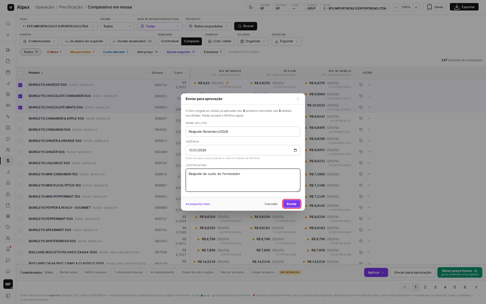
  </Step>
  <Step title="Confirmar o envio">
    Clique em **Enviar** para criar o lote, ou em **Cancelar** para desistir. O link **Acompanhar lotes** leva à tela "Lotes de preço". Depois do envio, a seleção é limpa e um aviso informa o número do lote, quantas células foram congeladas e a vigência.
  </Step>
</Steps>

<Warning>
Enviar cria o lote e congela os preços aplicados, mas nada vai para o ERP agora. Células que já estão em outro lote aberto (em aprovação ou aprovado) ficam de fora, e o aviso diz quantas. Se nenhum dos produtos e regiões marcados tiver preço aplicado, o envio é recusado e a tela pede para usar **Aplicar** antes. A vigência não pode ser uma data passada.
</Warning>

## Gerar preço futuro de um lote aprovado

<Steps>
  <Step title="Abrir a lista de lotes aprovados">
    O botão verde **Gerar preço futuro** mostra a quantidade de lotes aprovados da filial e a frase "grava no Winthor só na vigência". Ele fica desabilitado enquanto não houver lote aprovado. Clique nele.
  </Step>
  <Step title="Escolher os lotes">
    A janela lista cada lote aprovado com número, nome, vigência, quantidade de células e quem aprovou. Deixe marcados os que quer liberar.

    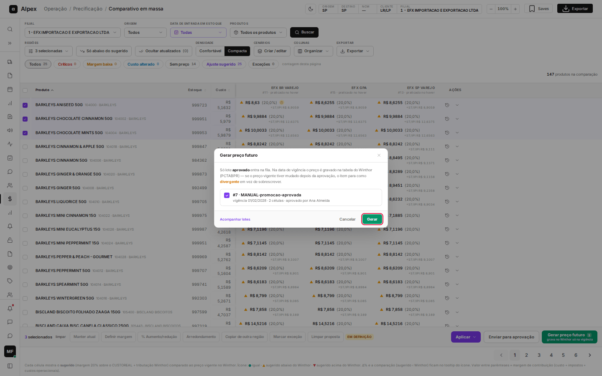
  </Step>
  <Step title="Gerar">
    Clique em **Gerar**. Os preços entram na fila de preço futuro. A gravação na tabela do ERP acontece sozinha na data de vigência. **Cancelar** fecha sem gerar.
  </Step>
</Steps>

<Warning>
Gerar preço futuro não grava no ERP. O preço só é gravado na data de vigência, em uma rotina automática diária. Se o preço vigente no ERP tiver mudado depois da aprovação, o item é marcado como **divergente** em vez de sobrescrever.
</Warning>
