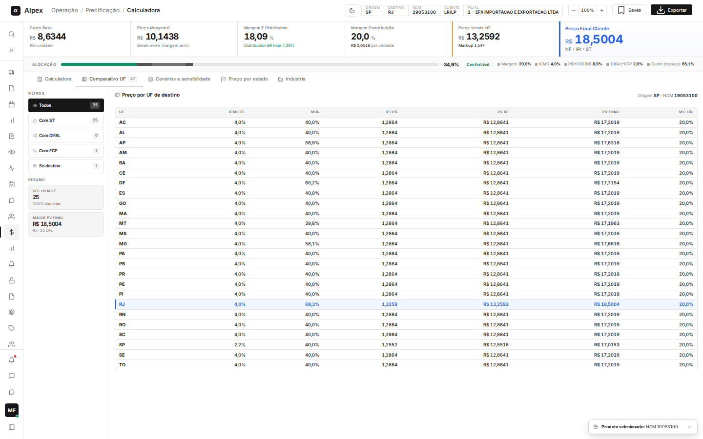
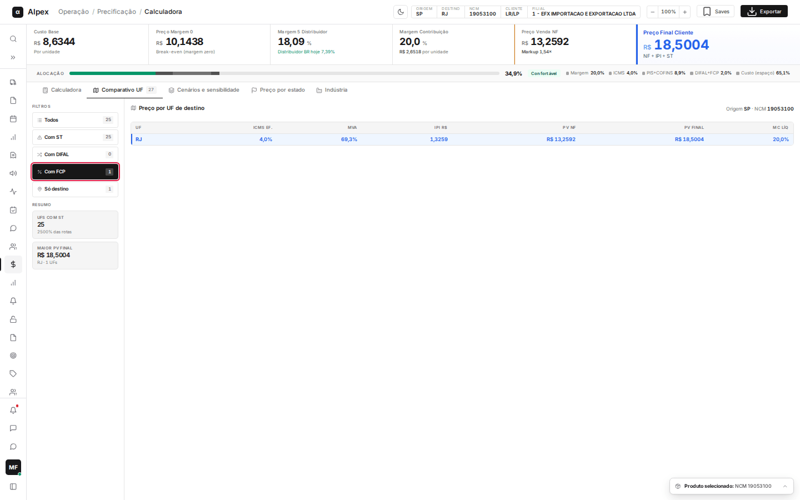
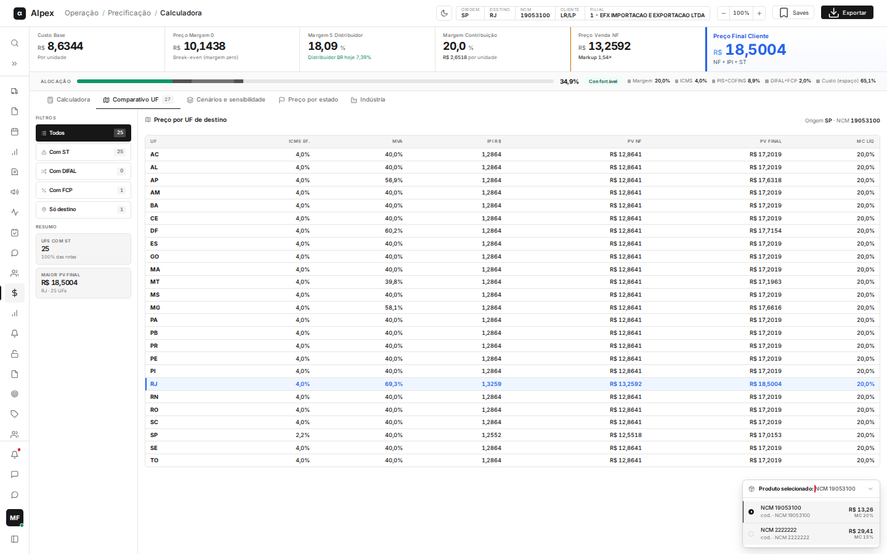

**Menu:** 1101 - Calculadora V2, aba Comparativo UF

A aba **Comparativo UF** mostra, para o produto selecionado, quanto fica o preço de venda em cada estado de destino, já com ICMS, IPI, ST (substituição tributária), DIFAL e FCP. É usada pela equipe de precificação e pelo comercial para saber em quais estados o preço final sobe e onde a margem se mantém.

Para qualquer aba de análise aparecer com dados, é preciso ter pelo menos um produto adicionado e calculado na aba **Calculadora** (veja a página "Calculadora"). Sem produto calculado, as abas ficam vazias.

## Ler a tabela de preço por UF

<Steps>
  <Step title="Abrir a aba">
    Com o produto calculado, clique em **Comparativo UF** (logo abaixo da barra de indicadores). O número ao lado do nome da aba é apenas um contador fixo de estados.

    A tabela **Preço por UF de destino** traz uma linha por estado. O texto no canto direito informa a origem (**Origem SP**) e o NCM do produto analisado.
  </Step>
  <Step title="Entender cada coluna">
    - **UF**: estado de destino da venda.
    - **ICMS ef.**: ICMS efetivo cobrado na venda para aquele estado.
    - **MVA**: margem de valor agregado usada no cálculo da ST. Aparece **—** quando o estado não tem ST para o produto.
    - **IPI R$**: valor do IPI por unidade.
    - **PV NF**: preço de venda na nota fiscal, sem IPI e sem ST por fora.
    - **PV Final**: preço que o cliente paga, somando IPI e ST ao PV NF.
    - **MC líq**: margem de contribuição líquida que sobra ao vender para aquele estado.
  </Step>
  <Step title="Achar o estado que você escolheu">
    A linha em azul, com uma barra azul na lateral, é a UF de destino definida na Calculadora. As demais servem de comparação.
  </Step>
  <Step title="Ler o resumo">
    No quadro **Resumo**, à esquerda, **UFs com ST** diz em quantos estados existe ST, e **Maior PV final** mostra o preço final mais alto e em qual UF ele ocorre.
  </Step>
</Steps>

<Note>
Os valores mudam quando você recalcula a Calculadora. A aba não grava nada: é só uma leitura do cálculo atual.
</Note>

## Filtrar as UFs da tabela

<Steps>
  <Step title="Escolher o filtro">
    Na coluna **Filtros**, clique em um dos botões: **Todos**, **Com ST**, **Com DIFAL**, **Com FCP** ou **Só destino**. O número à direita de cada botão é a quantidade de estados naquele grupo.

    
  </Step>
  <Step title="Voltar a ver tudo">
    Clique em **Todos** para listar novamente os estados. O botão escuro é o filtro ativo.
  </Step>
</Steps>

<Note>
**DIFAL** é a diferença de alíquota de ICMS em vendas interestaduais e **FCP** é o Fundo de Combate à Pobreza, adicional de ICMS em alguns estados. Com um filtro ativo, o cartão **UFs com ST** pode mostrar uma porcentagem acima de 100%, porque ela é calculada sobre a lista filtrada.
</Note>

## Trocar o produto analisado

<Steps>
  <Step title="Abrir a lista de produtos">
    No rodapé da tela, clique na barra **Produto selecionado**. Ela abre a lista de todos os produtos calculados, com preço NF e margem de contribuição (**MC**) de cada um.

    
  </Step>
  <Step title="Escolher o produto">
    Clique na linha do produto desejado. Todas as abas de análise passam a mostrar os números desse produto.
  </Step>
</Steps>

<Note>
O produto escolhido aqui vale para todas as abas de análise (Comparativo UF, Cenários e sensibilidade, Preço por estado, Resumo Operação e Comparativo Winthor).
</Note>
