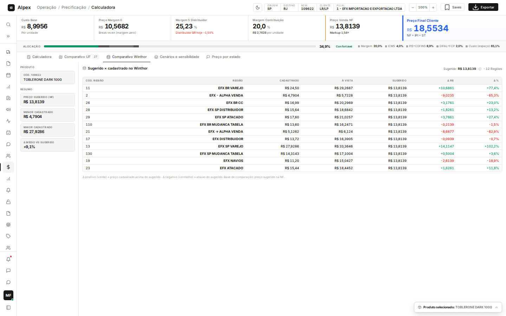

**Menu:** 1101 - Calculadora V2, aba Comparativo Winthor

Quando a origem do custo é **WinThor**, aparece a aba **Comparativo Winthor**. Ela confronta o preço que a calculadora sugere com o preço de venda realmente cadastrado no Winthor, região a região. Quem precifica usa para saber onde a tabela atual está acima ou abaixo do sugerido.

Escolha **WinThor** em **Origem do custo**, adicione o produto (a lista traz código, fornecedor, marca, custo real e último custo), informe a margem, escolha o destino e clique em **Calcular** (veja a página "Calculadora").

## Ler o comparativo com o Winthor

<Steps>
  <Step title="Conferir o produto e o resumo">
    À esquerda, o quadro **Produto** mostra o código e a descrição. Em **Resumo**, quatro cartões: **Preço sugerido (NF)**, **Menor cadastrado**, **Maior cadastrado** e **Δ médio vs sugerido** (diferença média, em porcentagem, entre os preços cadastrados e o sugerido).
  </Step>
  <Step title="Ler a tabela">
    Cada linha é uma região de preço do Winthor ligada à filial escolhida:
    - **Cód. Região** e **Região**: número e nome da tabela de preço.
    - **Cadastrado**: preço de venda cadastrado hoje.
    - **À vista**: preço à vista cadastrado, quando existe.
    - **Sugerido**: preço sugerido pela calculadora (o mesmo em todas as linhas).
    - **Δ R$** e **Δ %**: diferença entre o cadastrado e o sugerido. Verde significa cadastrado acima do sugerido; vermelho, abaixo do sugerido.
  </Step>
  <Step title="Ver como o sugerido foi calculado">
    No topo, ao lado de **Sugerido**, o ícone de informação (**Como o sugerido foi calculado**) abre a composição do preço. O texto **· N Regiões** indica quantas regiões foram comparadas.
  </Step>
</Steps>

<Note>
Sem produto calculado, a aba mostra o aviso **Selecione um produto e calcule para comparar com o preço cadastrado no Winthor**. Se o produto não tem preço cadastrado ou a consulta ao Winthor falha, a aba mostra a mensagem correspondente. A aba só consulta o Winthor; nada é alterado lá.
</Note>
