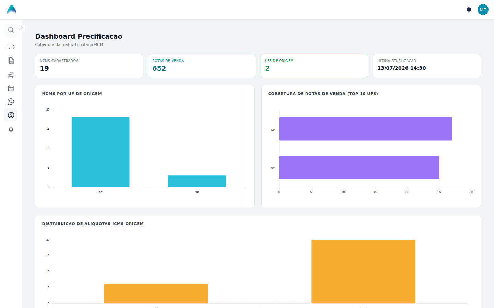
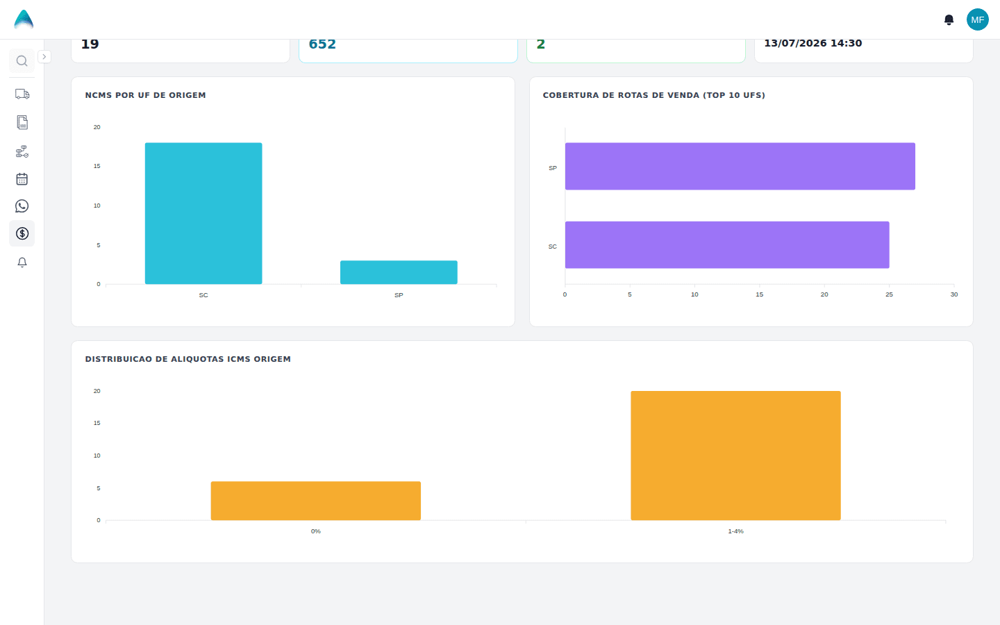

**Menu:** 1104 - Dashboard

Painel de consulta que mostra a cobertura do Cadastro NCM: quantos NCMs, UFs e rotas de venda já estão cadastrados. Serve para a equipe fiscal e de precificação enxergar lacunas. Não grava nada e não interfere nos cálculos.

## Ler os indicadores e gráficos

<Steps>
  <Step title="Ler os cartões do topo">
    Os quatro cartões mostram: **NCMs Cadastrados** (quantidade de NCMs diferentes), **Rotas de Venda** (total de combinações de NCM, UF de origem e UF de destino com imposto de venda), **UFs de Origem** (quantas UFs de origem têm cadastro) e **Ultima Atualizacao** (data e hora da última alteração de impostos de compra).
  </Step>
  <Step title="Ler os gráficos">
    Role a página para ver os três gráficos. **NCMs por UF de Origem** conta os NCMs de cada UF; **Cobertura de Rotas de Venda (Top 10 UFs)** mostra, para as 10 UFs com mais destinos, para quantas UFs de destino há imposto de venda; **Distribuição de Alíquotas ICMS Origem** agrupa os cadastros em faixas (0%, 1-4%, 5-7%, 8-12%, 13-18% e 19% ou mais). Passe o mouse sobre as barras para ver os valores.

    
  </Step>
</Steps>

<Note>
Os números vêm do Cadastro NCM e se atualizam ao abrir ou recarregar a página. Para corrigir uma lacuna, vá em **Cadastro NCM**. Quando não há dados, os gráficos mostram "Sem dados cadastrados".
</Note>
