**Menu:** 1106 - Cadastro Despesas

Cadastro das despesas padrão de cada mês, em percentual, usadas para formar o preço. Cada cadastro vale para um mês e ano e, opcionalmente, para uma filial. A tela se chama **Despesa Mensal** no topo da página.

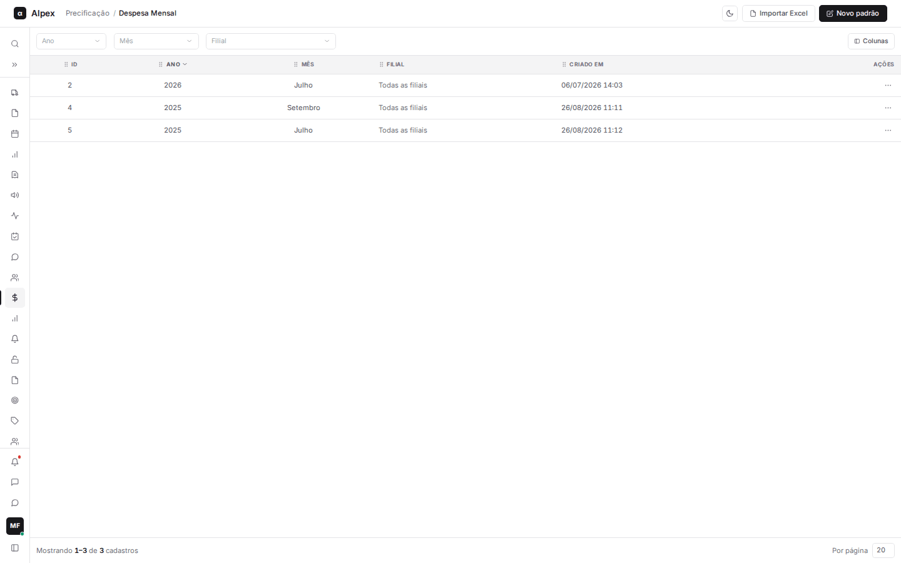

**Como esse cadastro é usado nos cálculos**

- **Calculadora:** no campo **Utilizar despesa cadastrada**, você escolhe um mês (ou a **Média anual** de um ano), e os campos de despesa da Calculadora são preenchidos com esses percentuais (comissão, marketing, frete de saída, custo financeiro, etiquetagem, importação etc.). Os percentuais de despesa entram no cálculo do preço de venda. Só aparecem os meses da filial escolhida e os gerais; quando existem os dois para o mesmo mês, vale o da filial.
- **Comparativo em massa:** a tela não lê este cadastro diretamente. As despesas dos produtos vêm do cenário vinculado à tabela de preço, e um cenário com despesas próprias pode ser preenchido a partir de um mês cadastrado aqui (veja as dúvidas no fim do relatório).

## Filtrar, ordenar e escolher colunas

<Steps>
  <Step title="Filtrar">
    Use **Ano**, **Mês** e **Filial** na barra de filtros. A opção "Todas as filiais (geral)" mostra os cadastros sem filial. Quando houver filtro ativo, aparece **Limpar** para voltar à lista completa.

    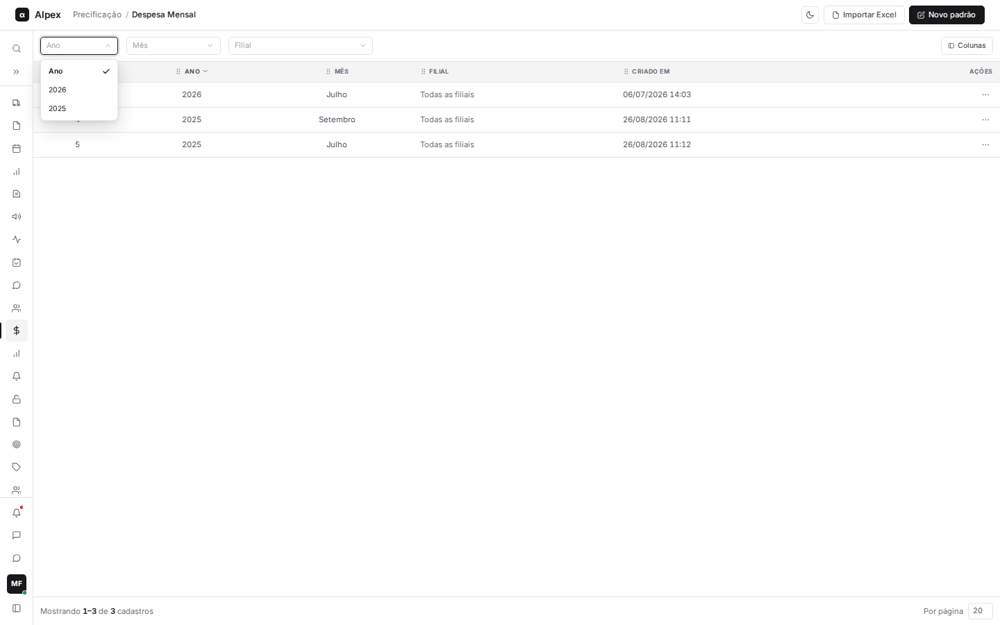
  </Step>
  <Step title="Ordenar e paginar">
    Clique no título de uma coluna para ordenar. No rodapé, escolha quantos cadastros mostrar **Por página**.
  </Step>
  <Step title="Escolher colunas">
    Clique em **Colunas** para exibir ou ocultar **ID**, **Moeda FOB**, **Criado em** e **Atualizado em**. **Ano**, **Mês** e **Filial** são fixas. **Resetar** volta ao padrão.

    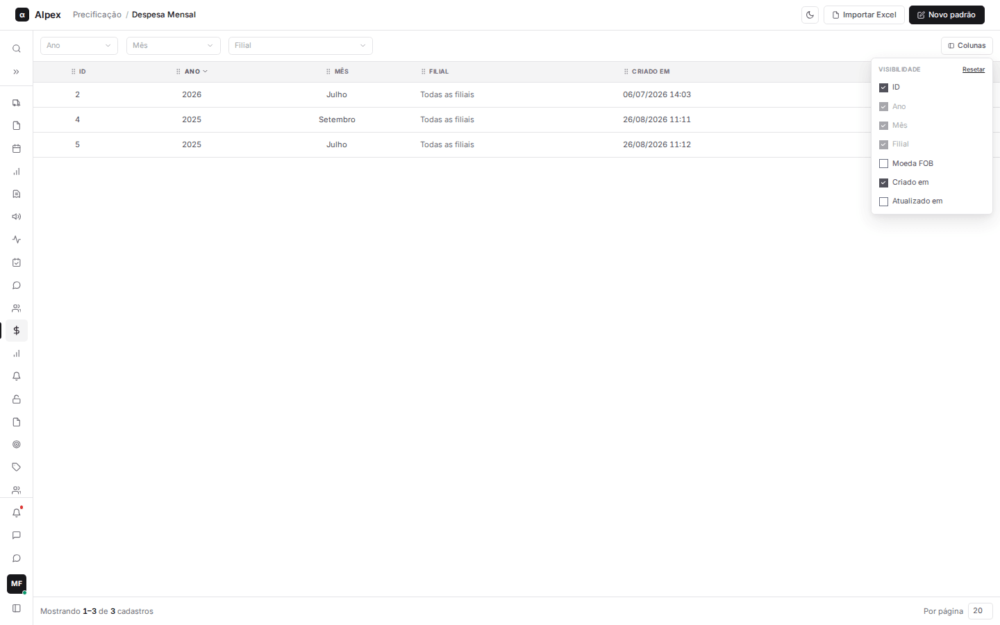
  </Step>
</Steps>

## Cadastrar um novo padrão de despesa

<Steps>
  <Step title="Abrir o formulário">
    Clique em **Novo padrão**. O mês e o ano já vêm preenchidos com a data atual.

    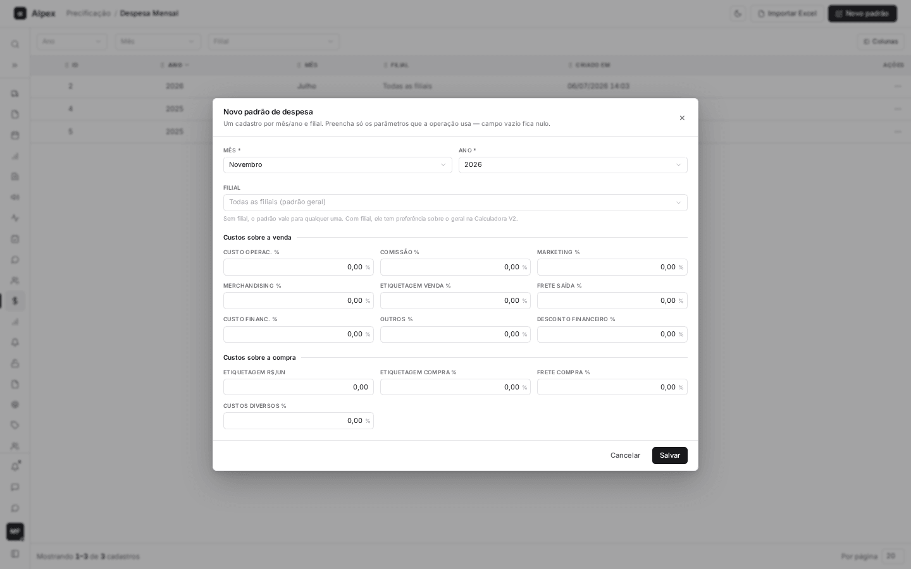
  </Step>
  <Step title="Definir mês, ano e filial">
    Escolha **Mês** e **Ano**. Em **Filial**, deixe "Todas as filiais (padrão geral)" para valer para qualquer filial, ou escolha uma filial específica, que terá preferência sobre o geral.
  </Step>
  <Step title="Preencher os custos">
    Preencha só o que a operação usa; campo vazio fica sem valor. Os grupos são **Custos sobre a venda** (custo operacional, comissão, marketing, merchandising, etiquetagem de venda, frete de saída, custo financeiro, outros e desconto financeiro), **Custos sobre a compra** (etiquetagem em R$ por unidade e em %, frete de compra e custos diversos) e os grupos de **Importação**. Use vírgula ou ponto nos decimais.

    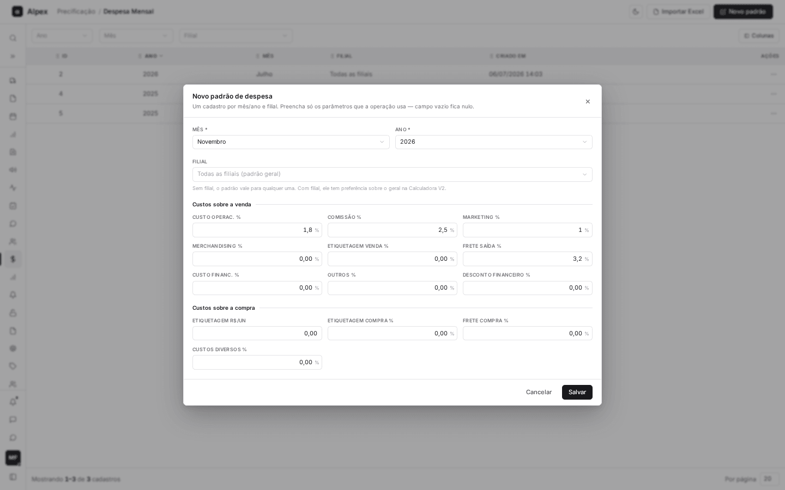
  </Step>
  <Step title="Importação (se aplicável)">
    Role o formulário para ver **Importação · operação** (**Moeda FOB**, **Câmbio** e **Modal**), **Importação · % sobre FOB**, **Base ICMS importação** (marque o que entra na base: IPI, PIS, COFINS, AFRMM) e **Origem da mercadoria** (**Mercosul**).

    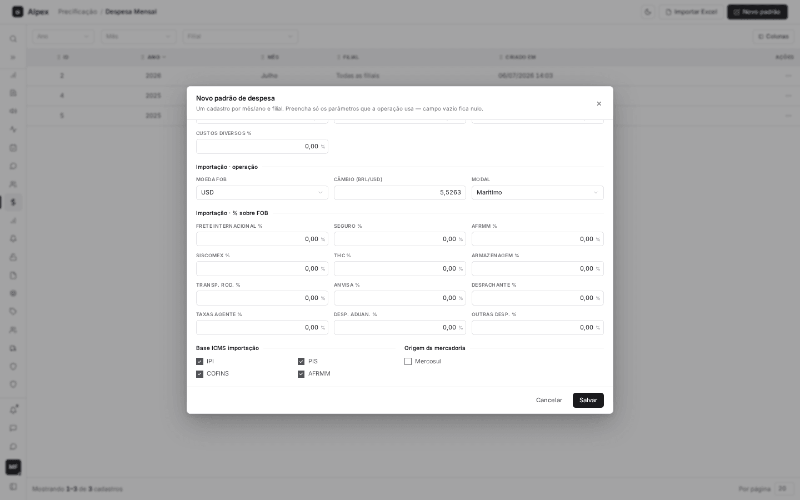
  </Step>
  <Step title="Salvar">
    Clique em **Salvar**. **Cancelar** ou o X fecham sem gravar.
  </Step>
</Steps>

<Note>
Só pode haver um cadastro por mês, ano e filial. Se já existir, o sistema avisa (por exemplo, "Já existe um cadastro de Julho/2026 para todas as filiais.") e você deve editar o existente. **Mês** e **Ano** são obrigatórios.
</Note>

## Editar um padrão de despesa

<Steps>
  <Step title="Abrir o menu da linha">
    Na coluna **Ações**, clique nos três pontos da linha.

    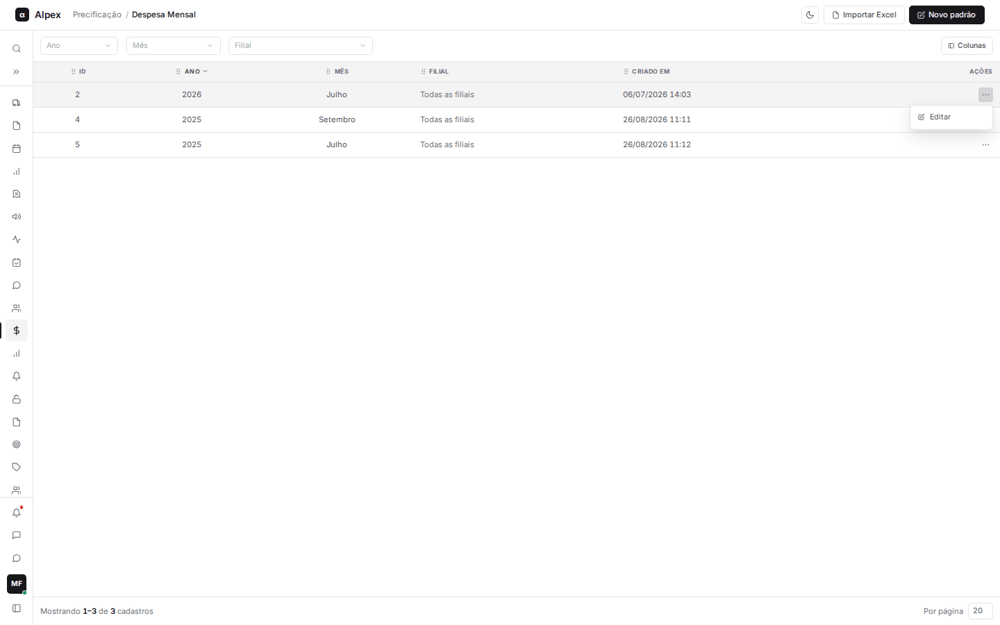
  </Step>
  <Step title="Editar">
    Clique em **Editar**. O título mostra o período e a filial. Ajuste os valores e clique em **Salvar**.

    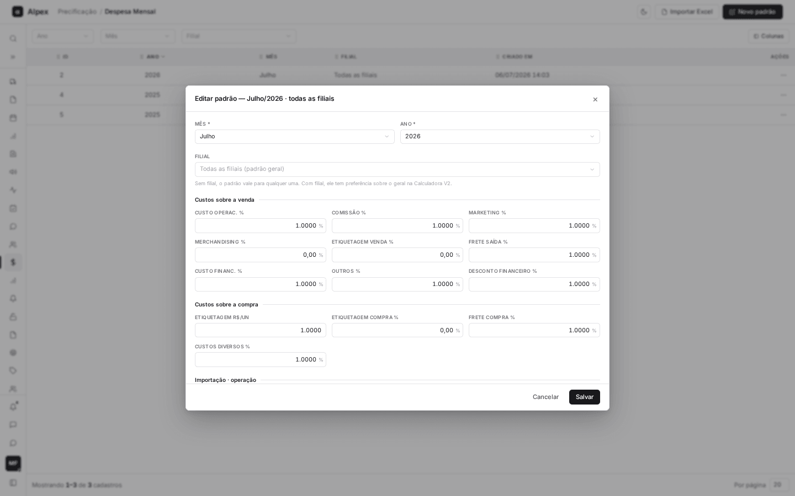
  </Step>
</Steps>

<Note>
Não há exclusão nesta tela. Para um mês deixar de ter despesas, edite o cadastro e deixe os campos vazios.
</Note>

## Importar padrões de uma planilha

<Steps>
  <Step title="Abrir a importação">
    Clique em **Importar Excel**. Use **Baixar planilha modelo** para obter os nomes corretos de coluna. **ano** e **mes** (1 a 12) são obrigatórios; **codfilial** vazio significa padrão geral.

    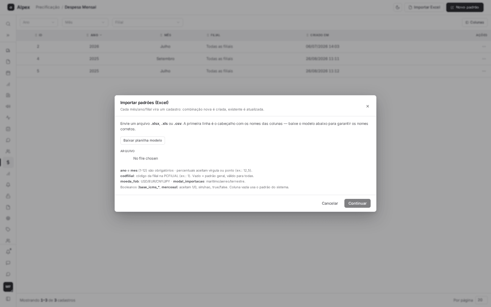
  </Step>
  <Step title="Enviar o arquivo">
    Escolha o arquivo (.xlsx, .xls ou .csv). O sistema mostra o nome, o número de colunas reconhecidas e uma prévia das primeiras linhas.

    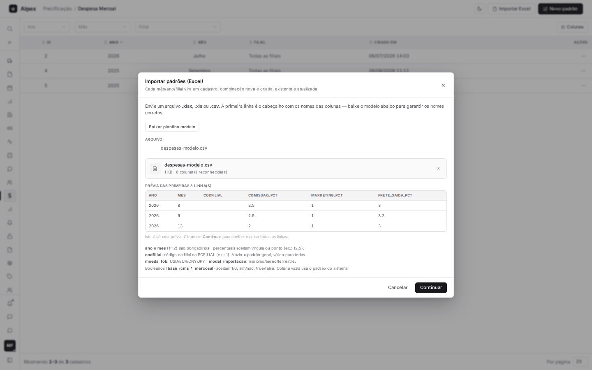
  </Step>
  <Step title="Conferir">
    Clique em **Continuar**. Na tela **Conferir importação**, as linhas aparecem editáveis; as com erro ficam em vermelho com a explicação, e dá para remover linhas, adicionar linhas com **Adicionar linha** e navegar com **Anterior** e **Próxima**.

    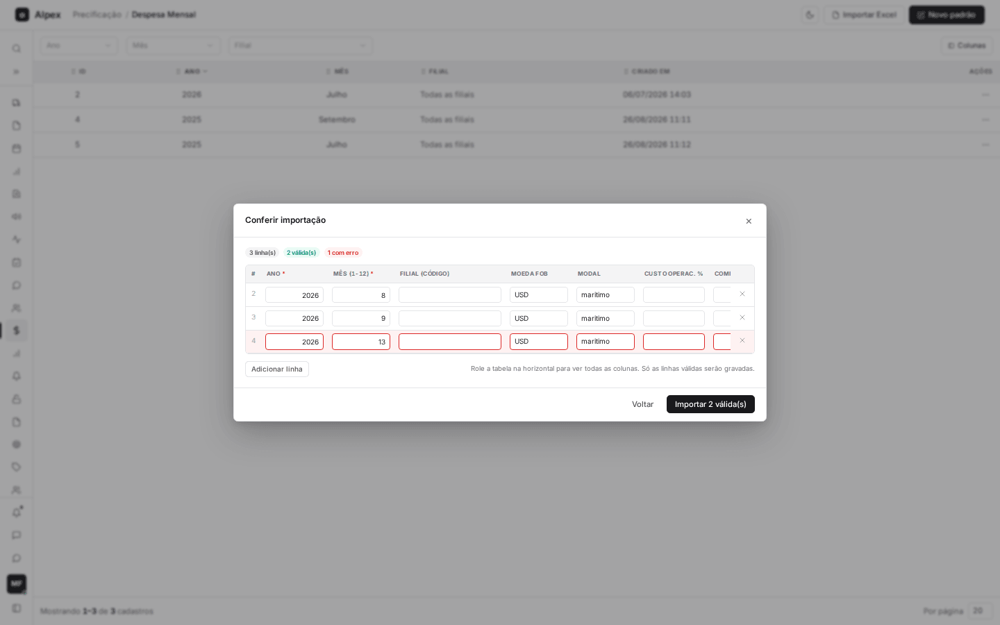
  </Step>
  <Step title="Importar">
    Clique em **Importar N válida(s)**. Só as linhas válidas são gravadas. **Voltar** retorna ao envio do arquivo.
  </Step>
</Steps>

<Note>
Cada combinação de mês, ano e filial vira um cadastro: se for nova, é criada; se já existir, é atualizada. A leitura aceita até 10.000 linhas por arquivo.
</Note>
