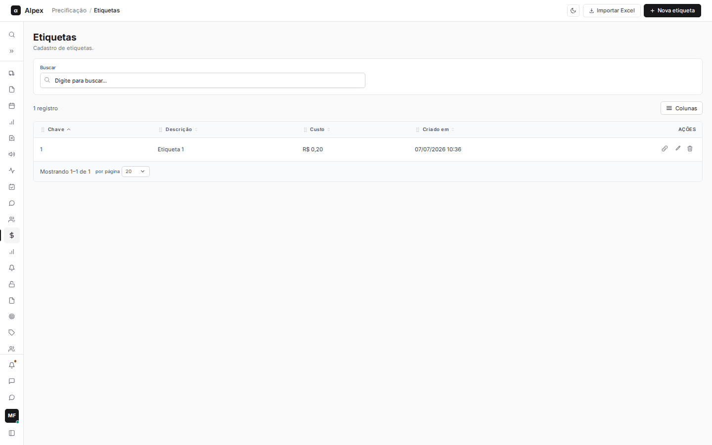
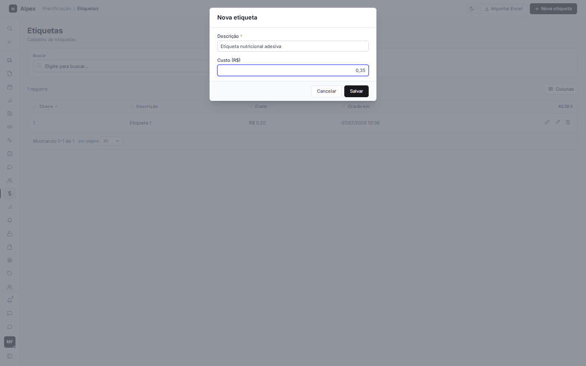
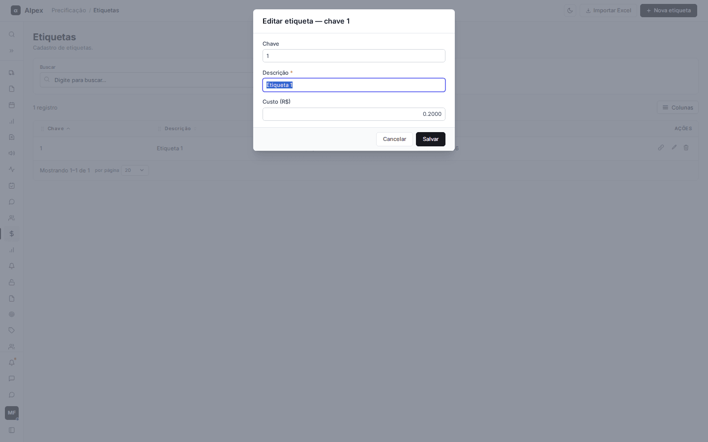
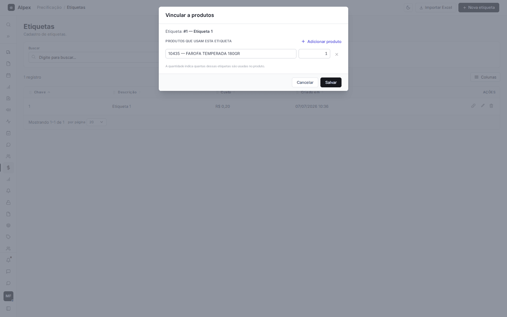
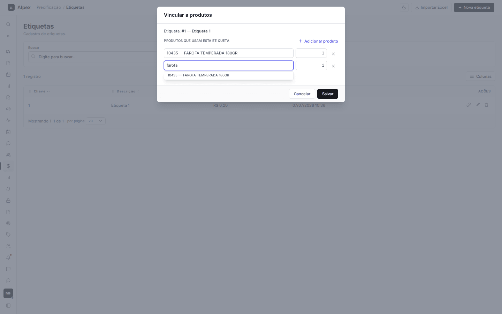
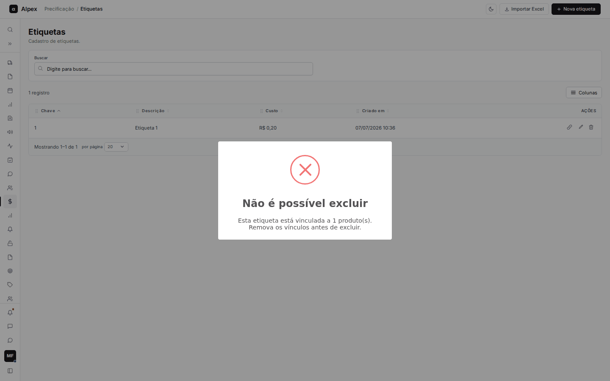
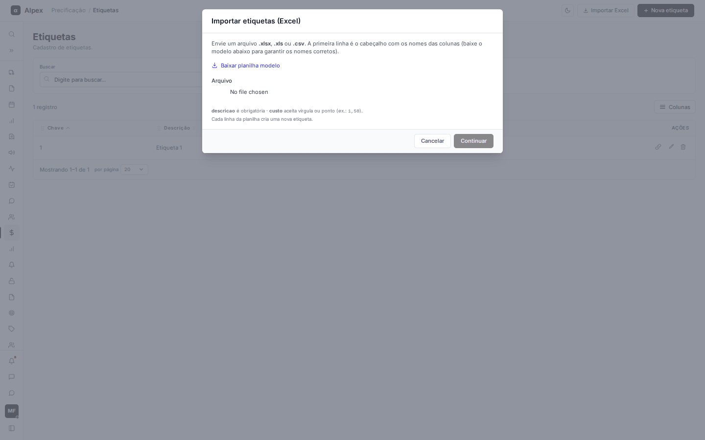
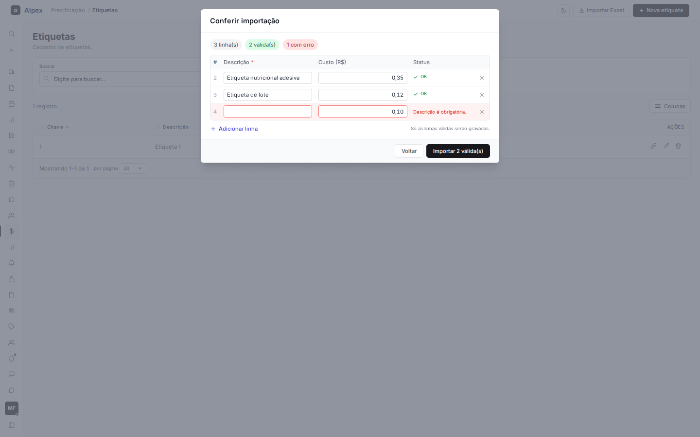

**Menu:** 1108 - Etiquetas

Catálogo das etiquetas usadas nas embalagens, cada uma com seu custo unitário em reais. Depois de cadastradas, são ligadas aos produtos (aqui ou na tela **Produtos com etiqueta**).

**Como esse cadastro é usado nos cálculos**

- **Calculadora:** se **Usar custo de etiquetagem** estiver em **Sim**, para um produto do Winthor marcado como etiquetável o custo total das etiquetas ligadas a ele (quantidade vezes o custo de cada etiqueta) é somado ao custo base, antes do ICMS-ST. Produtos sem vínculo não recebem custo de etiqueta por aqui.
- **Comparativo em massa:** não há consulta a este cadastro no código da tela (veja as dúvidas no fim do relatório).

A lista aceita busca, ordenação pelos títulos, menu **Colunas** e paginação, como as demais telas.

## Cadastrar ou editar uma etiqueta

<Steps>
  <Step title="Abrir o formulário">
    Clique em **Nova etiqueta**. Para editar, use o lápis da linha.
  </Step>
  <Step title="Preencher">
    Informe a **Descrição** (obrigatória) e o **Custo (R$)** por unidade (use vírgula ou ponto).

    
  </Step>
  <Step title="Salvar">
    Clique em **Salvar**. A **Chave** (número da etiqueta) é gerada automaticamente e, na edição, aparece só para consulta.

    
  </Step>
</Steps>

<Note>
Mudar o custo de uma etiqueta altera o custo de todos os produtos que a usam, nos próximos cálculos.
</Note>

## Vincular uma etiqueta a produtos

<Steps>
  <Step title="Abrir o vínculo">
    Na linha da etiqueta, clique no ícone de corrente (**Vincular a produtos**). A janela mostra os produtos que já usam a etiqueta.

    
  </Step>
  <Step title="Adicionar um produto">
    Clique em **Adicionar produto**, digite 2 ou mais caracteres do código ou da descrição e escolha o produto na lista.

    
  </Step>
  <Step title="Informar a quantidade">
    No campo ao lado, informe quantas dessas etiquetas são usadas no produto (mínimo 1). O **×** remove o produto da lista.
  </Step>
  <Step title="Salvar">
    Clique em **Salvar**. A lista da janela passa a ser a lista oficial da etiqueta: produtos retirados perdem o vínculo.
  </Step>
</Steps>

## Excluir uma etiqueta

<Steps>
  <Step title="Pedir a exclusão">
    Na linha da etiqueta, clique no ícone de lixeira (**Excluir**).
  </Step>
  <Step title="Ler o aviso">
    Se a etiqueta estiver ligada a produtos, a exclusão é bloqueada: "Não é possível excluir". Remova antes os vínculos. Se não houver vínculos, aparece a pergunta "Excluir a etiqueta ...?" para confirmar.

    
  </Step>
</Steps>

<Warning>
Depois de confirmada, a exclusão é definitiva.
</Warning>

## Importar etiquetas de uma planilha

<Steps>
  <Step title="Abrir a importação">
    Clique em **Importar Excel**. Use **Baixar planilha modelo** para obter o arquivo. **descricao** é obrigatória e **custo** aceita vírgula ou ponto.

    
  </Step>
  <Step title="Enviar e continuar">
    Escolha o arquivo (.xlsx, .xls ou .csv) e clique em **Continuar**.
  </Step>
  <Step title="Conferir">
    A tela **Conferir importação** mostra quantas linhas são válidas e quantas têm erro. Corrija os campos na própria tabela, remova linhas com o **×** ou use **Adicionar linha**.

    
  </Step>
  <Step title="Importar">
    Clique em **Importar N válida(s)**. Só as linhas válidas são gravadas.
  </Step>
</Steps>

<Note>
Cada linha da planilha cria uma nova etiqueta: importar duas vezes o mesmo arquivo duplica os cadastros. A leitura aceita até 10.000 linhas.
</Note>
