**Menu:** 1105 - Indústrias e Produtos

Cadastro das indústrias (fornecedores), das marcas e dos produtos que elas vendem, com preço de compra e NCM. Usado pela equipe de precificação para calcular o preço de produtos que ainda não estão no Winthor.

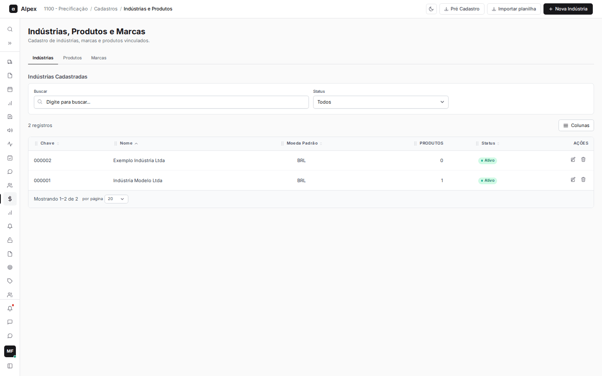

**Como esse cadastro é usado nos cálculos**

- **Calculadora:** na opção de usar o preço da indústria, você escolhe a indústria e os produtos dela. O **Preço de Compra** do cadastro vira o custo de partida, e o **NCM** do produto indica quais impostos buscar no Cadastro NCM. Um produto cujo NCM não tem impostos cadastrados é salvo com aviso, mas não consegue ser calculado.
- **Comparativo em massa:** não consulta este cadastro, pois trabalha com os produtos do Winthor.

A tela tem três abas: **Indústrias**, **Produtos** e **Marcas**. O botão de ação no canto superior direito muda conforme a aba (**Nova Indústria**, **Novo Produto** ou **Nova Marca**). Em todas as listas valem a busca, o filtro **Status**, a ordenação pelos títulos das colunas, o menu **Colunas** e a paginação.

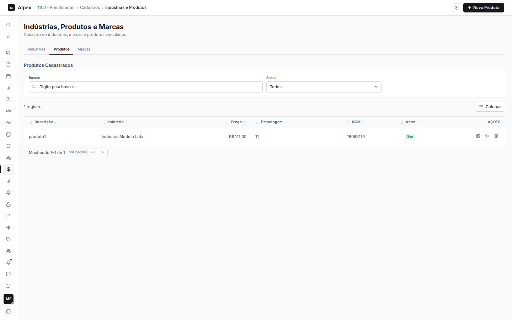

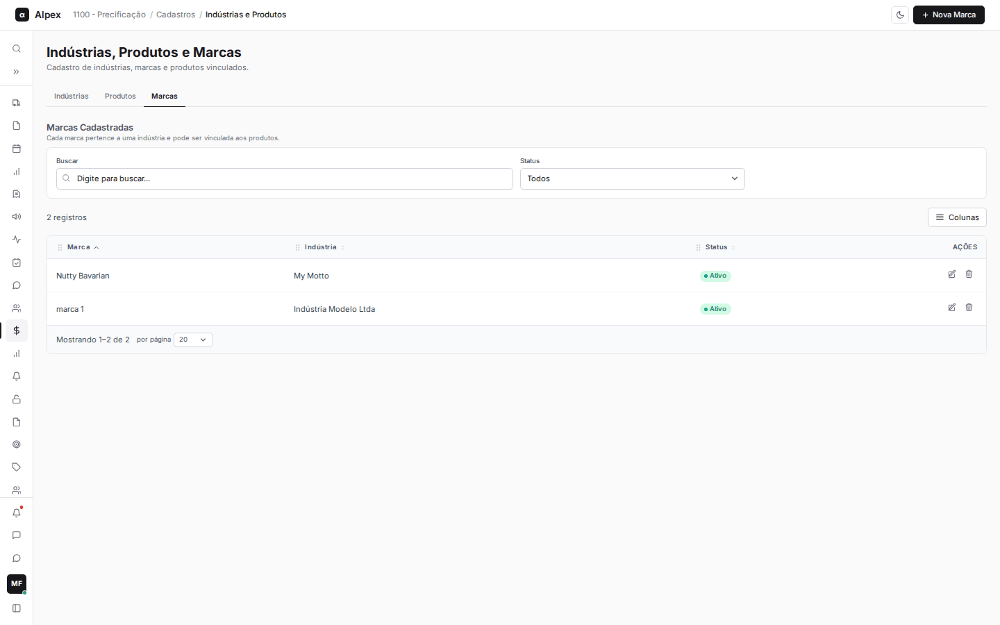

## Cadastrar ou editar uma indústria

<Steps>
  <Step title="Abrir o formulário">
    Na aba **Indústrias**, clique em **Nova Indústria**. Para editar, use o lápis (**Editar**) da linha.

    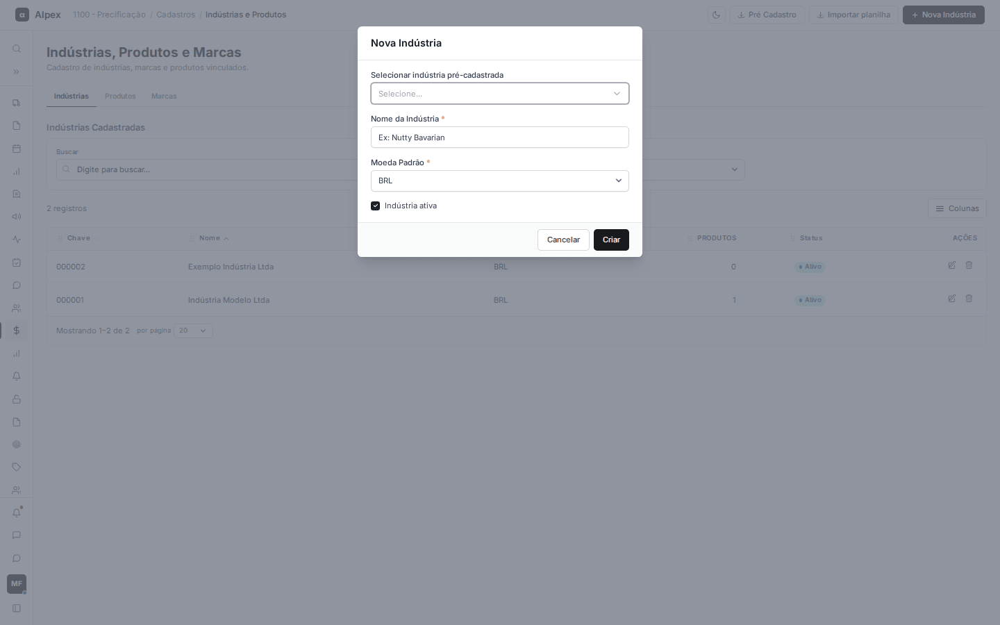
  </Step>
  <Step title="Partir de uma indústria pré-cadastrada (opcional)">
    No campo **Selecionar indústria pré-cadastrada**, busque e escolha um nome já existente para preencher o formulário com os dados dele.

    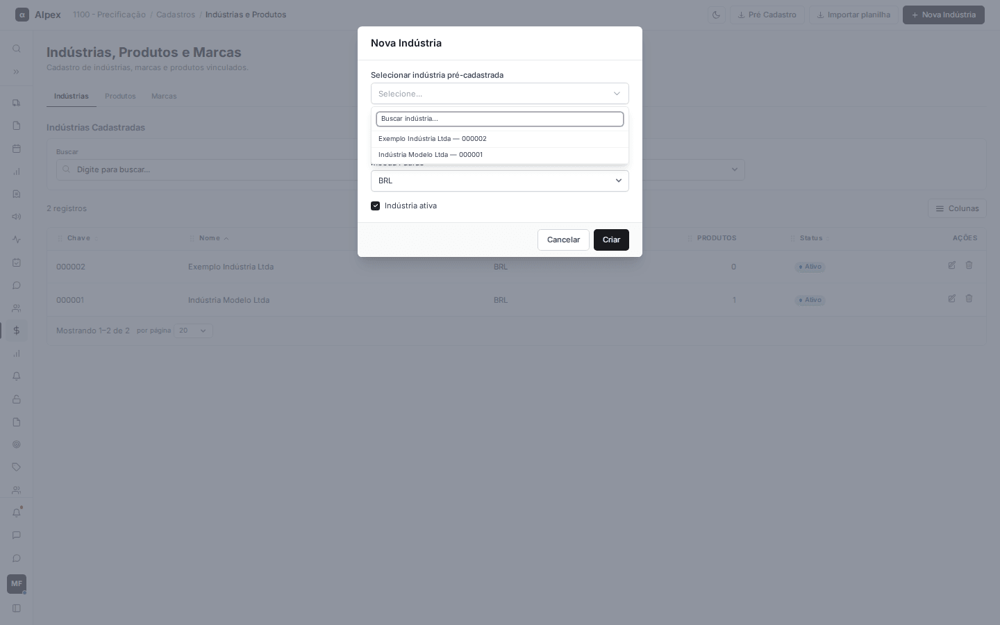
  </Step>
  <Step title="Preencher">
    Informe o **Nome da Indústria** (mínimo de 2 letras) e a **Moeda Padrão**. Deixe **Indústria ativa** marcado para ela aparecer nas escolhas.

    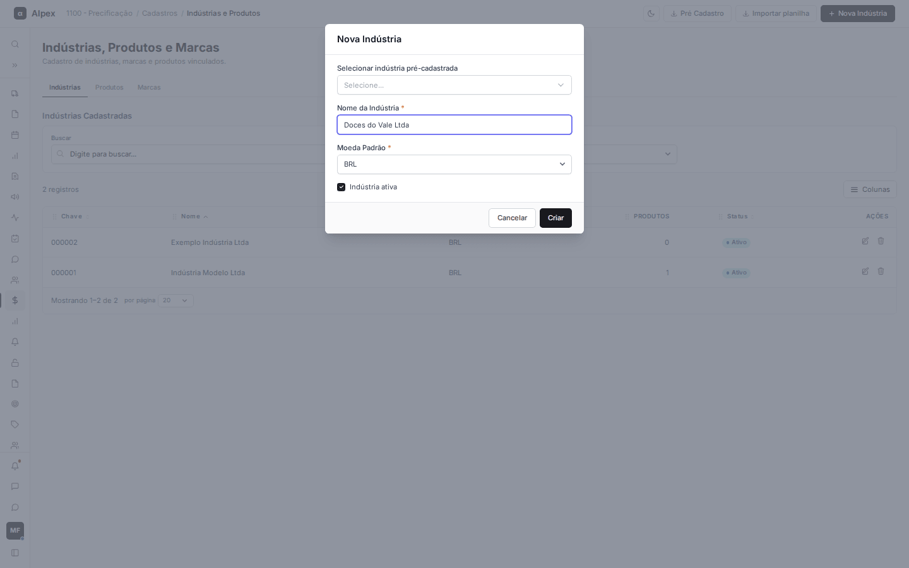
  </Step>
  <Step title="Salvar">
    Clique em **Criar** (ou **Atualizar**, na edição). A **Chave** é gerada pelo sistema e aparece, sem edição, ao editar.

    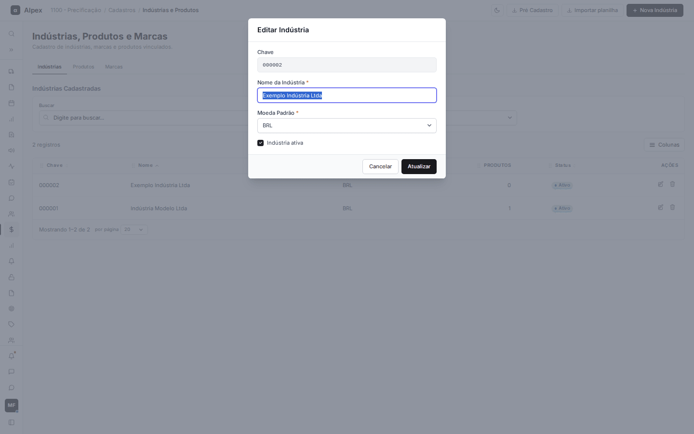
  </Step>
</Steps>

<Note>
Não podem existir duas indústrias com o mesmo nome (o sistema ignora acentos e maiúsculas e avisa qual já existe). Ao renomear uma indústria, o novo nome é copiado para as marcas e os produtos dela.
</Note>

## Excluir uma indústria

<Steps>
  <Step title="Pedir a exclusão">
    Na linha da indústria, clique no ícone de lixeira (**Excluir**).
  </Step>
  <Step title="Confirmar ou cancelar">
    Aparece "Excluir indústria ...? Os produtos vinculados não serão removidos." Clique em **Sim, excluir!** para confirmar ou em **Cancelar** para desistir.

    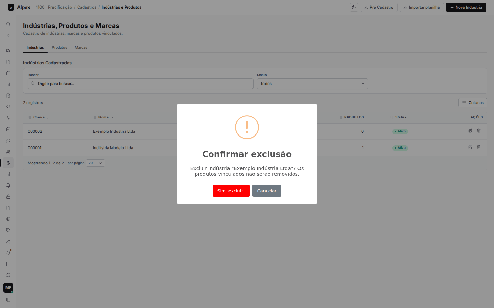
  </Step>
</Steps>

<Warning>
A indústria é removida de forma definitiva. Os produtos dela continuam na lista, mas ficam sem a indústria vinculada.
</Warning>

## Cadastrar, editar, duplicar ou excluir um produto

<Steps>
  <Step title="Abrir o formulário">
    Na aba **Produtos**, clique em **Novo Produto**. Na linha de um produto existente há três ações: **Editar**, **Duplicar** e **Excluir**.

    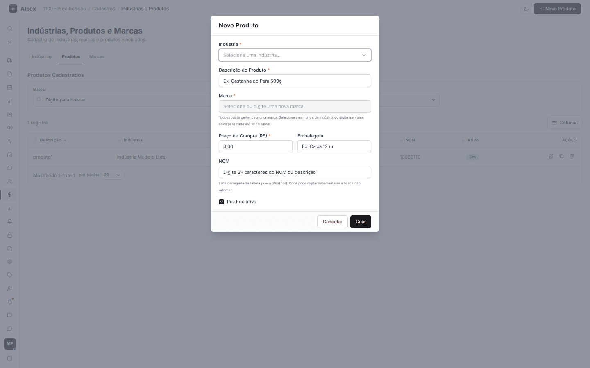
  </Step>
  <Step title="Preencher">
    Escolha a **Indústria** (só aparecem indústrias ativas) e informe a **Descrição do Produto**. Em **Marca**, escolha uma marca da indústria ou digite um nome novo: ele é cadastrado ao salvar. Informe o **Preço de Compra (R$)**, a **Embalagem** e o **NCM** (digite 2 ou mais caracteres para buscar na lista do Winthor; se a busca não retornar, pode digitar o número livremente).

    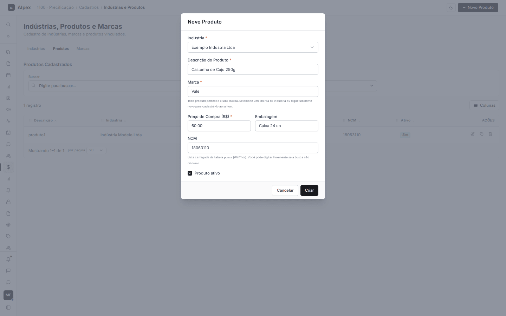
  </Step>
  <Step title="Salvar">
    Clique em **Criar** (ou **Atualizar**). Se o NCM informado não tiver impostos no Cadastro NCM, o produto é salvo com um aviso para cadastrar os dados fiscais.
  </Step>
  <Step title="Duplicar">
    O ícone **Duplicar** abre o formulário já preenchido com os dados do produto e a descrição terminando em "(cópia)". Ajuste o que for diferente e clique em **Criar**.

    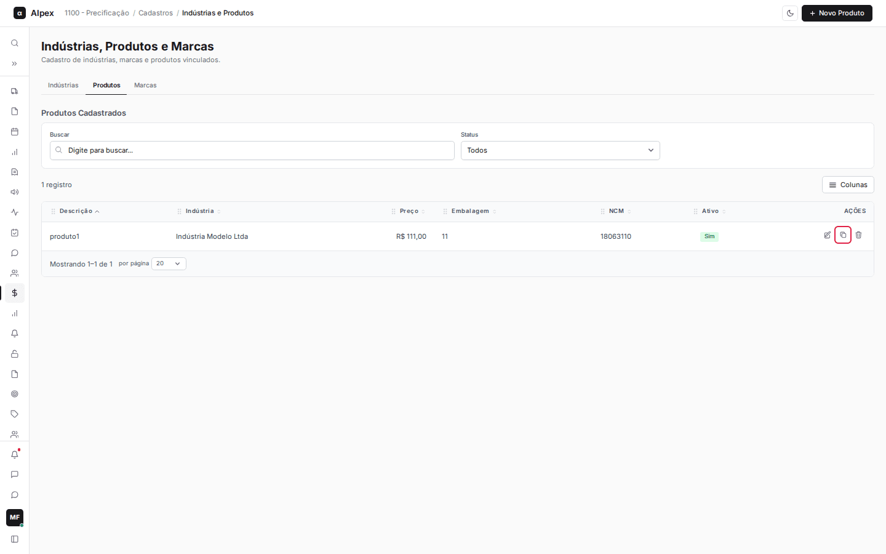

    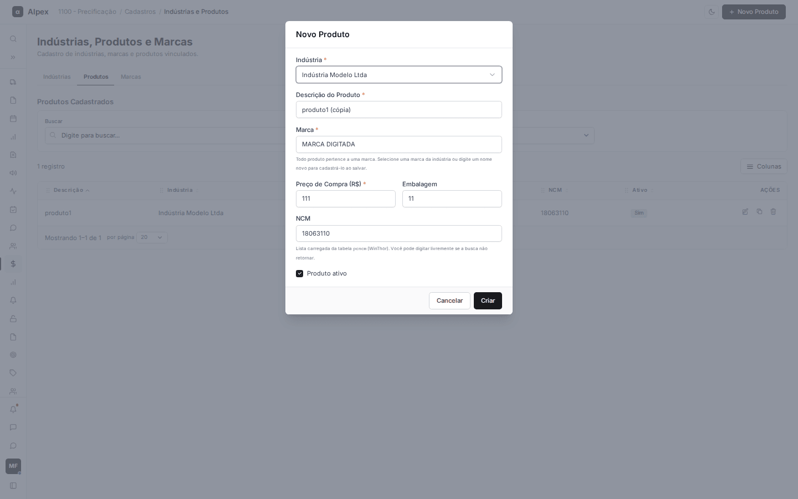
  </Step>
  <Step title="Excluir">
    O ícone **Excluir** pede confirmação ("Excluir produto ...?"). **Sim, excluir!** remove o produto.

    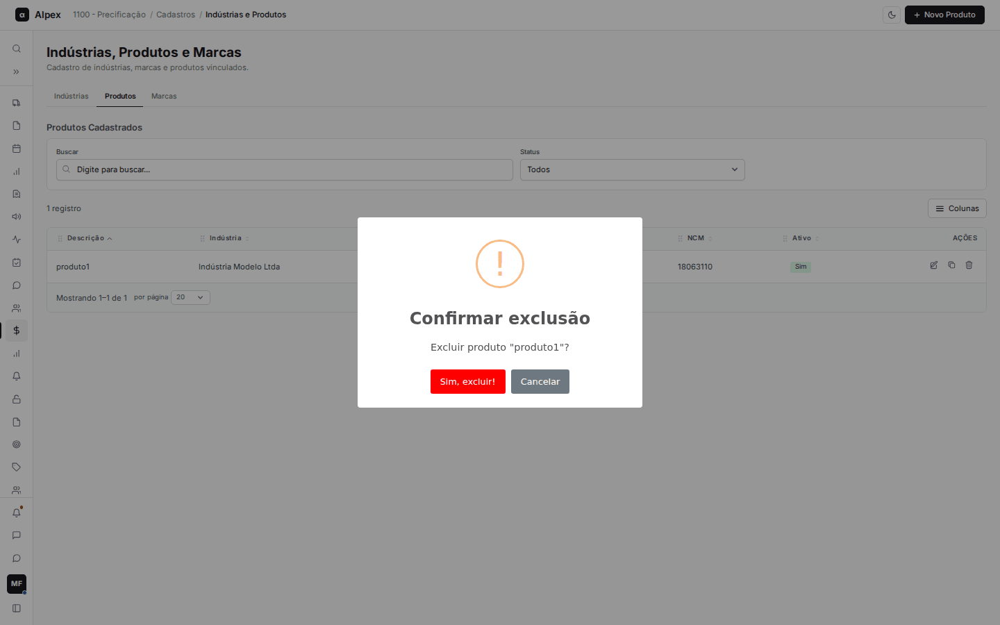
  </Step>
</Steps>

<Note>
**Descrição do Produto** (mínimo de 2 letras), **Marca**, **Indústria** e **Preço de Compra** (maior que zero) são obrigatórios. A moeda do produto segue a moeda padrão da indústria. Se não houver nenhuma indústria ativa, o formulário avisa para cadastrar uma primeiro.
</Note>

## Cadastrar, editar ou excluir uma marca

<Steps>
  <Step title="Abrir o formulário">
    Na aba **Marcas**, clique em **Nova Marca** (ou no lápis da linha, para editar).
  </Step>
  <Step title="Preencher e salvar">
    Escolha a **Indústria**, digite o **Nome da Marca** e deixe **Marca ativa** marcado. Clique em **Criar** (ou **Atualizar**).

    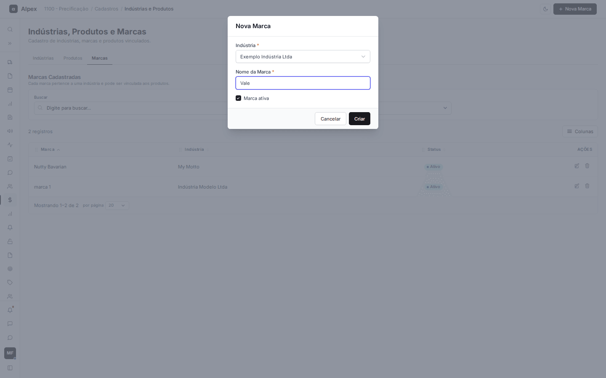
  </Step>
  <Step title="Excluir">
    O ícone de lixeira pede confirmação. Se houver produtos usando a marca, o aviso informa quantos ficarão sem marca.

    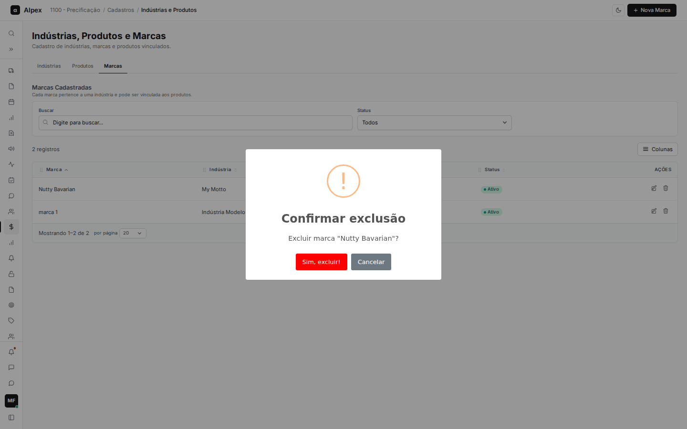
  </Step>
</Steps>

<Note>
Uma indústria não pode ter duas marcas com o mesmo nome. Mover uma marca para outra indústria move também os produtos dela.
</Note>

## Importar indústrias e produtos por planilha

<Steps>
  <Step title="Abrir a importação">
    Na aba **Indústrias**, clique em **Importar planilha**. A janela lista as colunas esperadas (**industria** e **marca** são obrigatórias; as demais são **moeda_padrao**, **descricao**, **ncm**, **valor**, **peso**, **qtd**, **embalagem**, **moeda** e **ativo**). Use **Baixar modelo** para obter o arquivo de exemplo.

    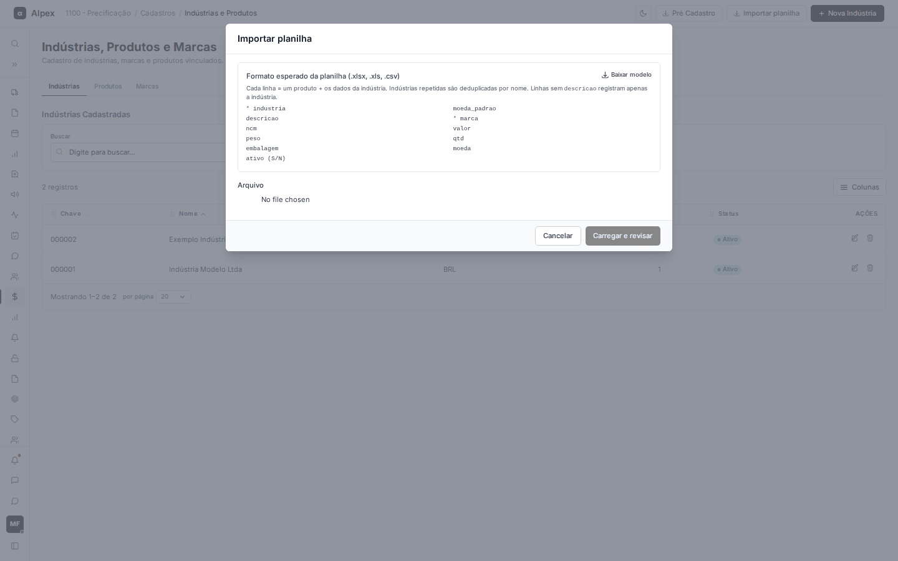
  </Step>
  <Step title="Enviar o arquivo">
    Escolha o arquivo (.xlsx, .xls ou .csv) e clique em **Carregar e revisar**.
  </Step>
  <Step title="Revisar">
    A janela **Revisar importação** mostra as indústrias e os produtos lidos. Corrija os campos direto na tabela, remova linhas com o **×** e veja os problemas na coluna de erros (linhas com erro aparecem em vermelho). **Voltar** retorna ao envio.

    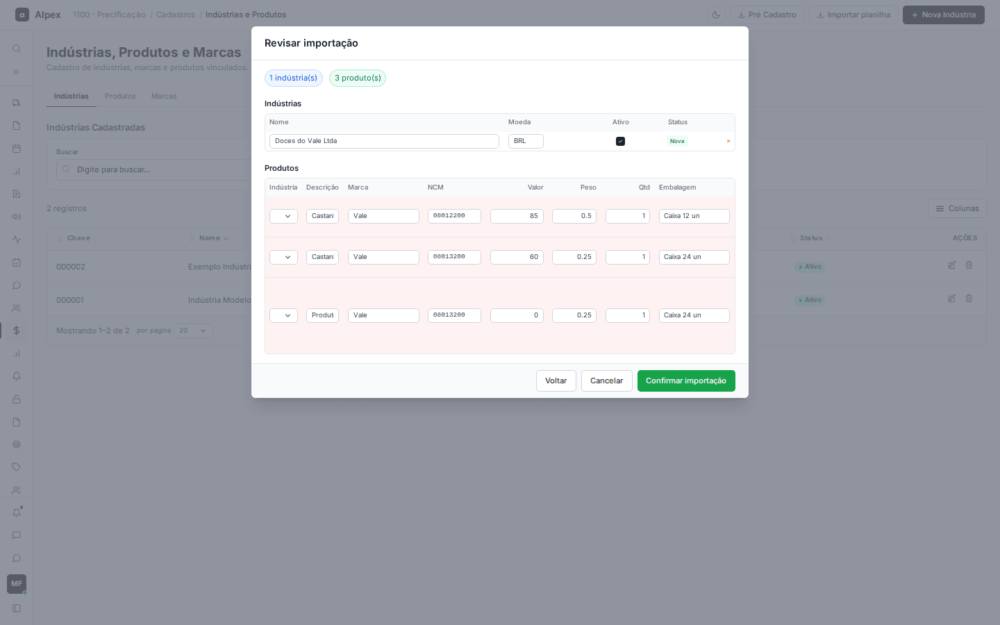
  </Step>
  <Step title="Confirmar">
    **Confirmar importação** grava as indústrias e os produtos. Indústrias repetidas na planilha são unificadas pelo nome. Linhas sem **descricao** cadastram só a indústria.
  </Step>
</Steps>

## Pré-cadastrar indústrias por planilha

<Steps>
  <Step title="Abrir o pré-cadastro">
    Na aba **Indústrias**, clique em **Pré Cadastro**. A tela pede um arquivo com as colunas **Nome**, **Moeda** e **Ativo** (S/N). **Baixar modelo** entrega um exemplo e **Voltar à lista** retorna.

    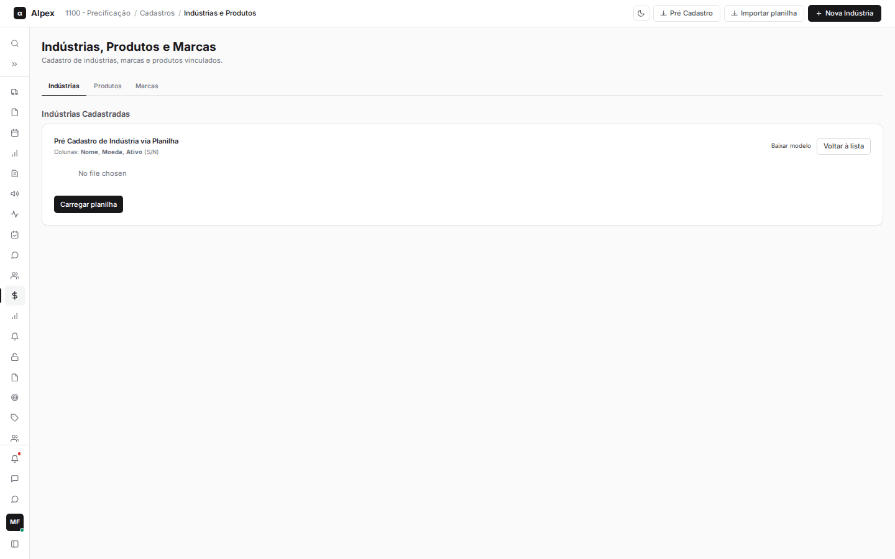
  </Step>
  <Step title="Carregar a planilha">
    Escolha o arquivo e clique em **Carregar planilha**. Cada linha aparece com o status **Novo** ou **Existente**; ajuste nome, moeda e ativo, ou remova linhas com o **×**.

    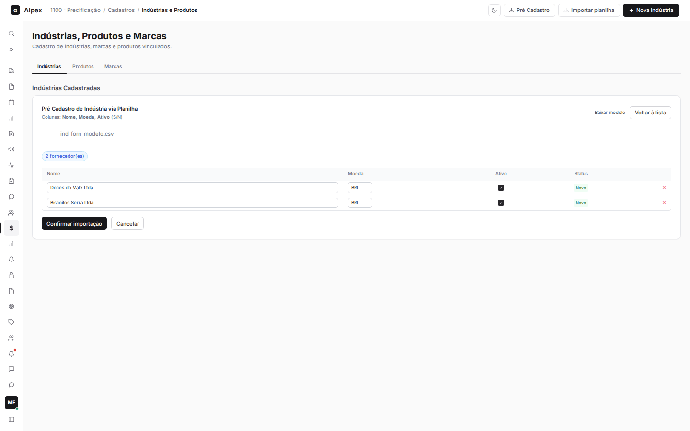
  </Step>
  <Step title="Confirmar">
    Clique em **Confirmar importação**. O aviso final informa quantas foram criadas e quantas já existiam. **Cancelar** descarta tudo.
  </Step>
</Steps>
