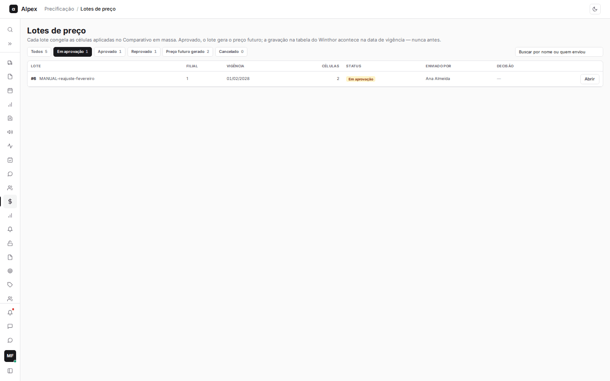
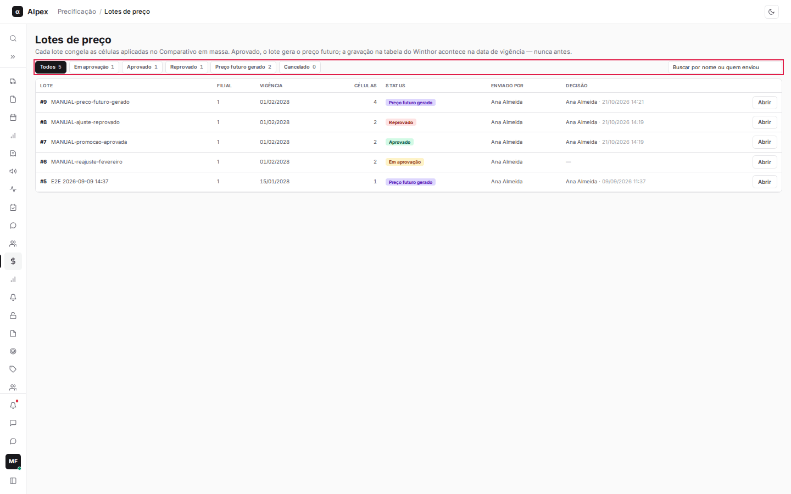
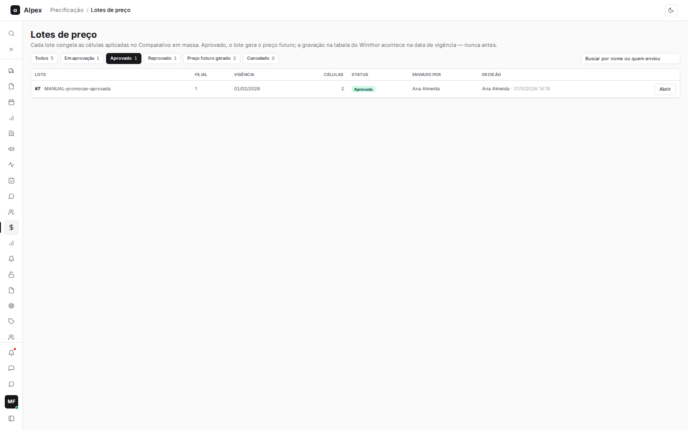
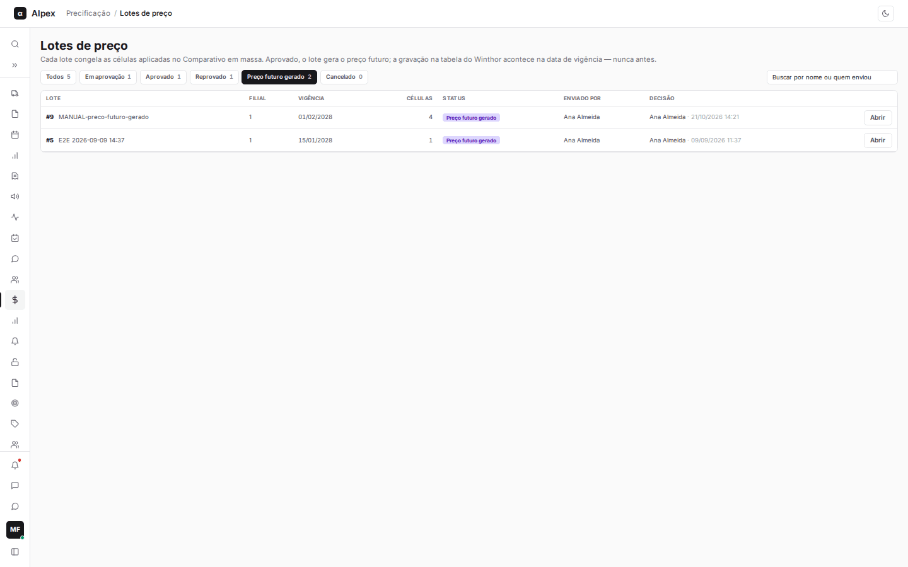
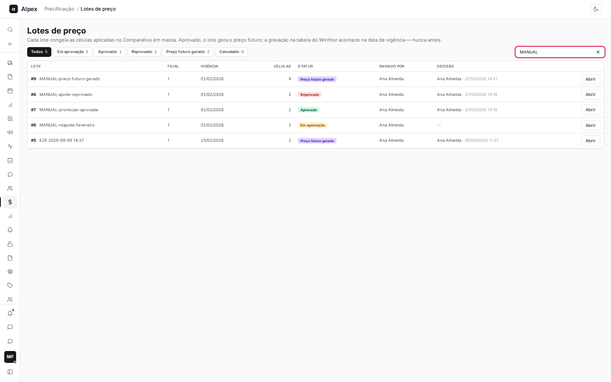
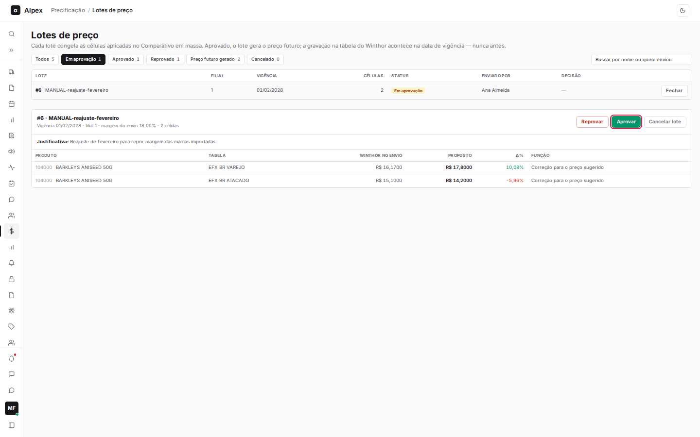
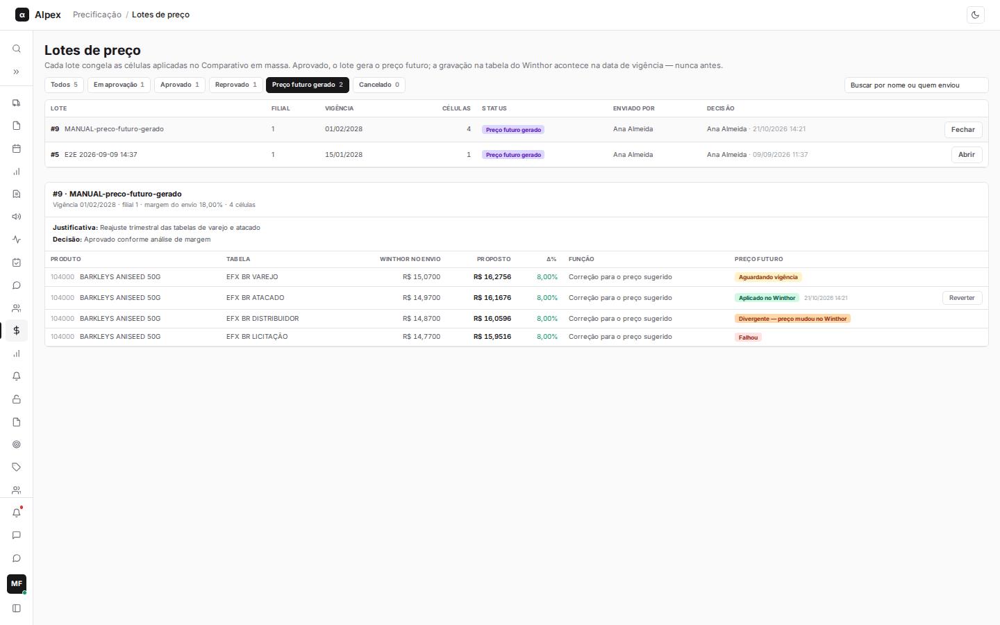
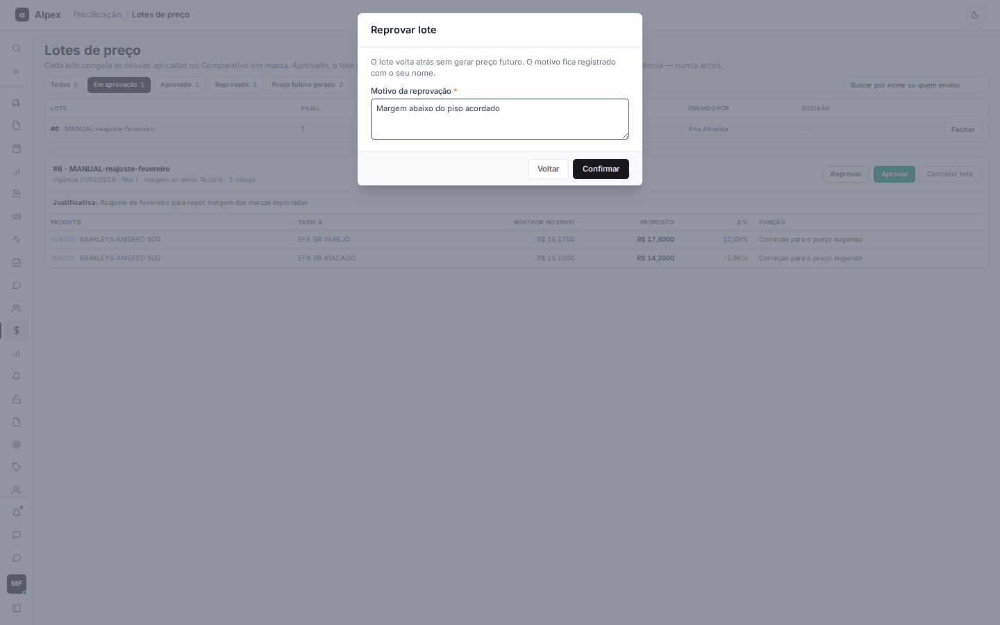
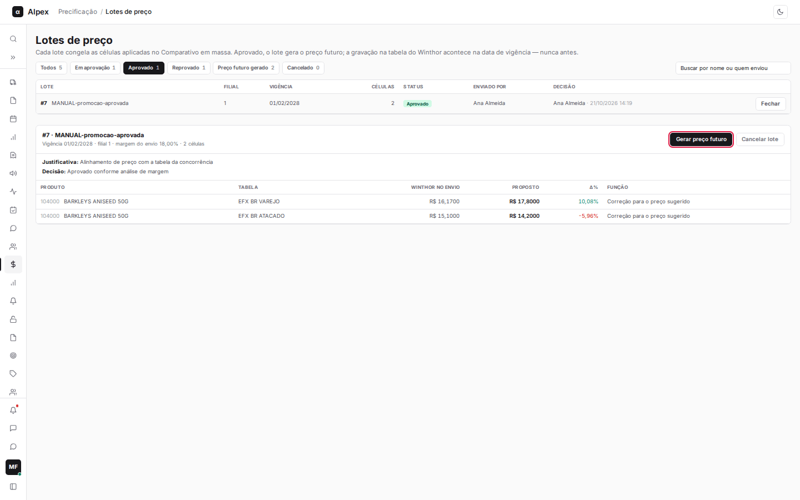
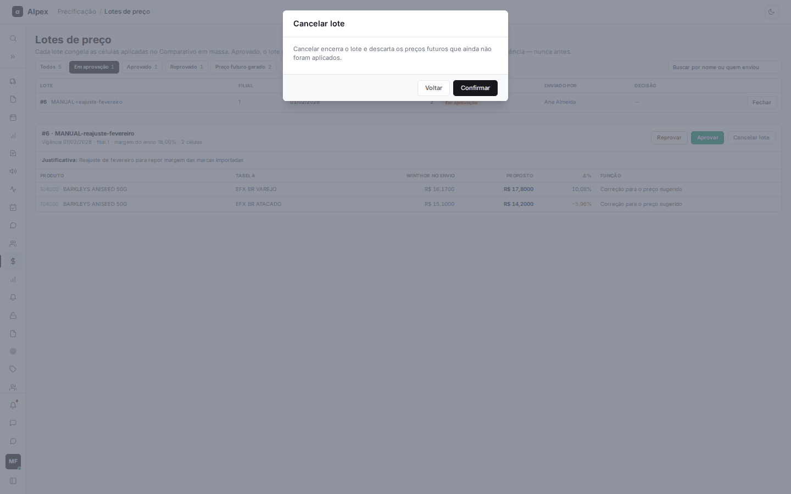

**Menu:** 1111 - Lotes de preço

Tela para acompanhar e decidir os lotes de preço enviados pelo Comparativo em massa. Quem envia acompanha o andamento; quem tem permissão de aprovação aprova, reprova ou reverte.

**Ciclo de vida de um lote**

1. **Em aprovação**: o lote foi enviado pelo Comparativo em massa, com os preços congelados e uma data de vigência. Ninguém mexe no ERP.
2. **Aprovado** ou **Reprovado**: quem tem permissão decide. Reprovado termina aqui, sem gerar preço.
3. **Preço futuro gerado**: o lote aprovado entra na fila. Cada item fica **Aguardando vigência**.
4. **Na data de vigência**: uma rotina automática, que roda uma vez por dia de manhã, grava o preço na tabela do ERP e o item passa a **Aplicado no Winthor**. Nunca antes da vigência.
5. **Cancelado**: o lote foi encerrado antes de gerar preço futuro.

Se o preço vigente no ERP mudou depois da aprovação, o item vira **Divergente — preço mudou no Winthor** e não é gravado. Se a gravação falhar, o item fica **Falhou**. Um lote novo para a mesma célula substitui o preço futuro pendente de outro lote.

## Filtrar por status e buscar

<Steps>
  <Step title="Filtrar por status">
    Na linha de botões, escolha **Todos**, **Em aprovação**, **Aprovado**, **Reprovado**, **Preço futuro gerado** ou **Cancelado**. O número ao lado é a quantidade de lotes naquele status. A tela abre em **Em aprovação**.

    

    

    
  </Step>
  <Step title="Buscar">
    No campo **Buscar por nome ou quem enviou**, digite parte do nome do lote ou de quem o enviou. A lista filtra enquanto você digita e respeita o status escolhido. A lista mostra 15 lotes por página.

    
  </Step>
</Steps>

<Note>
A lista mostra **Lote**, **Filial**, **Vigência**, **Células** (preços do lote), **Status**, **Enviado por** e **Decisão** (quem decidiu e quando).
</Note>

## Abrir um lote e ler o detalhe

<Steps>
  <Step title="Abrir">
    Na linha do lote, clique em **Abrir**. O detalhe aparece abaixo da lista. Clique em **Fechar** na mesma linha para recolher.

    
  </Step>
  <Step title="Ler o cabeçalho">
    O cabeçalho mostra número, nome, vigência, filial, a margem usada no envio e a quantidade de células. Abaixo ficam a **Justificativa** do envio e, se houver, a **Decisão** (a observação de quem aprovou ou reprovou).
  </Step>
  <Step title="Ler a tabela de itens">
    Cada linha é um produto em uma tabela de preço: **Produto**, **Tabela**, **Winthor no envio** (preço do ERP no momento do envio), **Proposto**, **Δ%** (variação do proposto sobre o preço do ERP, verde para alta e vermelho para queda) e **Função** (a regra usada ao aplicar).
  </Step>
  <Step title="Acompanhar o preço futuro">
    Depois que o lote gera preço futuro, aparece a coluna **Preço futuro** com a situação de cada item (**Aguardando vigência**, **Aplicado no Winthor** com a data, **Divergente — preço mudou no Winthor**, **Falhou**, **Cancelado** ou **Revertido**). Passe o mouse sobre a situação para ver o motivo.

    
  </Step>
</Steps>

## Aprovar ou reprovar um lote

<Steps>
  <Step title="Abrir o lote em aprovação">
    Filtre por **Em aprovação** e clique em **Abrir** no lote. Os botões **Reprovar** e **Aprovar** aparecem no cabeçalho do detalhe. Quem não tem o controle de aprovação vê o aviso "Aguardando aprovação" no lugar dos botões.
  </Step>
  <Step title="Aprovar">
    Clique em **Aprovar**. A janela **Aprovar lote** explica que a aprovação libera o lote para gerar preço futuro e que o ERP só recebe o preço na vigência. Escreva uma **Observação (opcional)** e clique em **Confirmar**. **Voltar** desiste.

    
  </Step>
  <Step title="Reprovar">
    Clique em **Reprovar**. Na janela **Reprovar lote**, escreva o **Motivo da reprovação**, obrigatório e com pelo menos 5 caracteres, e clique em **Confirmar**. O lote não gera preço futuro e o motivo fica registrado com o seu nome.

    
  </Step>
</Steps>

<Note>
Aprovar e reprovar exigem a permissão de aprovação de lote de preço (controle 501104-1). A decisão registra seu nome e a data, e só vale para lote que ainda está em aprovação.
</Note>

## Gerar preço futuro e reverter

<Steps>
  <Step title="Gerar o preço futuro">
    Abra um lote **Aprovado** e clique em **Gerar preço futuro**. Os itens entram na fila e passam a **Aguardando vigência**. O preço só é gravado no ERP na data de vigência.

    
  </Step>
  <Step title="Reverter um item já aplicado">
    Quando um item está **Aplicado no Winthor**, aparece o botão **Reverter** na linha. Ao clicar, a tela pergunta "Reverter no Winthor?" e avisa que a tabela volta ao valor anterior à aplicação, com registro no histórico de preços. Confirme com **Sim, reverter** ou desista com **Cancelar**.
  </Step>
</Steps>

<Warning>
Reverter altera o preço no ERP e exige a mesma permissão de aprovação (controle 501104-1).
</Warning>

## Cancelar um lote

<Steps>
  <Step title="Cancelar">
    Abra um lote **Em aprovação** ou **Aprovado** e clique em **Cancelar lote**. A janela **Cancelar lote** explica que o cancelamento encerra o lote e descarta os preços futuros que ainda não foram aplicados. Clique em **Confirmar** para cancelar ou em **Voltar** para desistir.

    
  </Step>
</Steps>

<Note>
Qualquer usuário com acesso à tela pode cancelar um lote que não esteja gerado ou cancelado. O botão não aparece em lotes com **Preço futuro gerado** nem em lotes já **Cancelados**. Para desfazer um preço já gravado no ERP, use **Reverter**.
</Note>
