**Menu:** 1102 - Cadastro NCM

Guarda as alíquotas de cada NCM (classificação fiscal do produto), por UF de origem e por empresa (**EFX** ou **Alpha**). É a base de impostos usada para formar o preço. Quem mantém é a equipe fiscal ou de precificação.

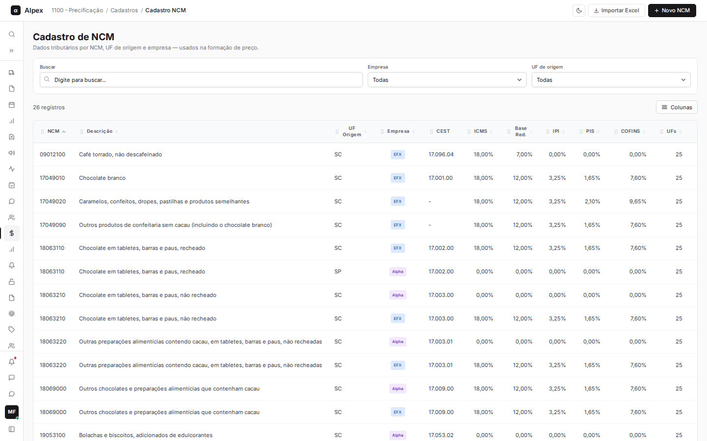

**Como esse cadastro é usado nos cálculos**

- **Calculadora:** para um produto identificado pelo NCM, ela busca aqui os impostos de compra (ICMS, base reduzida, MVA, IPI, PIS e COFINS) e os impostos de venda da UF de destino escolhida. Se o NCM não estiver cadastrado para a UF de origem e a empresa, a Calculadora avisa que os impostos não foram encontrados e pede o cadastro antes de calcular. As alíquotas de importação (II, IPI, PIS, COFINS e ICMS de importação) também saem daqui.
- **Comparativo em massa:** os produtos vêm do Winthor, e os impostos de compra e de venda vêm da figura fiscal do próprio Winthor. Do cadastro de NCM, o Comparativo aproveita apenas as alíquotas de importação (veja as dúvidas no fim do relatório).
- Os campos de **Reforma tributária** (IBS, CBS e códigos) são só informativos: ainda não entram no cálculo.

## Buscar, filtrar, ordenar e escolher colunas

<Steps>
  <Step title="Buscar">
    No campo **Buscar**, digite parte do NCM ou da descrição. A lista se atualiza sozinha.

    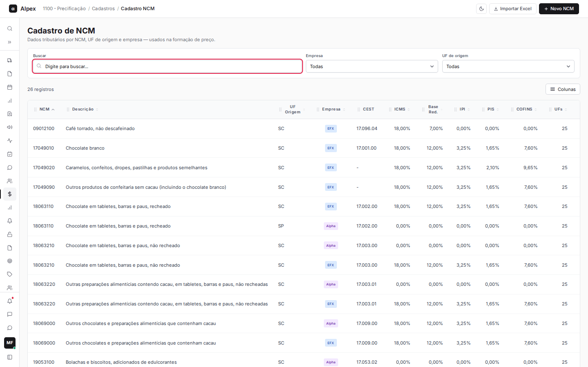
  </Step>
  <Step title="Filtrar por empresa e UF">
    Use os filtros **Empresa** e **UF de origem**. Eles combinam com a busca. Para voltar à lista completa, clique em **Limpar filtros**.

    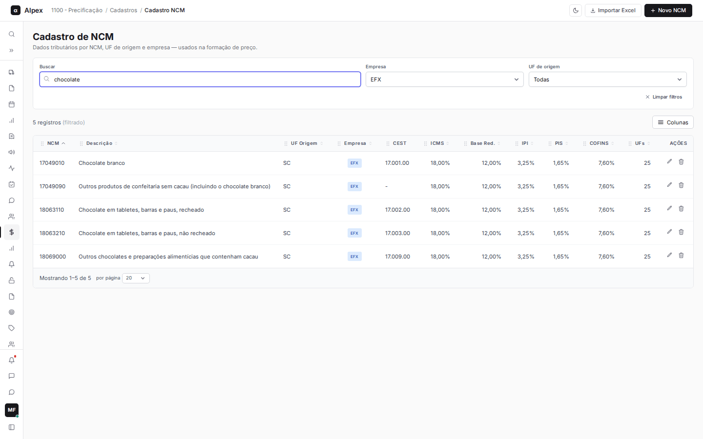
  </Step>
  <Step title="Ordenar">
    Clique no título de uma coluna (por exemplo **NCM**, **ICMS** ou **UFs**) para ordenar. Clique de novo para inverter a ordem.
  </Step>
  <Step title="Escolher colunas">
    Clique em **Colunas** e marque ou desmarque o que quer ver. **Resetar** devolve a seleção original. A coluna **NCM** é fixa.

    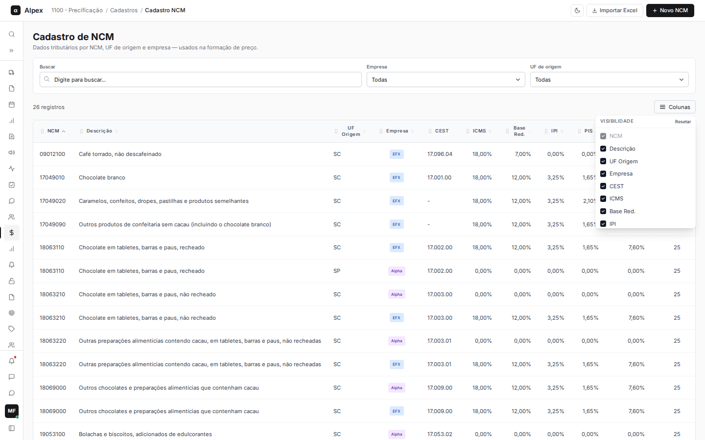
  </Step>
  <Step title="Paginar">
    No rodapé da lista, escolha quantos registros mostrar **por página** e navegue entre as páginas.
  </Step>
</Steps>

<Note>
A coluna **UFs** mostra para quantas UFs de destino já existem impostos de venda cadastrados para aquele NCM.
</Note>

## Cadastrar um NCM

<Steps>
  <Step title="Abrir o formulário">
    No canto superior direito, clique em **Novo NCM**.

    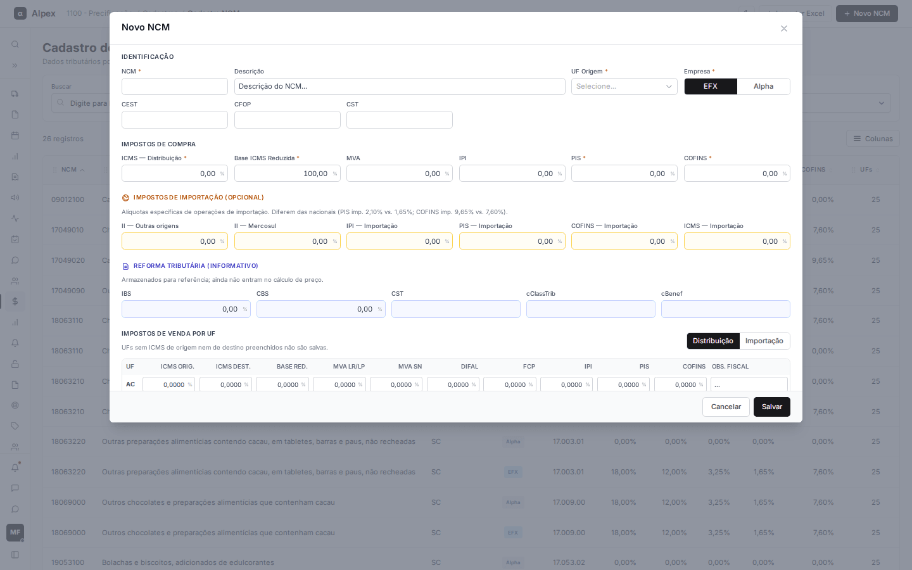
  </Step>
  <Step title="Preencher a identificação">
    Informe o **NCM**, a **Descrição**, a **UF Origem** (escolha na lista, que tem busca) e a **Empresa** (**EFX** ou **Alpha**). **CEST**, **CFOP** e **CST** são opcionais.
  </Step>
  <Step title="Preencher os impostos de compra">
    Em **Impostos de compra**, preencha **ICMS — Distribuição**, **Base ICMS Reduzida**, **PIS** e **COFINS** (obrigatórios) e, se houver, **MVA** e **IPI**. Os campos de percentual preenchem da direita para a esquerda: digite apenas os números (1200 vira 12,00).

    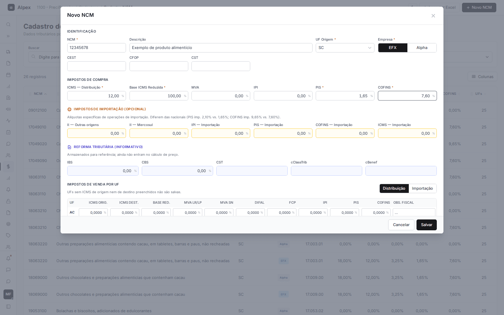
  </Step>
  <Step title="Preencher importação e reforma tributária (opcional)">
    **Impostos de importação** (II, IPI, PIS, COFINS e ICMS de importação) só precisam ser preenchidos para produtos importados. **Reforma tributária** é apenas informativa.
  </Step>
  <Step title="Preencher os impostos de venda por UF">
    Em **Impostos de venda por UF**, há uma linha para cada UF de destino. Alterne entre **Distribuição** e **Importação** para preencher cada conjunto de colunas: **ICMS Orig.**, **ICMS Dest.**, **Base Red.**, **MVA LR/LP**, **MVA SN**, **DIFAL**, **FCP**, **IPI**, **PIS**, **COFINS** e **Obs. fiscal**.

    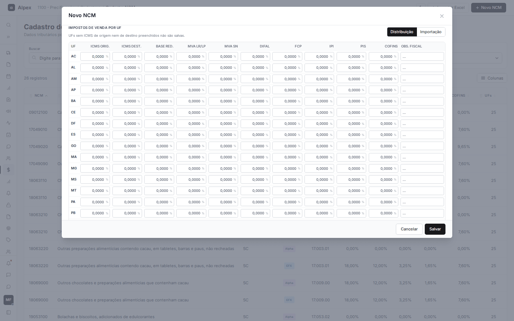

    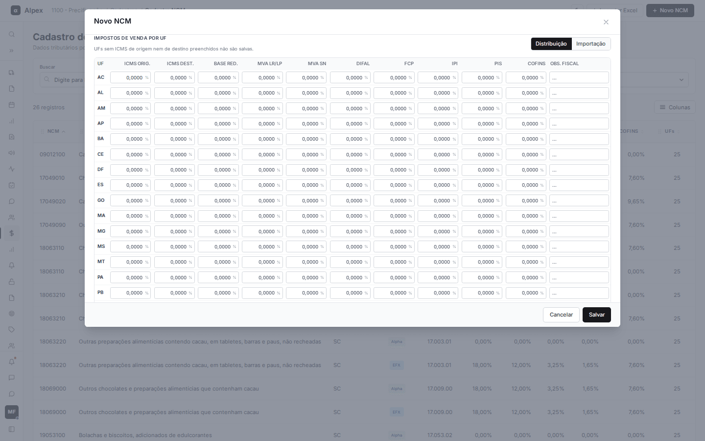
  </Step>
  <Step title="Salvar">
    Clique em **Salvar**. **Cancelar** (ou o X) fecha sem gravar.
  </Step>
</Steps>

<Note>
Obrigatórios: **NCM**, **UF Origem**, **Empresa**, **ICMS — Distribuição**, **Base ICMS Reduzida**, **PIS** e **COFINS**. UFs de destino sem ICMS de origem nem ICMS de destino preenchidos não são salvas. Cada combinação de NCM, UF de origem e empresa só pode existir uma vez.
</Note>

## Editar um NCM

<Steps>
  <Step title="Abrir o registro">
    Clique na linha do NCM ou no ícone de lápis (**Editar**) na coluna de ações.
  </Step>
  <Step title="Ajustar os valores">
    O formulário abre com os dados atuais. O **NCM**, a **UF Origem** e a **Empresa** não podem ser alterados (para mudar, cadastre um novo registro). O título mostra a UF de origem e a empresa.

    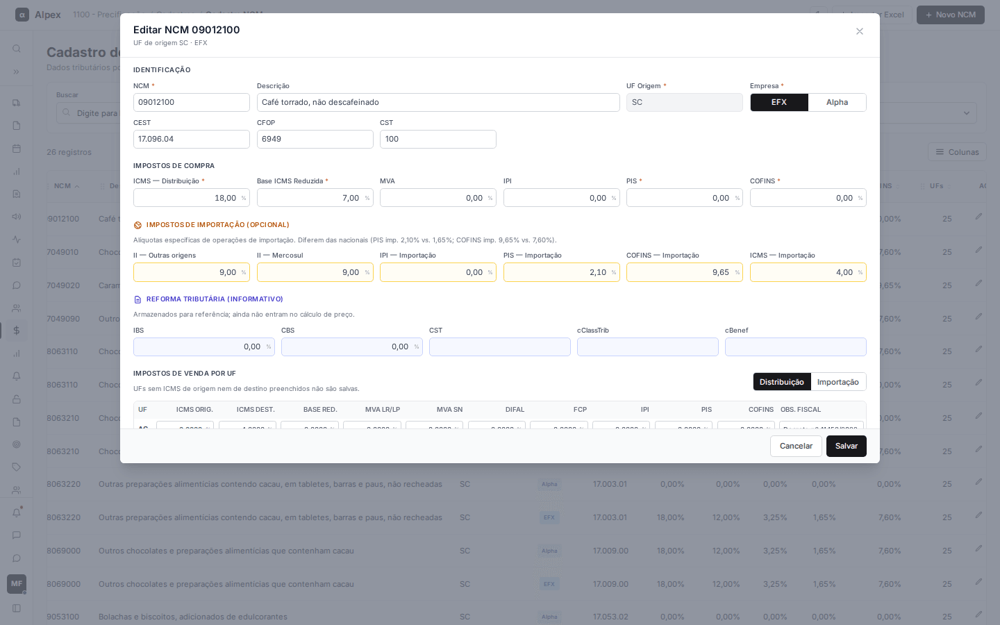
  </Step>
  <Step title="Salvar">
    Clique em **Salvar**. A mudança vale para os próximos cálculos.
  </Step>
</Steps>

## Excluir um NCM

<Steps>
  <Step title="Pedir a exclusão">
    Na linha do NCM, clique no ícone de lixeira (**Excluir**).
  </Step>
  <Step title="Conferir a confirmação">
    Aparece o aviso "Excluir NCM ... e todos os dados de venda?". Para desistir, clique em **Cancelar**.

    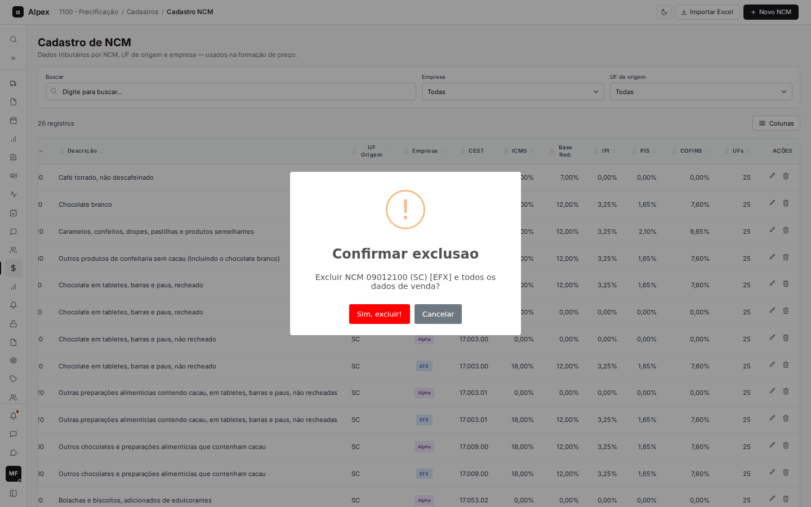
  </Step>
  <Step title="Confirmar">
    **Sim, excluir!** remove o NCM daquela UF de origem e empresa, junto com todas as UFs de venda dele.
  </Step>
</Steps>

<Warning>
A exclusão é definitiva. Depois dela, a Calculadora deixa de achar os impostos desse NCM até que ele seja cadastrado de novo.
</Warning>

## Importar NCMs de uma planilha Excel

<Steps>
  <Step title="Abrir a importação">
    Clique em **Importar Excel**.

    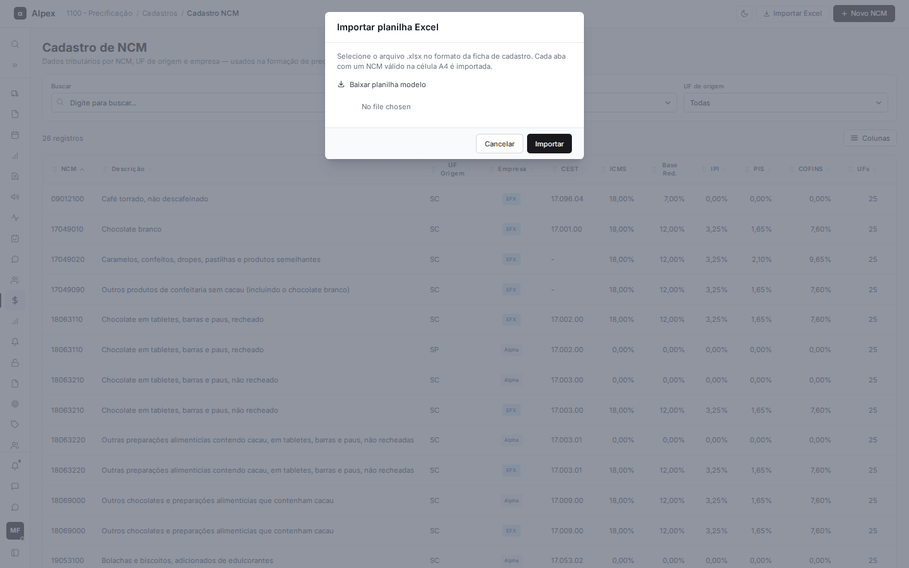
  </Step>
  <Step title="Baixar o modelo">
    Clique em **Baixar planilha modelo** e preencha a ficha de cadastro. Cada aba da planilha com um NCM válido na célula A4 é importada.
  </Step>
  <Step title="Enviar o arquivo">
    Escolha o arquivo (.xlsx ou .xls, até 5 MB) e clique em **Importar**. Ao terminar, aparece um aviso com o resultado.
  </Step>
</Steps>

<Note>
NCMs que já existem para a mesma UF de origem e empresa são atualizados pela planilha.
</Note>
