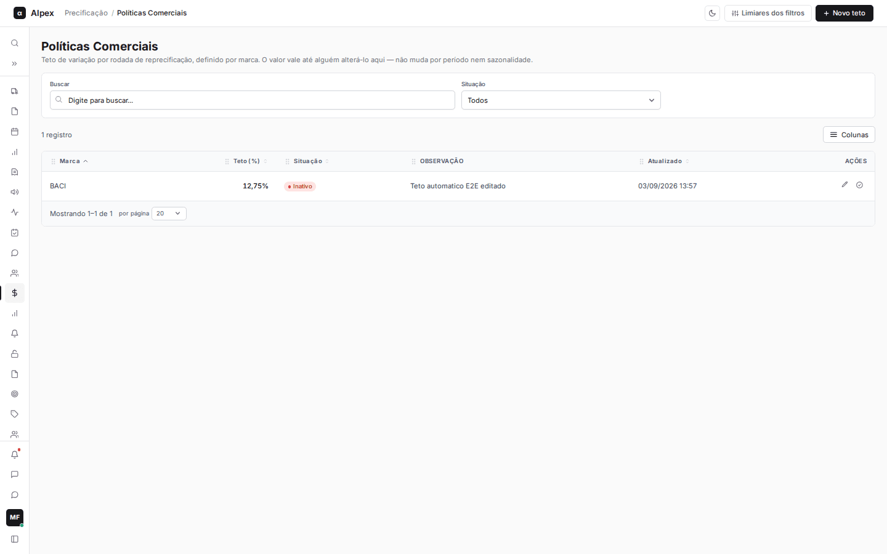
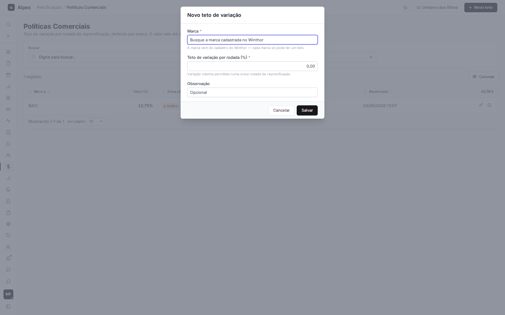
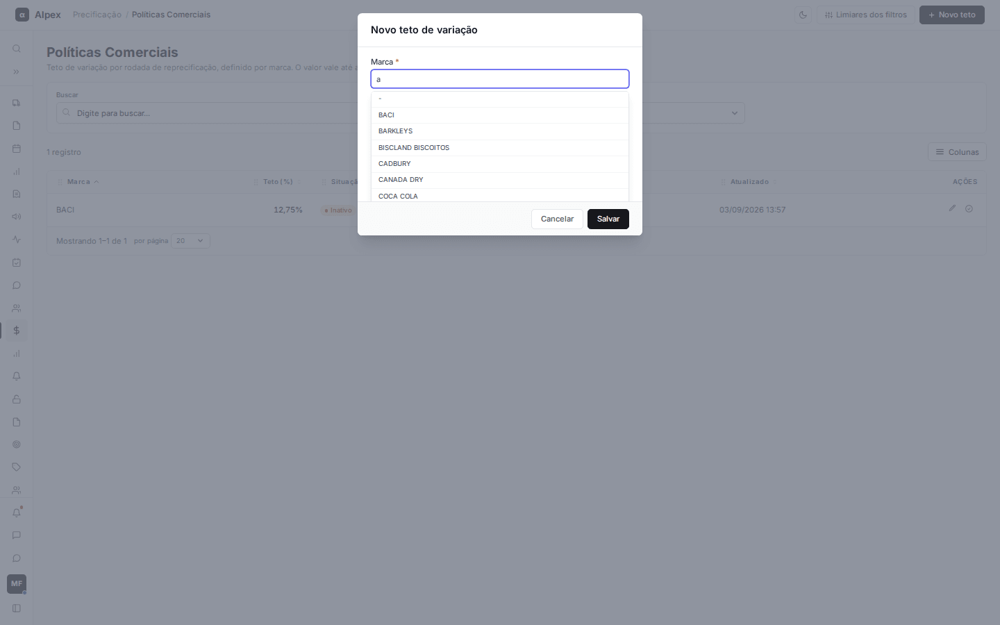
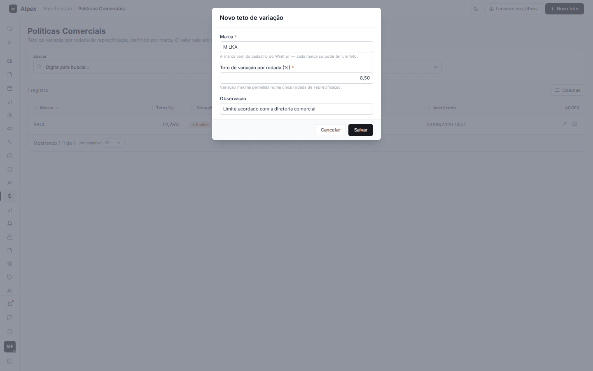
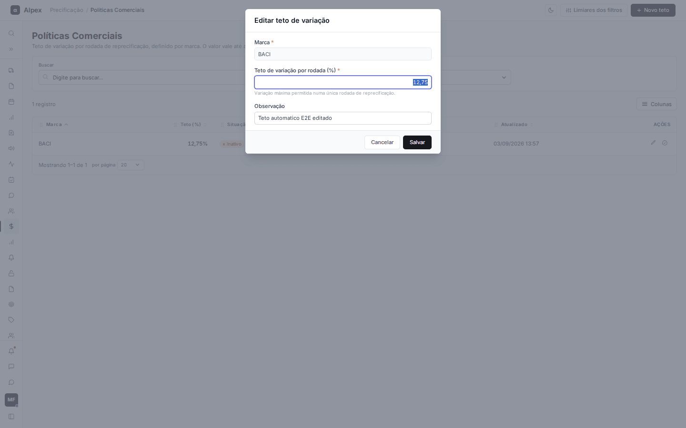
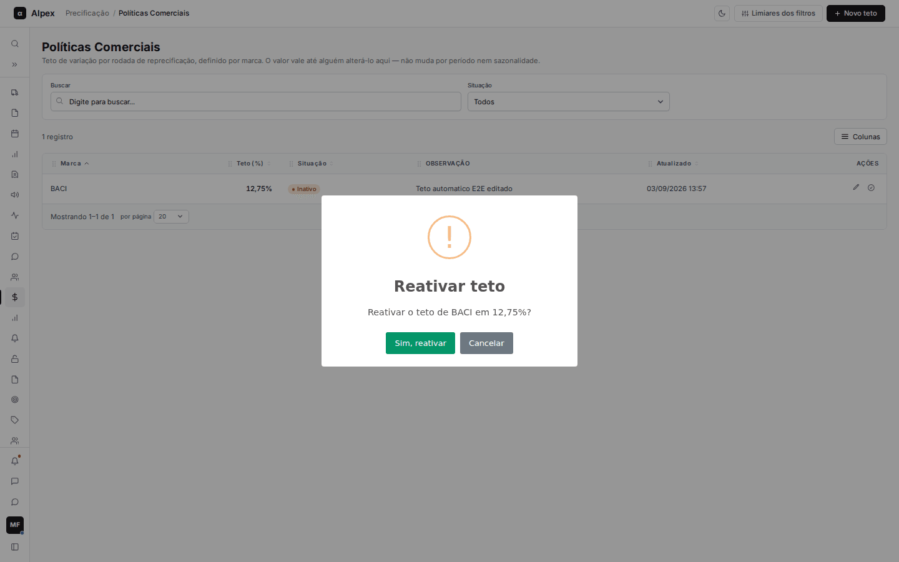
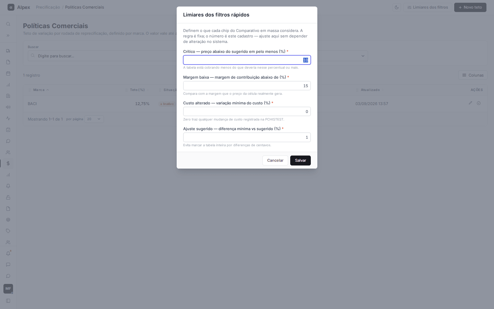

**Menu:** 1110 - Políticas Comerciais

Define as regras comerciais que orientam a reprecificação: o teto de variação de preço por marca e os limites usados pelos filtros rápidos do Comparativo em massa. Em geral é mantida por gestores comerciais.

**Como esse cadastro é usado nos cálculos**

- **Teto por marca:** é a variação máxima permitida para o preço da marca numa única rodada de reprecificação. Ele é consultado pela função **Teto de variação por rodada**, do menu **Aplicar** do Comparativo em massa. Hoje essa função aparece no menu como "Em definição" e ainda não executa, então o teto fica cadastrado, mas sem efeito no preço.
- **Limiares dos filtros:** definem o que cada chip do Comparativo em massa considera (**Críticos**, **Margem baixa**, **Custo alterado** e **Ajuste sugerido**). Valem imediatamente depois de salvar.

## Cadastrar um teto de variação

<Steps>
  <Step title="Abrir o formulário">
    Clique em **Novo teto**.

    
  </Step>
  <Step title="Escolher a marca">
    Em **Marca**, digite parte do nome e escolha na lista. As marcas vêm do cadastro do Winthor; não é possível digitar uma marca que não esteja lá.

    
  </Step>
  <Step title="Informar o teto e a observação">
    Em **Teto de variação por rodada (%)**, informe o percentual (de 0 a 999,99; vírgula ou ponto). **Observação** é opcional.

    
  </Step>
  <Step title="Salvar">
    Clique em **Salvar**. O teto nasce ativo.
  </Step>
</Steps>

<Note>
Cada marca só pode ter um teto. Se já existir, aparece "Esta marca já tem teto cadastrado — edite o registro existente."
</Note>

## Editar um teto

<Steps>
  <Step title="Abrir a edição">
    Na linha da marca, clique no lápis (**Editar teto**).
  </Step>
  <Step title="Ajustar e salvar">
    A **Marca** não muda (é a identidade do registro). Altere o teto ou a observação e clique em **Salvar**.

    
  </Step>
</Steps>

## Desativar ou reativar um teto

<Steps>
  <Step title="Pedir a mudança de situação">
    Na linha da marca, clique no ícone de situação: **Desativar teto** (quando ativo) ou **Reativar teto** (quando inativo).
  </Step>
  <Step title="Confirmar">
    A confirmação explica o efeito. Ao desativar, a marca deixa de ter limite de variação por rodada até alguém reativar; ao reativar, o teto volta com o percentual cadastrado. Clique em **Sim, desativar** ou **Sim, reativar**, ou em **Cancelar**.

    
  </Step>
</Steps>

<Note>
Não existe exclusão: um teto só pode ser desativado. Assim o histórico de quem alterou fica preservado. O filtro **Situação** da lista separa ativos e inativos.
</Note>

## Ajustar os limiares dos filtros rápidos

<Steps>
  <Step title="Abrir os limiares">
    Clique em **Limiares dos filtros**.

    
  </Step>
  <Step title="Ajustar os percentuais">
    Os quatro campos são obrigatórios: **Crítico** (preço abaixo do sugerido em pelo menos X%), **Margem baixa** (margem de contribuição abaixo de X%), **Custo alterado** (variação mínima do custo; zero traz qualquer mudança registrada) e **Ajuste sugerido** (diferença mínima em relação ao sugerido, para não marcar a tabela por diferença de centavos). Os valores iniciais são 10, 15, 0 e 1.
  </Step>
  <Step title="Salvar">
    Clique em **Salvar**. A mensagem "Os chips do Comparativo em massa já usam os novos valores" confirma a mudança.
  </Step>
</Steps>

## Buscar, filtrar, ordenar e escolher colunas

<Steps>
  <Step title="Usar os controles da lista">
    Use **Buscar** e o filtro **Situação** para achar marcas. Clique nos títulos (**Marca**, **Teto (%)**, **Situação**, **Atualizado**) para ordenar, abra **Colunas** para ocultar colunas e use **por página** no rodapé.
  </Step>
</Steps>
