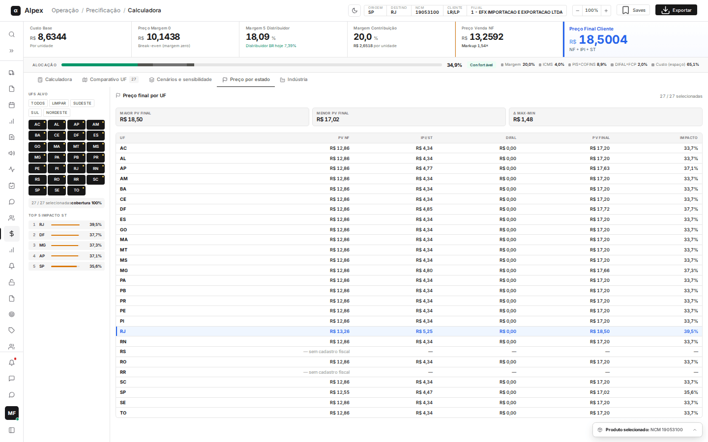
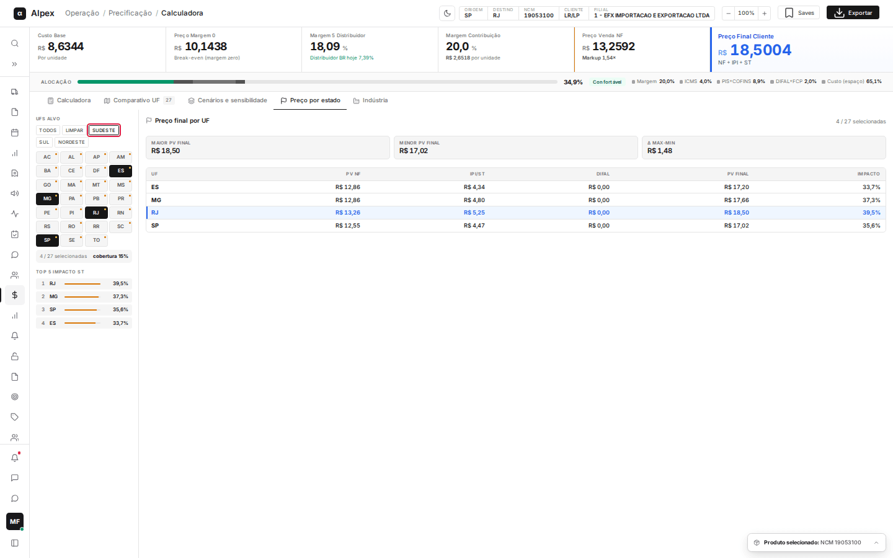
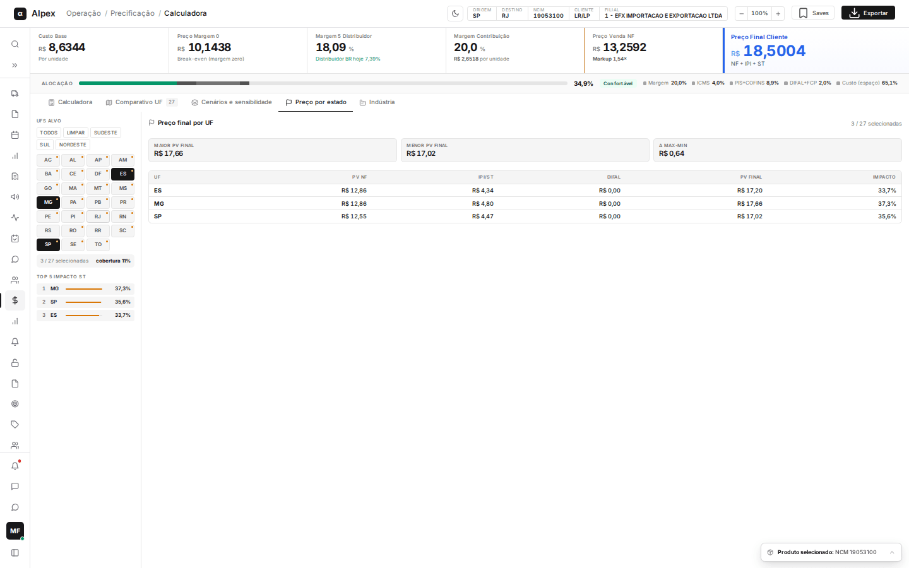

**Menu:** 1101 - Calculadora V2, aba Preço por estado

A aba **Preço por estado** mostra o preço final por UF do produto selecionado e destaca onde os impostos por fora (IPI e ST) mais encarecem a venda. Você escolhe quais estados quer ver.

É preciso ter produtos calculados na aba **Calculadora** (veja a página "Calculadora").

## Ler o preço final por UF

<Steps>
  <Step title="Ver os cartões do topo">
    Os três cartões mostram, entre os estados selecionados: **Maior PV final**, **Menor PV final** e **Δ max-min** (a diferença entre os dois). No canto direito, o texto **27 / 27 selecionadas** informa quantos estados estão sendo exibidos.
  </Step>
  <Step title="Ler a tabela">
    As colunas da tabela são:
    - **UF**: estado de destino.
    - **PV NF**: preço de venda na nota fiscal.
    - **IPI/ST**: soma do IPI e da substituição tributária cobrados por fora.
    - **DIFAL**: diferença de alíquota de ICMS, quando existe.
    - **PV Final**: preço final que o cliente paga.
    - **Impacto**: quanto, em porcentagem, o PV Final fica acima do PV NF.

    A linha em azul é o estado de destino definido na Calculadora.
  </Step>
  <Step title="Entender o aviso de cadastro">
    Estados com **— sem cadastro fiscal** não têm os impostos desse produto cadastrados, por isso não há preço calculado para eles.
  </Step>
  <Step title="Ver o ranking">
    Em **Top 5 impacto ST**, na coluna da esquerda, aparecem os cinco estados em que o preço final mais sobe sobre o PV NF, com a barra proporcional ao percentual.
  </Step>
</Steps>

<Note>
Os pontos laranja no canto dos botões de estado indicam UFs em que há ST. Esta aba só lê o cálculo; nada é gravado.
</Note>

## Escolher as UFs que aparecem

<Steps>
  <Step title="Usar um atalho por região">
    Em **UFs alvo**, clique em **Todos**, **Limpar**, **Sudeste**, **Sul** ou **Nordeste** para selecionar de uma vez. **Todos** liga os 27 estados e **Limpar** desmarca todos.

    
  </Step>
  <Step title="Marcar ou desmarcar um estado">
    Clique no botão de uma UF para incluí-la ou retirá-la. Os estados selecionados ficam em preto. O quadro cinza abaixo mostra **N / 27 selecionadas** e a **cobertura** em porcentagem.

    
  </Step>
</Steps>

<Note>
Com todos os estados selecionados, o primeiro clique em uma UF a retira e mantém as outras 26. Os cartões do topo, a tabela e o ranking passam a considerar só os estados selecionados. Não existe atalho para Norte nem Centro-Oeste: escolha esses estados um a um.
</Note>
