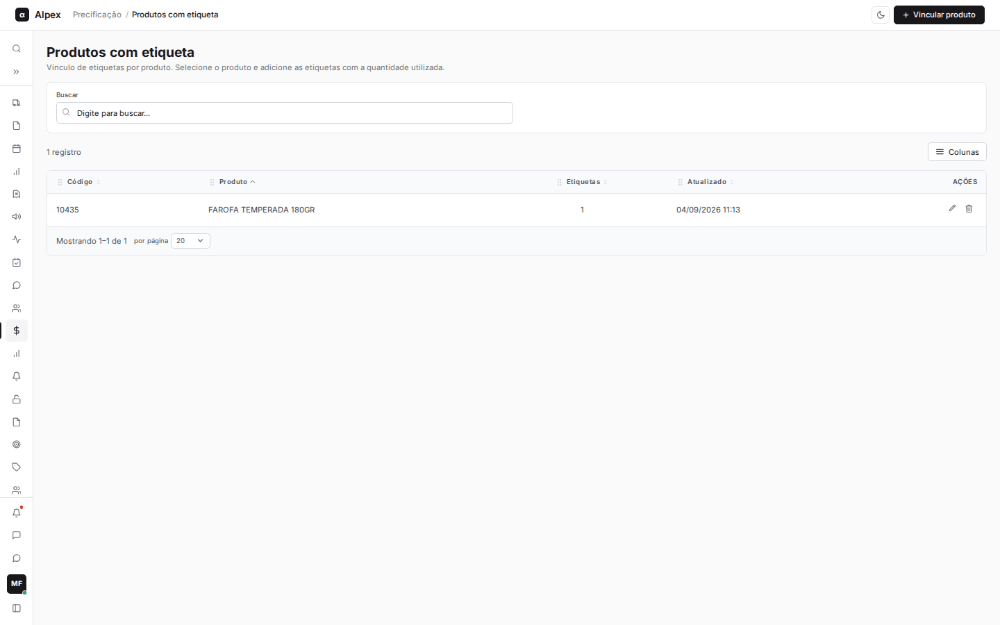
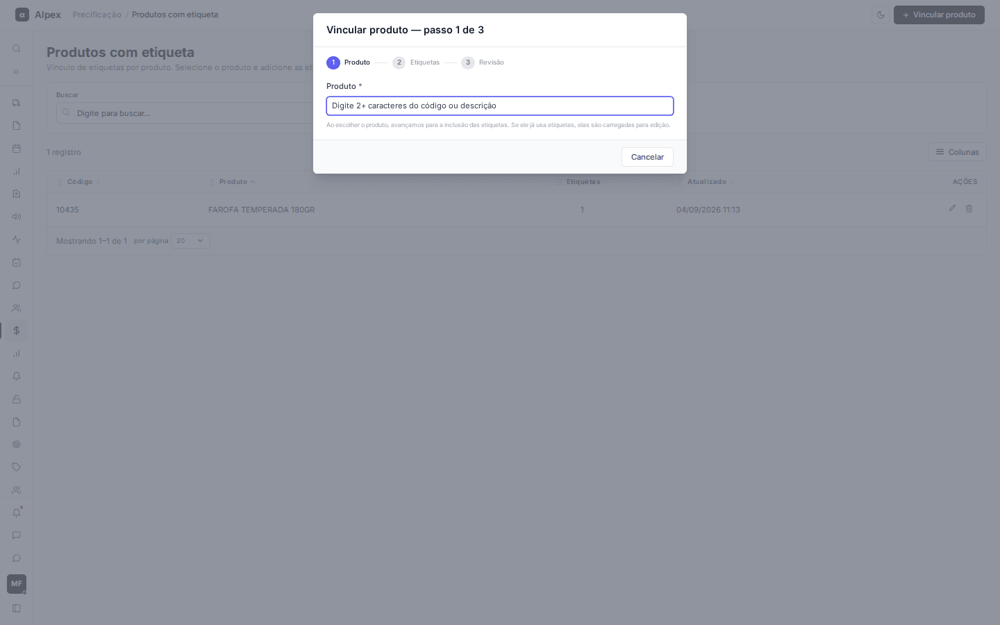
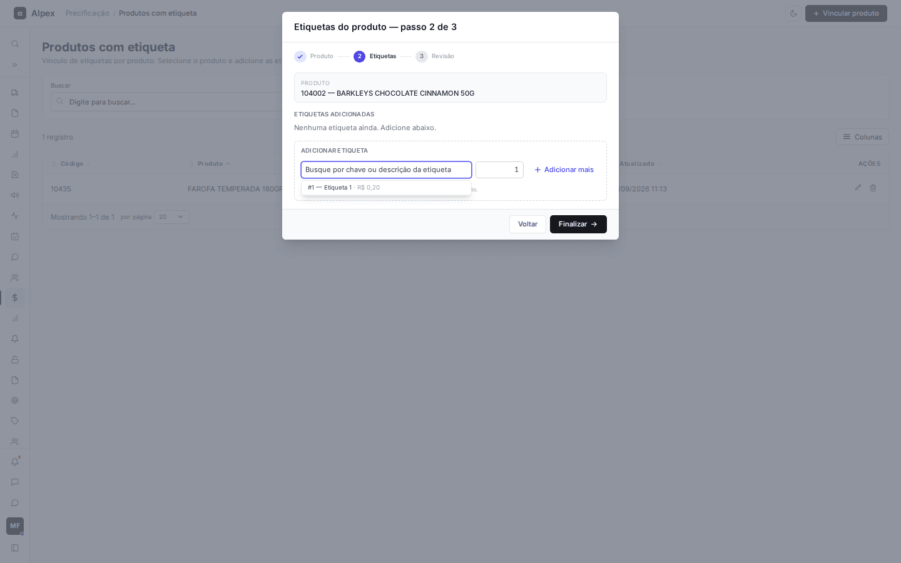
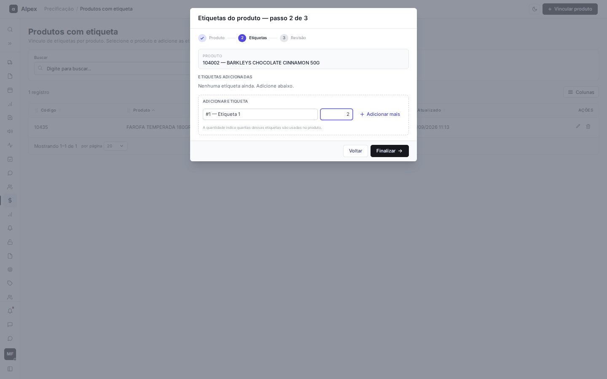
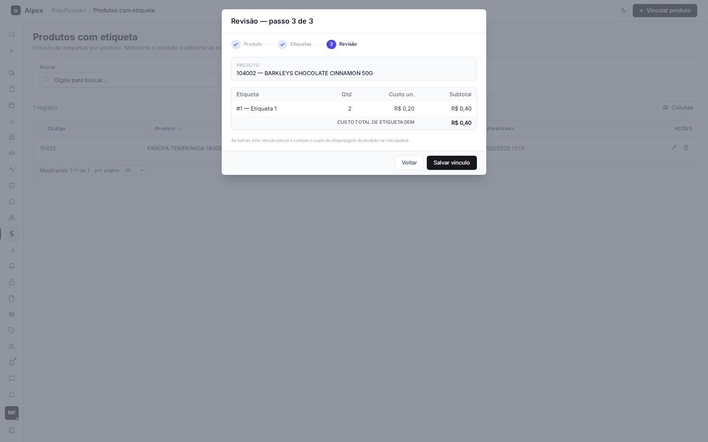
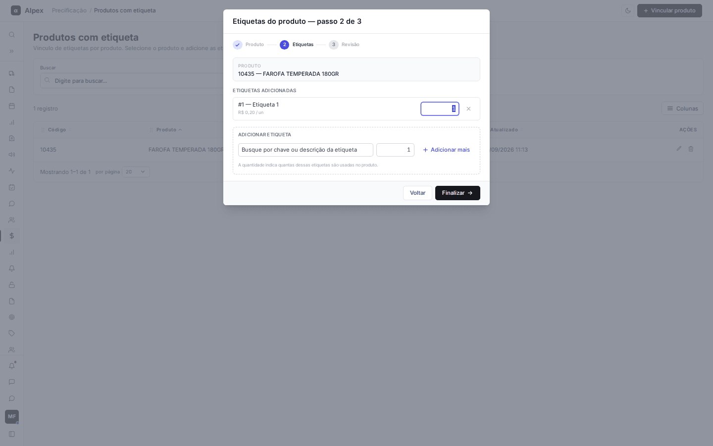
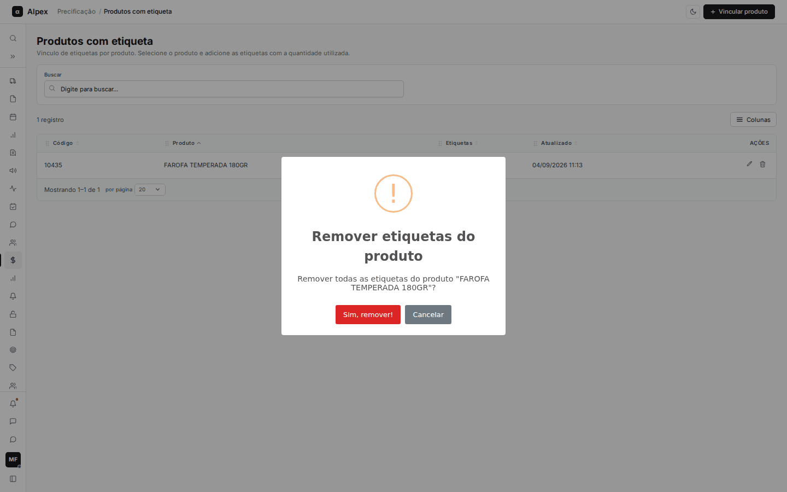

**Menu:** 1109 - Produtos com etiqueta

Mostra, produto a produto, quais etiquetas são usadas e em que quantidade. É daqui que o custo de etiquetagem de cada produto sai para a Calculadora.

**Como esse cadastro é usado nos cálculos**

- **Calculadora:** com **Usar custo de etiquetagem** em **Sim**, o custo de etiquetagem de um produto do Winthor etiquetável é a soma de (quantidade vezes custo unitário) de cada etiqueta do vínculo. Esse valor entra no custo base, antes do ICMS-ST.
- **Comparativo em massa:** o código da tela não consulta este vínculo (veja as dúvidas no fim do relatório).

A lista mostra apenas produtos que já têm etiqueta e aceita busca por código ou descrição, ordenação, **Colunas** e paginação.

## Vincular etiquetas a um produto

<Steps>
  <Step title="Iniciar o assistente">
    Clique em **Vincular produto**. O assistente tem 3 passos: **Produto**, **Etiquetas** e **Revisão**.

    
  </Step>
  <Step title="Escolher o produto (passo 1)">
    Digite 2 ou mais caracteres do código ou da descrição e clique no produto desejado. O assistente avança sozinho. Se o produto já tiver etiquetas, elas já vêm carregadas para edição.

    
  </Step>
  <Step title="Escolher as etiquetas (passo 2)">
    Clique no campo de etiqueta, busque pela chave ou descrição e escolha uma. O custo unitário aparece ao lado do nome.

    
  </Step>
  <Step title="Informar a quantidade">
    Informe a quantidade dessa etiqueta no produto. Para incluir outra, clique em **Adicionar mais** e repita. Etiquetas já adicionadas aparecem em **Etiquetas adicionadas**, com a quantidade editável e o **×** para remover. Depois, clique em **Finalizar**.

    
  </Step>
  <Step title="Revisar e salvar (passo 3)">
    A revisão mostra cada etiqueta com **Qtd**, **Custo un.** e **Subtotal**, e o **Custo total de etiquetagem**. Clique em **Salvar vínculo** para gravar ou em **Voltar** para ajustar.

    
  </Step>
</Steps>

<Note>
Cada etiqueta só pode aparecer uma vez por produto, e a quantidade precisa ser de pelo menos 1. É preciso ter ao menos uma etiqueta para avançar para a revisão. Ao salvar, o vínculo passa a compor o custo de etiquetagem do produto na Calculadora.
</Note>

## Editar as etiquetas de um produto

<Steps>
  <Step title="Abrir o produto">
    Na linha do produto, clique no lápis (**Editar etiquetas do produto**). O assistente abre direto no passo 2.

    
  </Step>
  <Step title="Ajustar">
    Altere a quantidade de uma etiqueta, remova com o **×** ou inclua novas, como no passo a passo anterior.
  </Step>
  <Step title="Finalizar e salvar">
    Clique em **Finalizar** e depois em **Salvar vínculo**.
  </Step>
</Steps>

## Remover todas as etiquetas de um produto

<Steps>
  <Step title="Pedir a remoção">
    Na linha do produto, clique na lixeira (**Remover todas as etiquetas do produto**).
  </Step>
  <Step title="Confirmar">
    Aparece "Remover todas as etiquetas do produto ...?". **Sim, remover!** apaga o vínculo; **Cancelar** desiste.

    
  </Step>
</Steps>

<Warning>
O produto sai da lista e deixa de ter custo de etiquetagem na Calculadora. As etiquetas em si continuam no catálogo.
</Warning>
