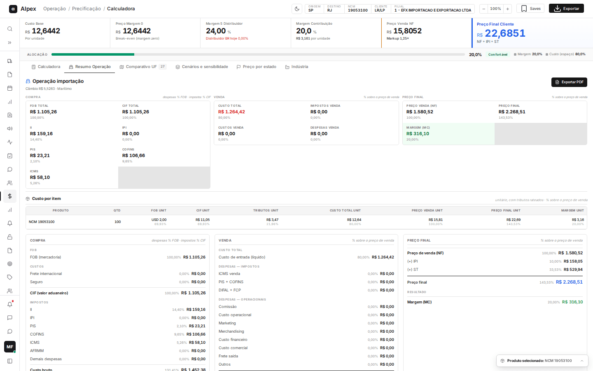
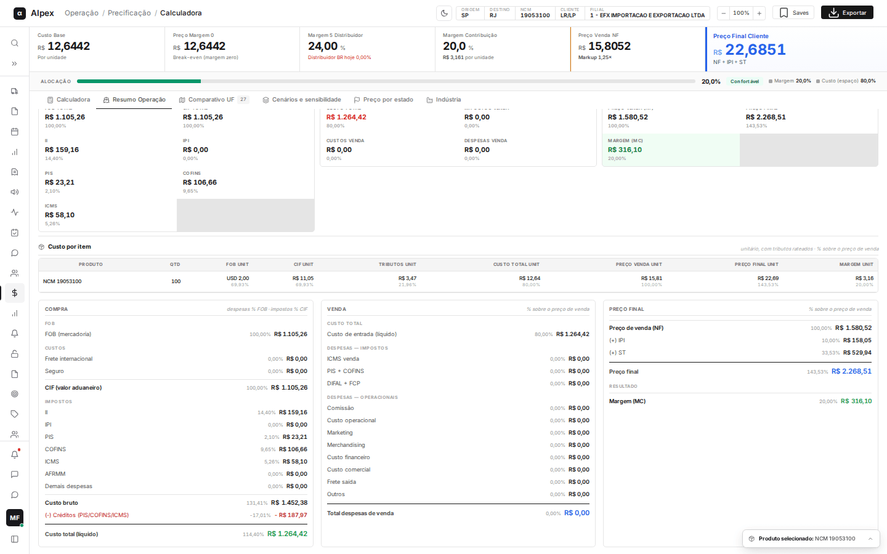
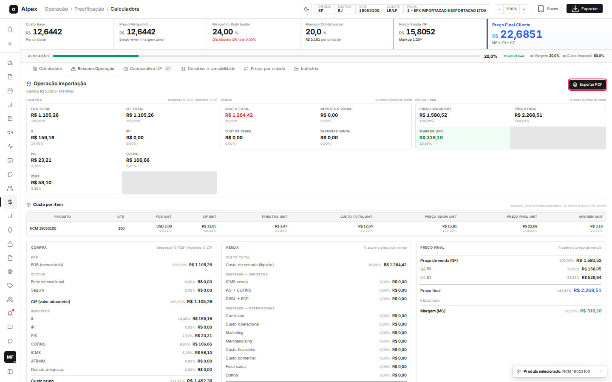

**Menu:** 1101 - Calculadora V2, aba Resumo Operação

Quando o **Tipo de Operação** da Calculadora é **Importação** (e a origem do custo é **Manual**), aparece a aba **Resumo Operação**. Ela consolida a operação inteira de compra e venda: valores FOB e CIF, impostos de importação, custo total, preço de venda, preço final e margem. É usada pela equipe de importação e pela precificação para conferir o custo de cada embarque.

Na Calculadora, escolha **Importação**, informe quantidade e valor FOB (**FOB USD**) do produto, a margem e clique em **Calcular** (veja a página "Calculadora").

## Ler o resumo da operação

<Steps>
  <Step title="Ver o título e o contexto">
    O título **Operação importação** vem com o câmbio e o modal usados (por exemplo, **Câmbio R$ 5,5263 · Marítimo**). Se houver algum problema no cadastro, aparece um aviso em amarelo logo abaixo.
  </Step>
  <Step title="Ler os três blocos do topo">
    - **COMPRA**: **FOB total**, **CIF total** (FOB mais frete e seguro), e os impostos da importação (**II**, **IPI**, **PIS**, **COFINS**, **ICMS**), cada um com o valor em reais e a porcentagem.
    - **VENDA**: **Custo total**, **Impostos venda**, **Custos venda** e **Despesas venda**, em reais e em porcentagem do preço de venda.
    - **PREÇO FINAL**: **Preço venda (NF)**, **Preço final** (com IPI e ST) e **Margem (MC)** em verde.
  </Step>
  <Step title="Ler a tabela Custo por item">
    A tabela traz, por produto, valores unitários com tributos rateados: **Produto**, **Qtd**, **FOB unit**, **CIF unit**, **Tributos unit**, **Custo total unit**, **Preço venda unit**, **Preço final unit** e **Margem unit**.

    
  </Step>
  <Step title="Conferir os três cartões de detalhe">
    Abaixo da tabela, os cartões **COMPRA**, **VENDA** e **PREÇO FINAL** abrem a conta linha a linha: FOB, custos (frete internacional, seguro), CIF, impostos, custo bruto, créditos (**(-) Créditos (PIS/COFINS/ICMS)**) e **Custo total (líquido)**, depois as despesas de venda, até o **Preço final** e a **Margem (MC)**. Valores em vermelho são deduções.
  </Step>
</Steps>

<Note>
A aba só existe em operações de importação: nas outras operações ou com o custo vindo do Winthor ela não aparece. Os percentuais de compra são sobre o FOB (despesas) ou sobre o CIF (impostos); os de venda, sobre o preço de venda.
</Note>

## Exportar o resumo em PDF

<Steps>
  <Step title="Clicar em Exportar PDF">
    No canto superior direito da aba, clique em **Exportar PDF**. Enquanto o arquivo é gerado, o botão fica desabilitado.

    
  </Step>
  <Step title="Baixar o arquivo">
    O navegador baixa um arquivo chamado **resumo-operacao-AAAAMMDD-HHMMSS.pdf**, com a data e a hora do momento.
  </Step>
</Steps>

<Note>
A exportação só lê o cálculo da tela; nada é gravado no sistema.
</Note>
