**Menu:** 1202 - Colaboradores

Cadastro das pessoas que aparecem nos registros de produção (etiquetadores, abastecedores e demais funções da fábrica). Quem mantém essa lista costuma ser o líder ou o PCP.

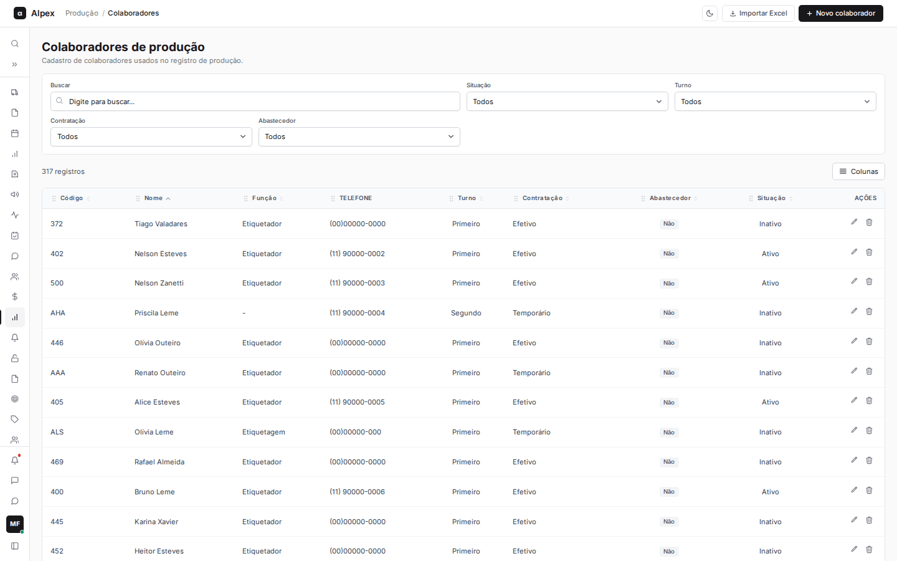

## Cadastrar um colaborador

<Steps>
  <Step title="Abrir o formulário">
    Clique em **Novo colaborador**, no canto superior direito.

    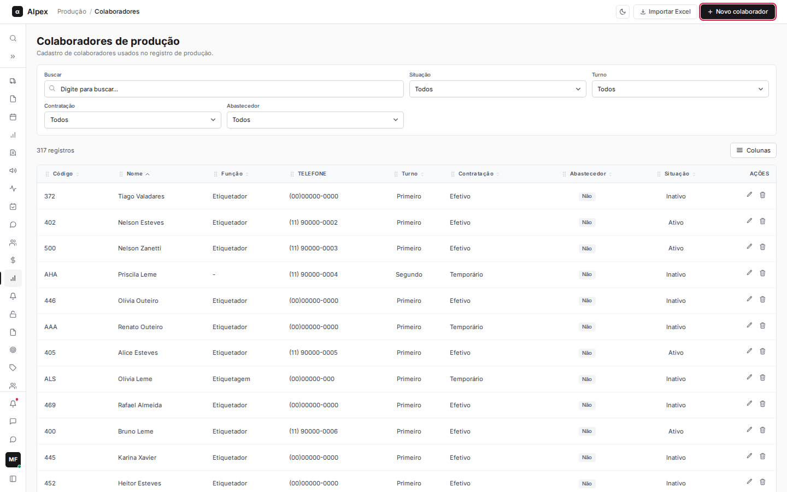
  </Step>
  <Step title="Conhecer o formulário">
    A janela **Novo colaborador** abre vazia. Os campos marcados com asterisco vermelho são obrigatórios: **Código**, **Nome** e **Situação**.

    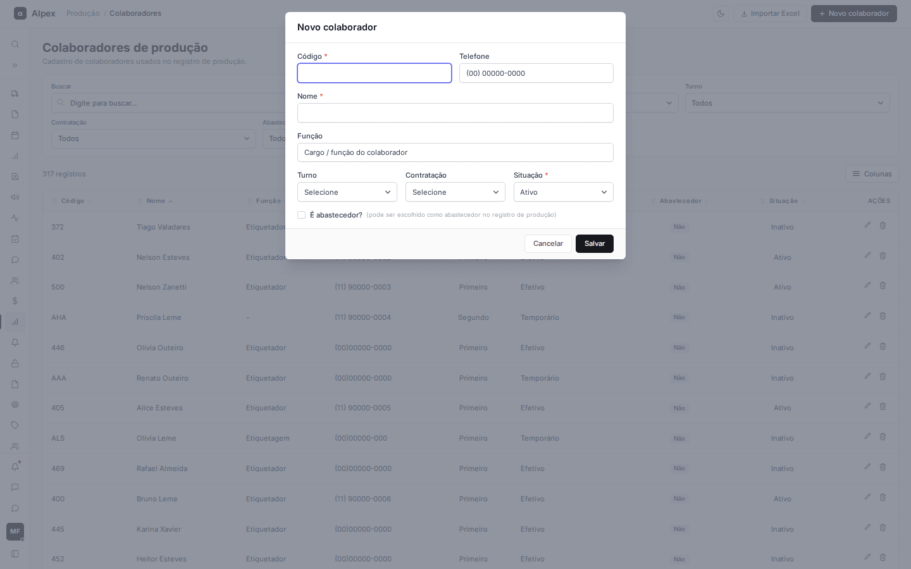
  </Step>
  <Step title="Preencher os dados">
    Informe o **Código** (letras e números, até 30 caracteres), o **Nome**, o **Telefone** e a **Função**. Escolha o **Turno** (Primeiro, Segundo ou Terceiro), a **Contratação** (Efetivo, Temporário, Aprendiz ou Estagiário) e a **Situação** (Ativo ou Inativo). Se a pessoa puder ser escolhida como abastecedor no registro de produção, marque **É abastecedor?**.

    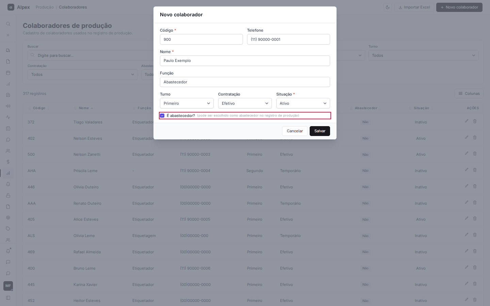
  </Step>
  <Step title="Salvar">
    Clique em **Salvar**. A janela fecha, a lista é atualizada e aparece a mensagem "Colaborador cadastrado com sucesso." Para desistir, clique em **Cancelar**.
  </Step>
</Steps>

<Note>
O **Código** precisa ser único: se já existir um colaborador com o mesmo código, o sistema avisa "Já existe um colaborador com esse código." e não grava. Ao digitar a função **Abastecedor** e sair do campo, a caixa **É abastecedor?** é marcada automaticamente. Telefone, turno, contratação e função são opcionais.
</Note>

## Editar um colaborador

<Steps>
  <Step title="Abrir a edição">
    Na linha do colaborador, clique no ícone de lápis (**Editar**) na coluna **Ações**. Clicar sobre a linha também abre a edição.

    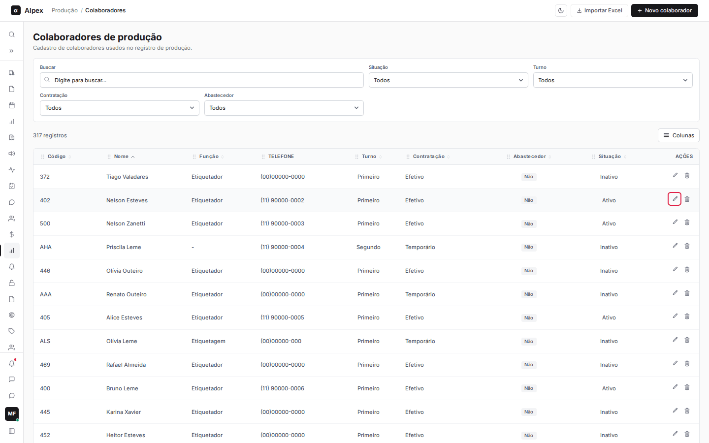
  </Step>
  <Step title="Alterar e salvar">
    A janela **Editar colaborador** abre com os dados atuais. Altere o que for preciso e clique em **Salvar**. A mensagem "Colaborador atualizado com sucesso." confirma.

    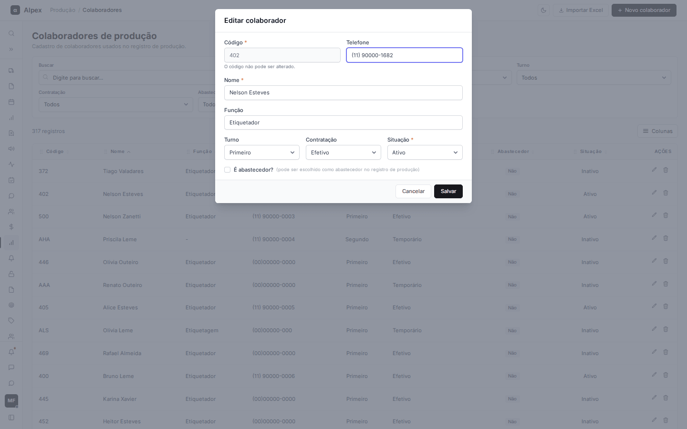
  </Step>
</Steps>

<Note>
O **Código** fica bloqueado na edição ("O código não pode ser alterado."). Para trocar o código, é preciso cadastrar um novo colaborador. Para tirar alguém de circulação sem apagar o histórico, mude a **Situação** para Inativo.
</Note>

## Excluir um colaborador

<Steps>
  <Step title="Pedir a exclusão">
    Na linha do colaborador, clique no ícone de lixeira (**Excluir**).
  </Step>
  <Step title="Confirmar ou cancelar">
    Aparece a pergunta **Confirmar exclusão**, com o nome da pessoa. Clique em **Sim, excluir!** para apagar ou em **Cancelar** para voltar sem alterar nada.

    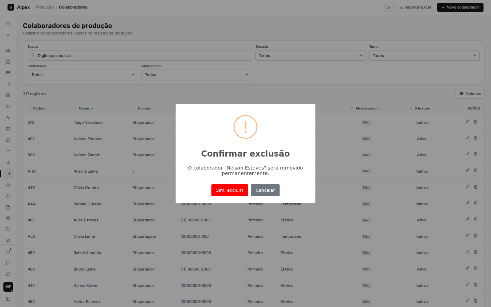
  </Step>
</Steps>

<Warning>
Ao confirmar, o colaborador é removido permanentemente e não há como desfazer. Se a pessoa apenas saiu da fábrica, prefira marcar como Inativo na edição.
</Warning>

## Buscar, filtrar, ordenar, escolher colunas e paginar

<Steps>
  <Step title="Buscar por texto">
    Digite no campo **Buscar**. A lista é filtrada por nome, código, função ou telefone enquanto você digita.

    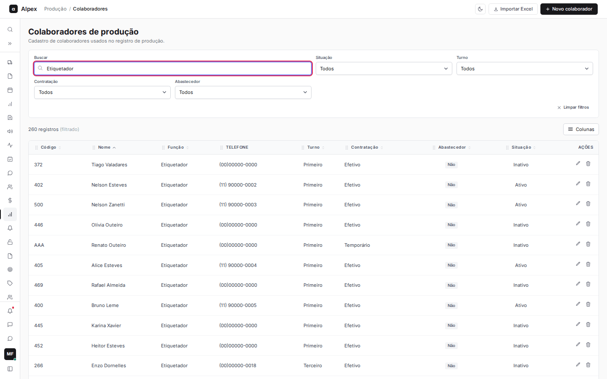
  </Step>
  <Step title="Usar os filtros">
    Escolha valores em **Situação**, **Turno**, **Contratação** e **Abastecedor**. Os filtros se combinam entre si e com a busca, e o contador mostra quantos registros restaram. Clique em **Limpar filtros** para voltar à lista completa.

    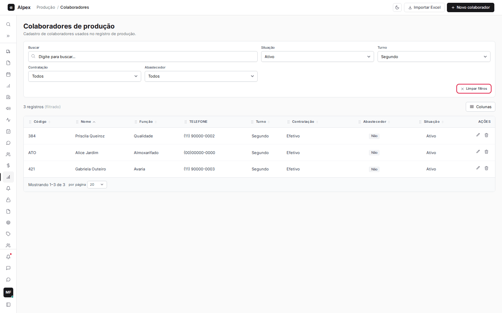
  </Step>
  <Step title="Ordenar">
    Clique no título de uma coluna (por exemplo **Código**) para ordenar de forma crescente; clique de novo para inverter. A lista abre ordenada por **Nome**. A coluna **Telefone** não ordena.

    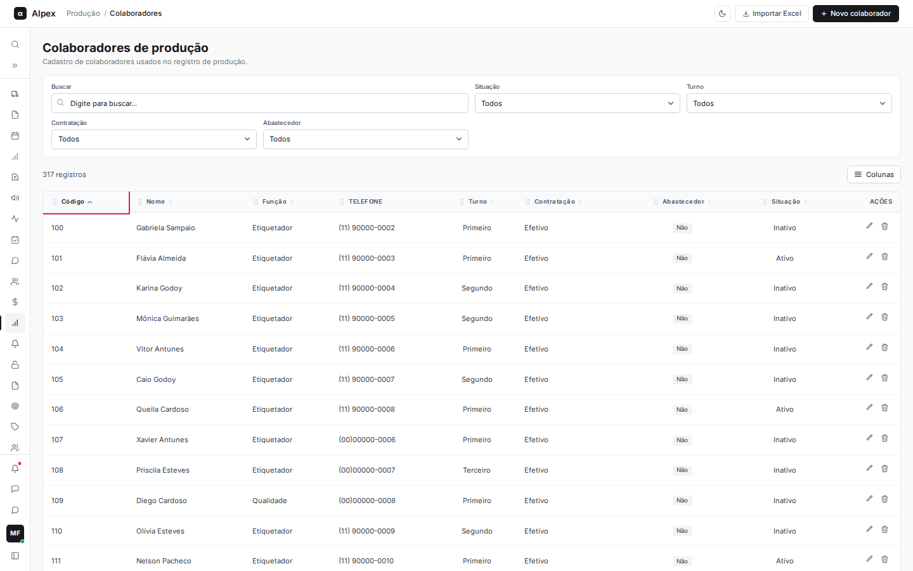
  </Step>
  <Step title="Escolher as colunas">
    Clique em **Colunas** e marque ou desmarque as colunas que quer ver. **Resetar** devolve a seleção original. A coluna **Cadastrado em** existe, mas começa escondida.

    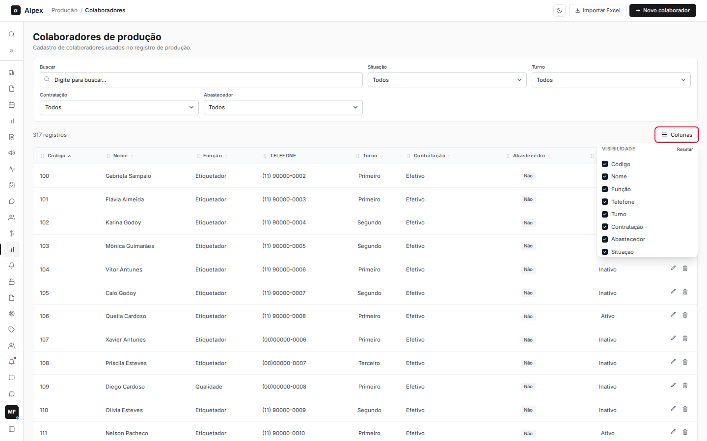
  </Step>
  <Step title="Navegar entre páginas">
    No rodapé da tabela, use os números de página e as setas. O seletor **por página** permite mostrar 10, 20, 50 ou 100 linhas.

    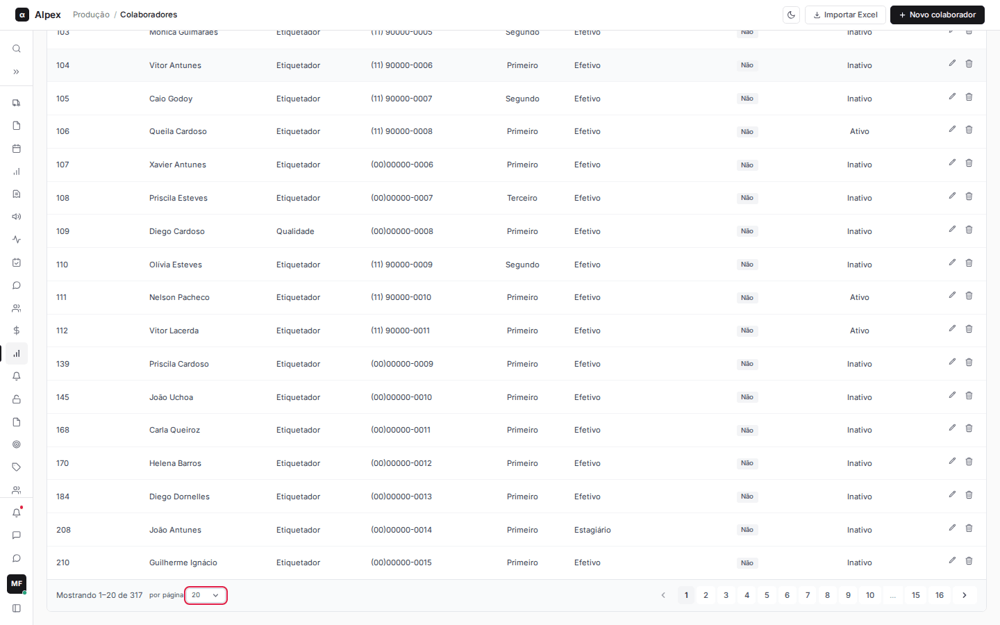
  </Step>
</Steps>

## Importar colaboradores de uma planilha Excel

<Steps>
  <Step title="Abrir a importação">
    Clique em **Importar Excel**. Se precisar do formato, clique em **Baixar planilha modelo** e preencha a planilha. As colunas são: código, nome, telefone, turno, situação, contratação, função e abastecedor.

    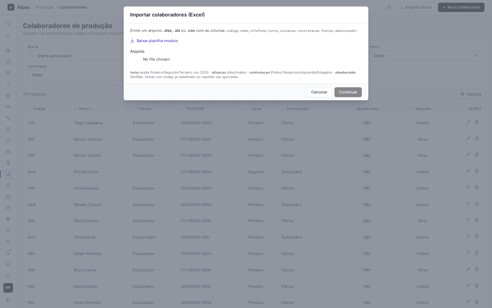
  </Step>
  <Step title="Escolher o arquivo">
    No campo **Arquivo**, selecione um arquivo .xlsx, .xls ou .csv. Quando o envio terminar, o botão **Continuar** fica ativo.

    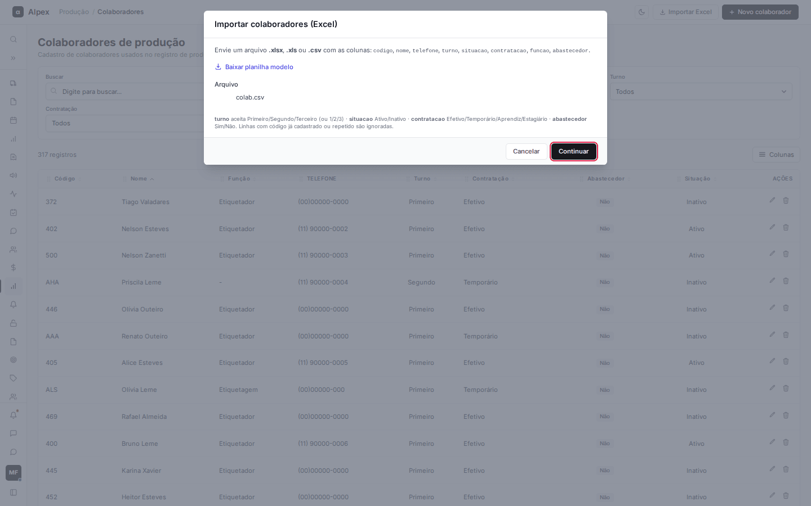
  </Step>
  <Step title="Conferir as linhas">
    Clique em **Continuar**. A tela **Conferir importação** mostra quantas linhas são válidas e quantas têm erro. Linhas com problema ficam em vermelho, com o motivo na coluna **Status** (por exemplo, "Código já cadastrado no sistema."). Corrija direto na tabela, remova uma linha com o **X** ou inclua uma nova com **Adicionar linha**. Os erros são recalculados a cada alteração.

    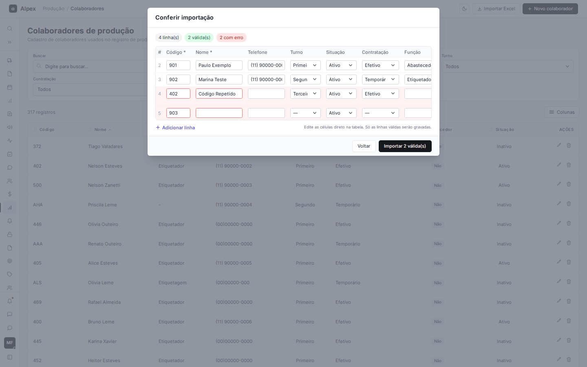
  </Step>
  <Step title="Gravar">
    Clique em **Importar N válida(s)**. Só as linhas sem erro são gravadas, e o aviso "Importação concluída" informa quantas foram ignoradas. Use **Voltar** para escolher outro arquivo.
  </Step>
</Steps>

<Note>
No arquivo, turno aceita Primeiro, Segundo e Terceiro (ou 1, 2 e 3); situação aceita Ativo e Inativo; contratação aceita Efetivo, Temporário, Aprendiz e Estagiário; abastecedor aceita Sim e Não. Textos fora desses valores ficam em branco e podem ser ajustados na conferência. Código e nome são obrigatórios; códigos já cadastrados ou repetidos no arquivo geram erro e a linha não é importada. A leitura vai até 10.000 linhas.
</Note>
