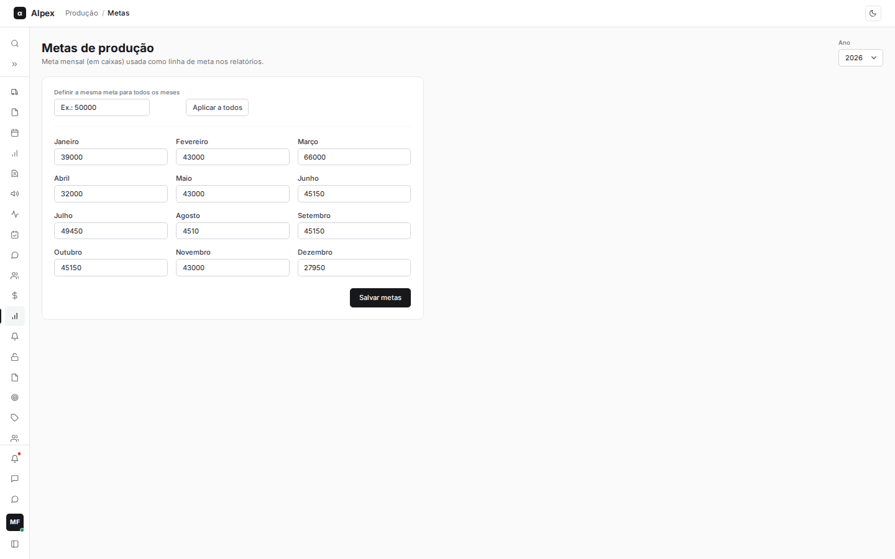
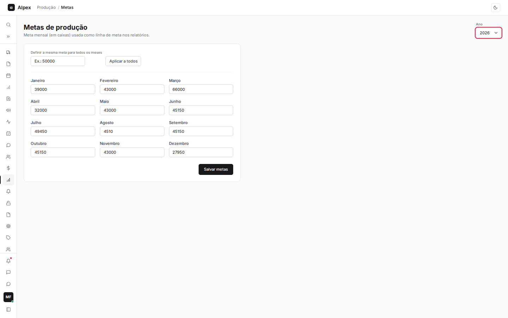
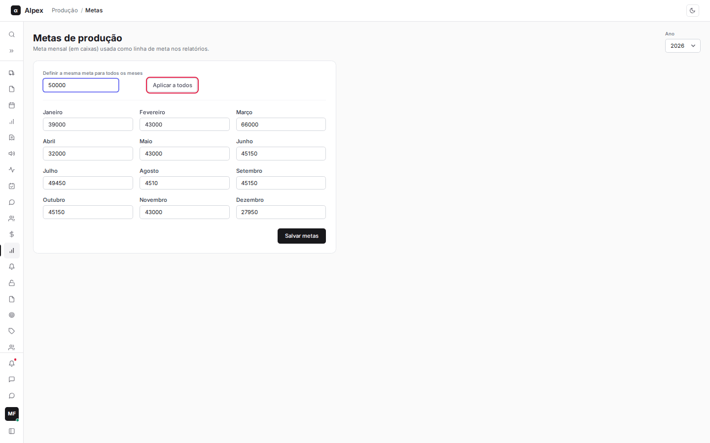
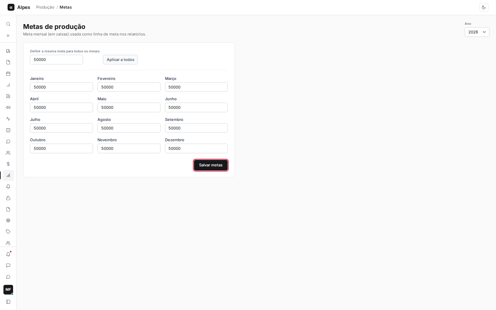

**Menu:** 1205 - Metas

Cadastro da meta mensal de produção, em caixas, para cada ano. Essas metas aparecem como a linha "Meta" nos gráficos de produção dos relatórios. Costuma ser usado pela gerência ou pelo PCP.

## Escolher o ano

<Steps>
  <Step title="Selecionar o ano">
    No canto superior direito, abra o seletor **Ano**. A tela abre no ano atual e permite ir do ano seguinte até quatro anos atrás.

    
  </Step>
  <Step title="Ver as metas do ano">
    Ao trocar o ano, os 12 campos mostram as metas já gravadas para ele. Meses sem meta aparecem zerados.
  </Step>
</Steps>

<Note>
Trocar de ano descarta o que foi digitado e ainda não foi salvo. Salve antes de mudar.
</Note>

## Definir e salvar as metas do ano

<Steps>
  <Step title="Digitar a meta de cada mês">
    Preencha o campo de cada mês, de **Janeiro** a **Dezembro**, com a quantidade de caixas.
  </Step>
  <Step title="Usar a mesma meta em todos os meses (opcional)">
    No campo **Definir a mesma meta para todos os meses**, digite o valor e clique em **Aplicar a todos**. Os 12 meses são preenchidos de uma vez, e você ainda pode ajustar meses específicos.

    
  </Step>
  <Step title="Salvar">
    Clique em **Salvar metas**. A mensagem "Metas salvas" confirma que as metas do ano foram atualizadas.

    
  </Step>
</Steps>

<Note>
**Aplicar a todos** só preenche os campos na tela; nada é gravado até clicar em **Salvar metas**. Valores negativos viram zero. O botão grava os 12 meses do ano mostrado, de uma só vez.
</Note>
