**Menu:** 1203 - Produtos

Cadastro dos produtos que podem ser escolhidos no registro de produção, com o código e a quantidade de unidades por caixa. Costuma ser mantido pelo PCP ou por quem cuida do cadastro.

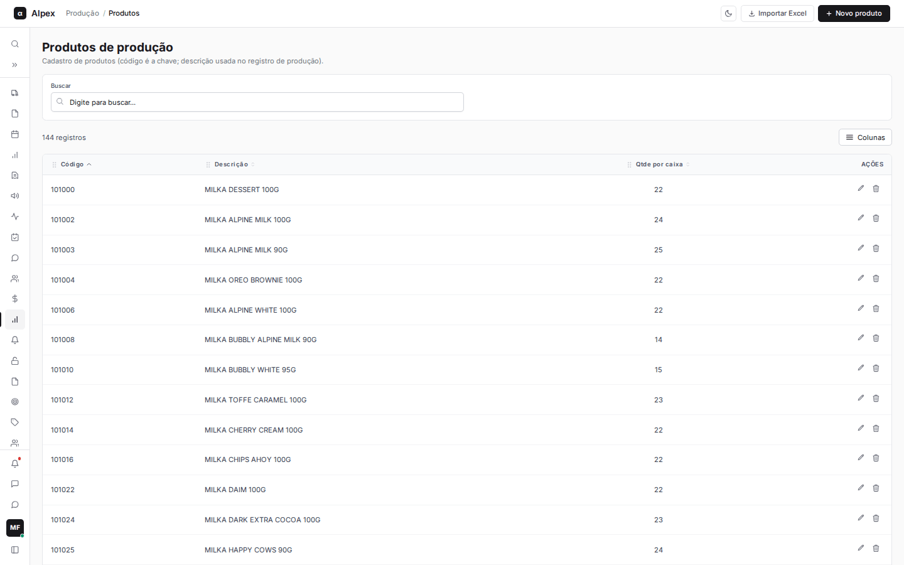

## Cadastrar um produto

<Steps>
  <Step title="Abrir o formulário">
    Clique em **Novo produto**.

    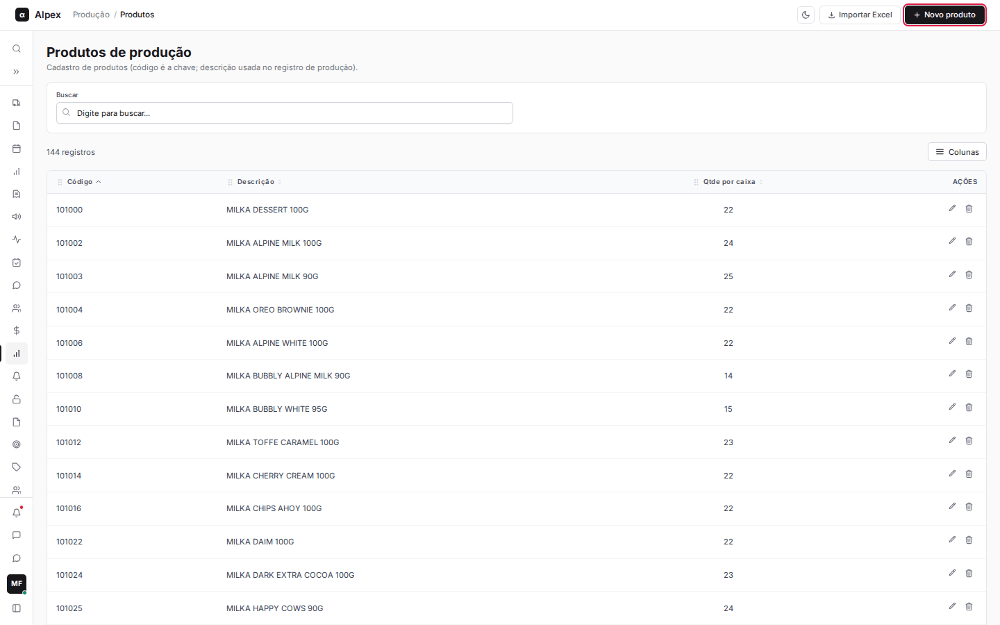
  </Step>
  <Step title="Preencher os dados">
    Informe o **Código** (número), a **Descrição** e, se quiser, a **Qtde por caixa**. **Código** e **Descrição** são obrigatórios.

    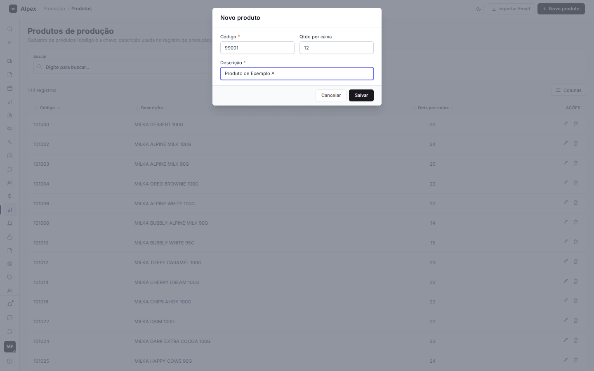
  </Step>
  <Step title="Salvar">
    Clique em **Salvar**. Aparece "Produto cadastrado com sucesso." e o item entra na lista. **Cancelar** fecha sem gravar.
  </Step>
</Steps>

<Note>
O código precisa ser um número maior que zero e único: se já existir, o sistema avisa "Já existe um produto com esse código." A descrição aceita até 255 caracteres.
</Note>

## Editar um produto

<Steps>
  <Step title="Abrir a edição">
    Na linha do produto, clique no ícone de lápis (**Editar**). Clicar sobre a linha também abre a edição.

    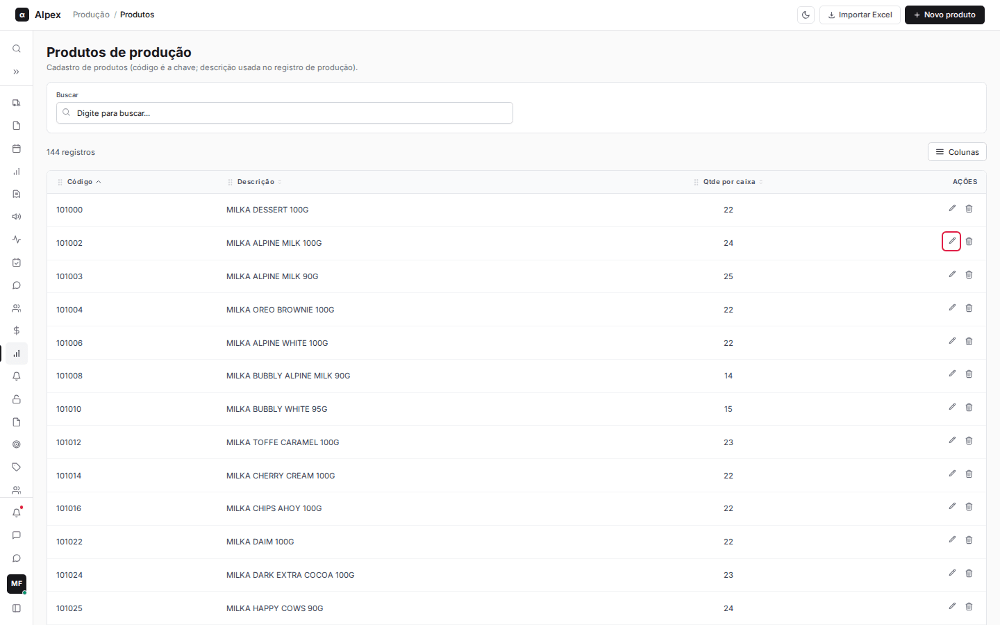
  </Step>
  <Step title="Alterar e salvar">
    Ajuste a **Descrição** ou a **Qtde por caixa** e clique em **Salvar**. Aparece "Produto atualizado com sucesso."

    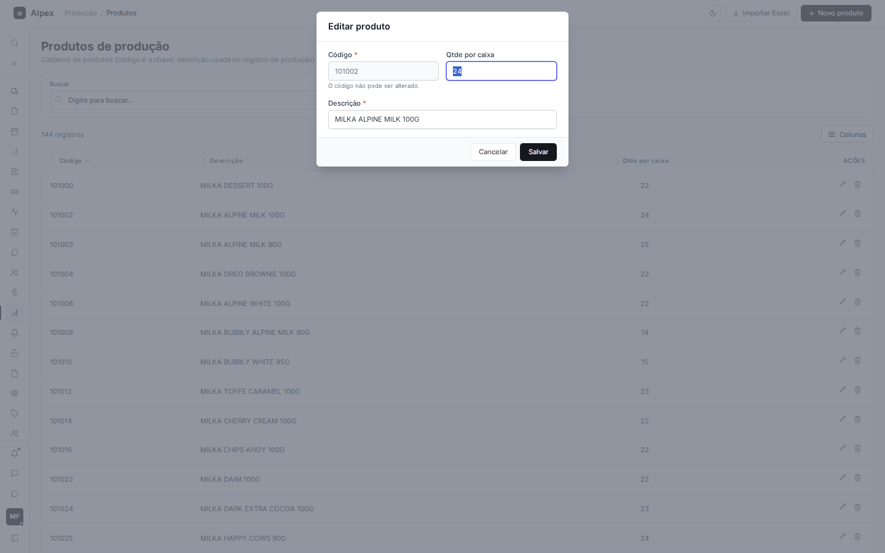
  </Step>
</Steps>

<Note>
O **Código** fica bloqueado na edição ("O código não pode ser alterado."). Para um código diferente, cadastre um novo produto.
</Note>

## Excluir um produto

<Steps>
  <Step title="Pedir a exclusão">
    Na linha do produto, clique no ícone de lixeira (**Excluir**).
  </Step>
  <Step title="Confirmar ou cancelar">
    Na pergunta **Confirmar exclusão**, clique em **Sim, excluir!** para apagar ou em **Cancelar** para desistir.

    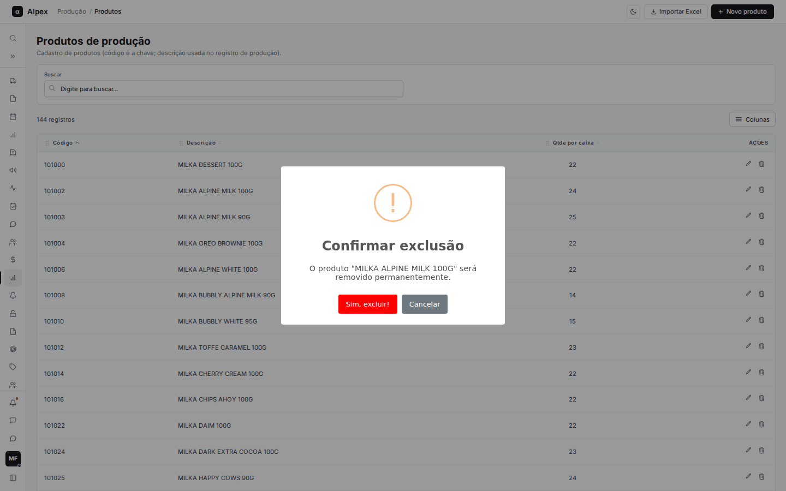
  </Step>
</Steps>

<Warning>
Ao confirmar, o produto é removido permanentemente e não há como desfazer.
</Warning>

## Buscar, ordenar, escolher colunas e paginar

<Steps>
  <Step title="Buscar">
    Digite no campo **Buscar** parte do código ou da descrição. Clique em **Limpar filtros** para voltar à lista completa.

    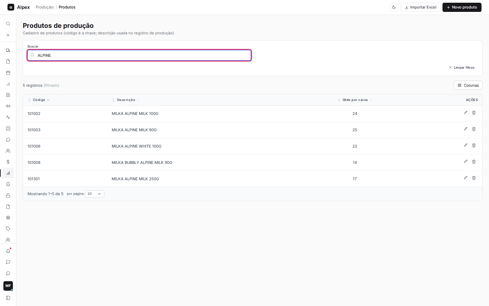
  </Step>
  <Step title="Ordenar">
    Clique no título de uma coluna (**Código**, **Descrição** ou **Qtde por caixa**) para ordenar; clique de novo para inverter. A lista abre ordenada por **Código**.

    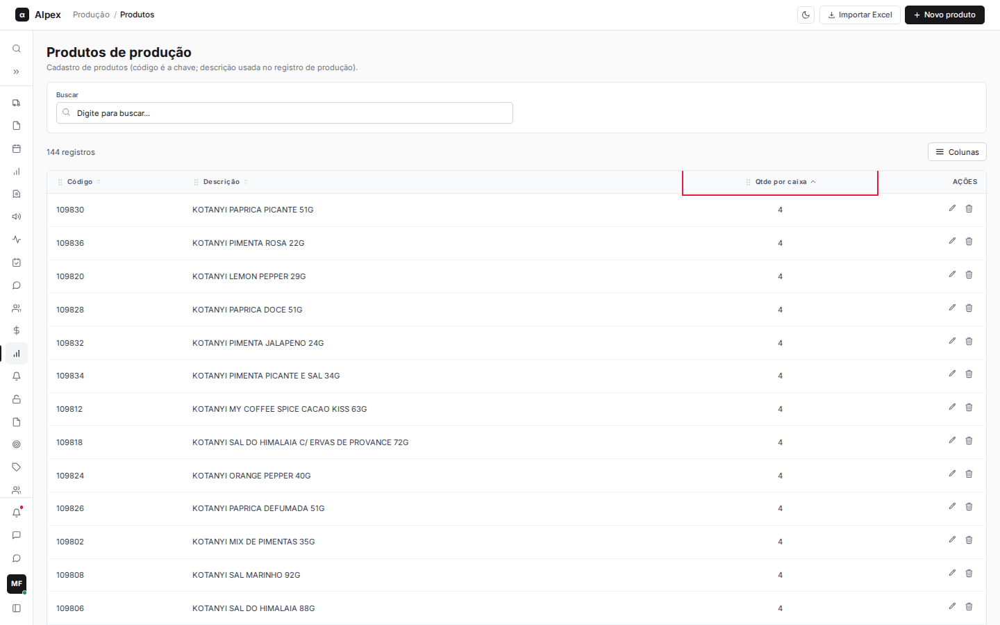
  </Step>
  <Step title="Escolher as colunas">
    Clique em **Colunas** para mostrar ou esconder colunas; **Resetar** volta ao padrão. **Cadastrado em** começa escondida.

    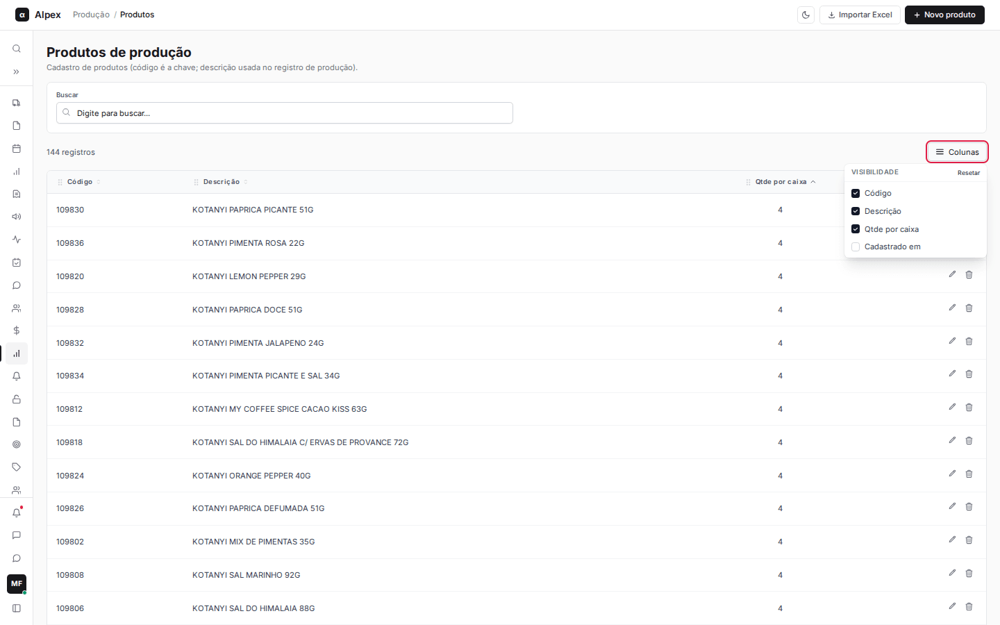
  </Step>
  <Step title="Paginar">
    Use os números de página no rodapé e o seletor **por página** (10, 20, 50 ou 100 linhas).
  </Step>
</Steps>

## Importar produtos de uma planilha Excel

<Steps>
  <Step title="Abrir a importação">
    Clique em **Importar Excel**. Use **Baixar planilha modelo** para ver o formato (colunas: código, descrição e qtde_caixa).

    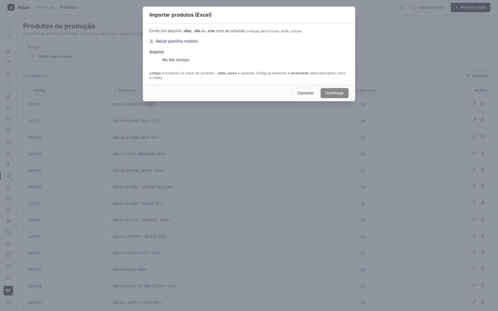
  </Step>
  <Step title="Enviar e conferir">
    Escolha o arquivo (.xlsx, .xls ou .csv) e clique em **Continuar**. Na tela **Conferir importação**, corrija as células direto na tabela, remova linhas com o **X** ou use **Adicionar linha**. Linhas com erro aparecem em vermelho com o motivo na coluna **Status**.

    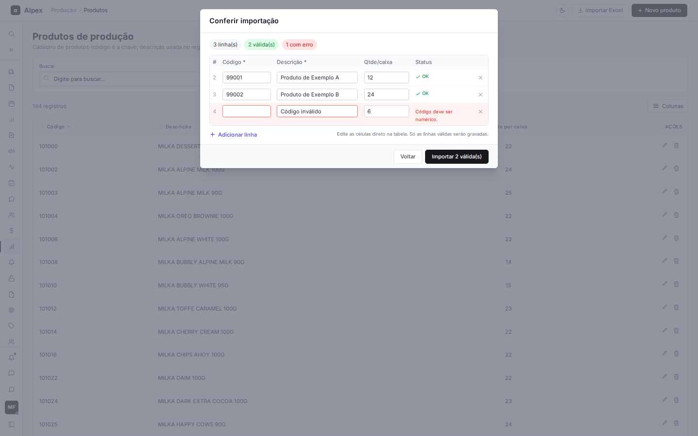
  </Step>
  <Step title="Gravar">
    Clique em **Importar N válida(s)**. Só as linhas sem erro são gravadas.
  </Step>
</Steps>

<Note>
Diferente dos colaboradores, aqui um código que já existe não é erro: a importação atualiza a descrição e a quantidade por caixa desse produto. São erros: código vazio ou não numérico, código repetido no arquivo, descrição vazia (ou acima de 255 caracteres) e quantidade por caixa não numérica.
</Note>
