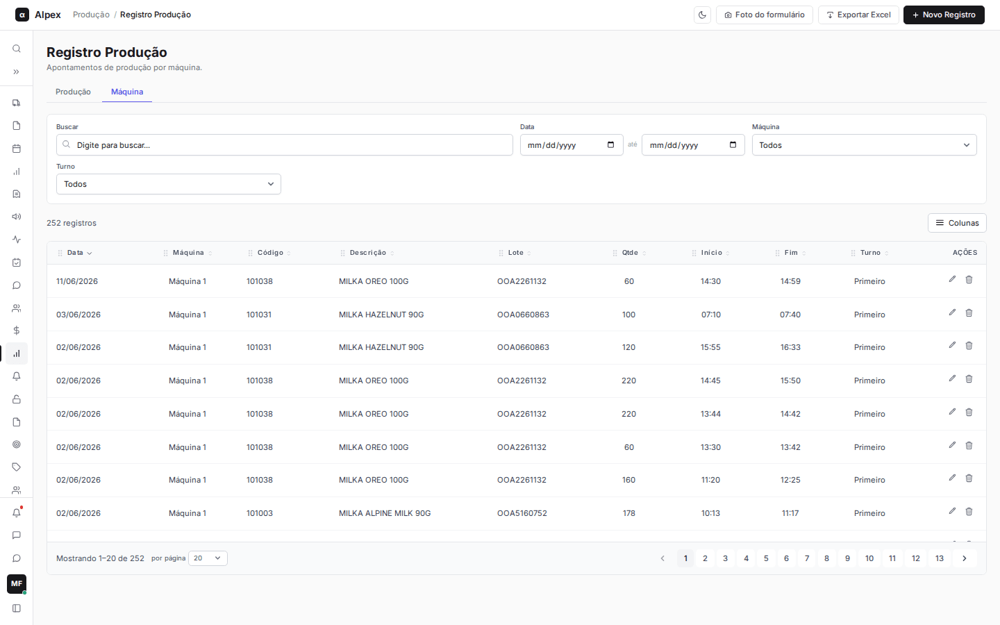
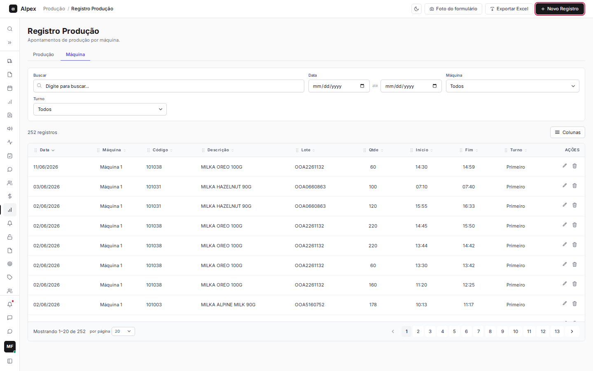
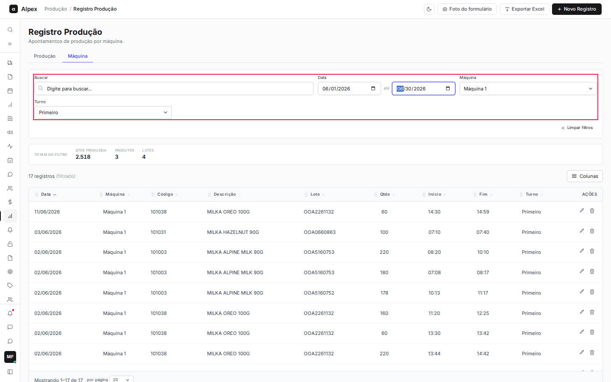
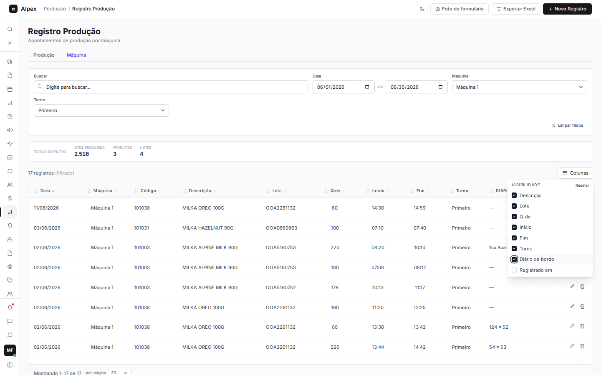
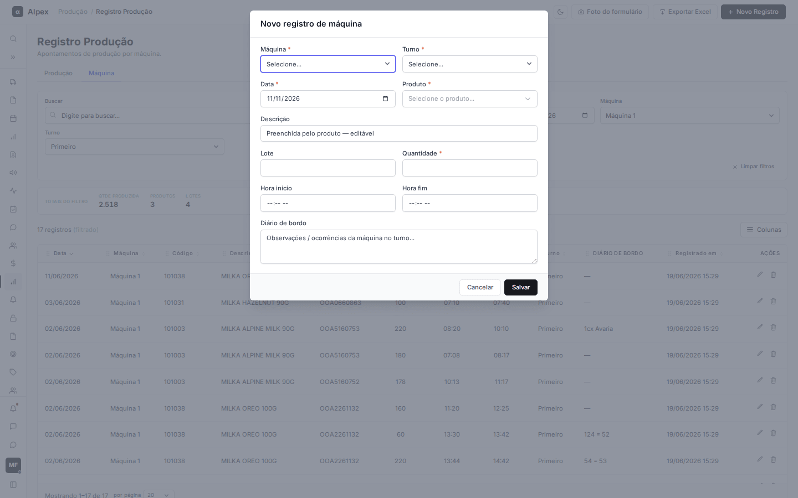
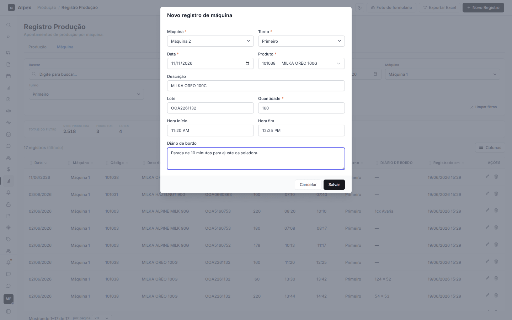
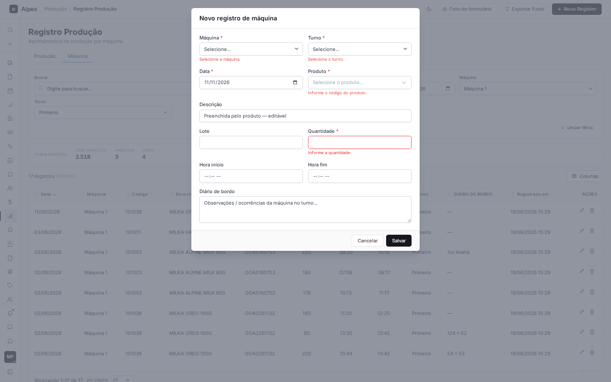
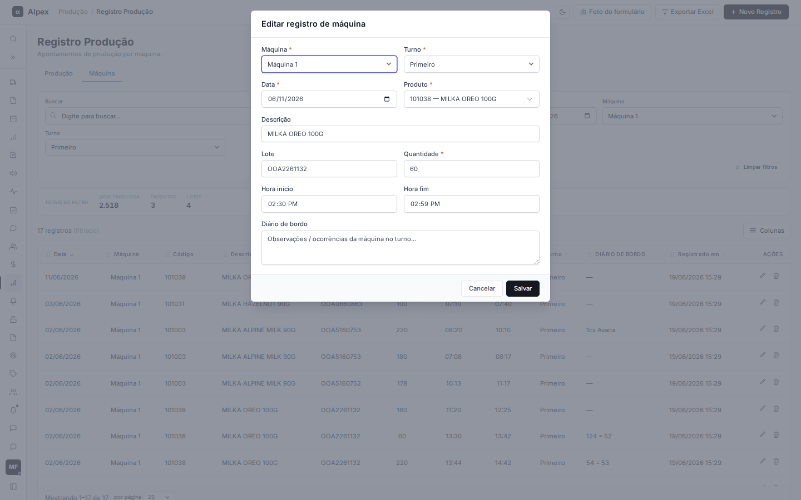
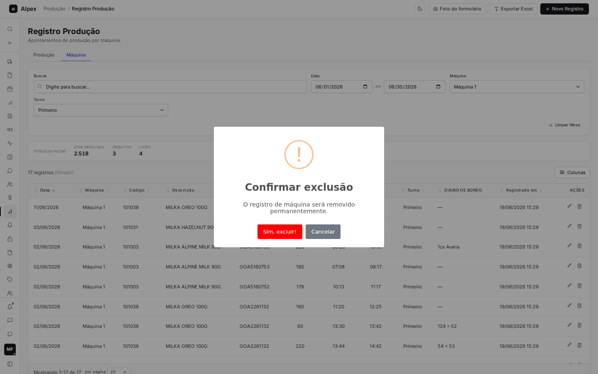
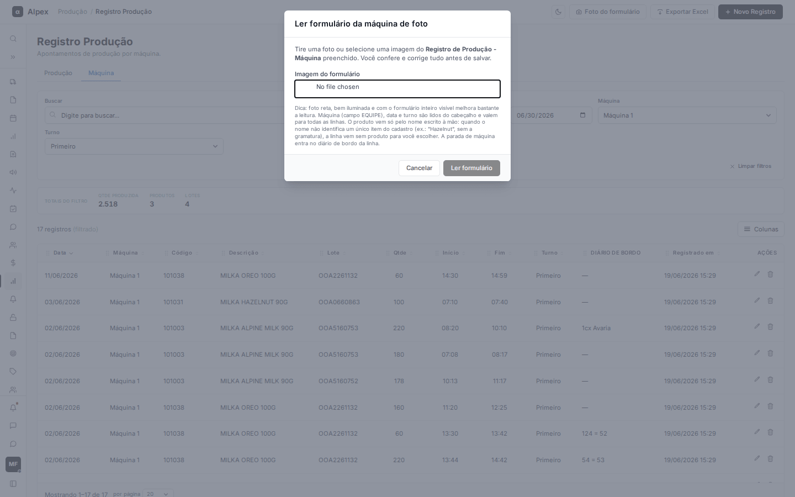

**Menu:** 1201 - Registro de Produção, aba Máquina

Aba da tela de Registro de Produção para lançar e consultar a produção de cada máquina (Máquina 1, 2 e 3), sem vínculo com colaborador. É usada por líderes e pelo apontamento da fábrica. Os registros de máquina entram nos mesmos relatórios de produção.

## Trocar para a aba Máquina

<Steps>
  <Step title="Clicar na aba">
    Na tela de Registro de Produção, clique em **Máquina**, ao lado de **Produção**. Os botões do topo (**Foto do formulário**, **Exportar Excel** e **Novo Registro**) passam a valer para a máquina.

    
  </Step>
</Steps>

## Buscar, filtrar, ordenar e paginar

<Steps>
  <Step title="Buscar e filtrar">
    Em **Buscar**, digite parte da descrição, do lote, do código do produto ou do diário de bordo. Filtre também por **Data** (período), **Máquina** e **Turno**. A faixa **Totais do filtro** mostra a quantidade produzida, o número de produtos e o número de lotes. **Limpar filtros** volta à lista completa.

    
  </Step>
  <Step title="Ordenar">
    Clique no título de uma coluna (**Data**, **Máquina**, **Código**, **Descrição**, **Lote**, **Qtde**, **Início**, **Fim** ou **Turno**) para ordenar; clique de novo para inverter.
  </Step>
  <Step title="Escolher colunas">
    Clique em **Colunas**. As colunas **Diário de bordo** e **Registrado em** ficam escondidas por padrão; marque-as para exibir.

    
  </Step>
  <Step title="Paginar">
    Use os números de página no rodapé e o seletor **por página** (padrão 20).
  </Step>
</Steps>

## Lançar um registro de máquina

<Steps>
  <Step title="Abrir o formulário">
    Clique em **Novo Registro**. Abre a janela **Novo registro de máquina**.

    
  </Step>
  <Step title="Preencher">
    Escolha a **Máquina** e o **Turno** (**Primeiro**, **Segundo** ou **Terceiro**); ambos são obrigatórios e aqui o turno não é automático. Confira a **Data** (vem com hoje), escolha o **Produto** buscando por código ou descrição (a **Descrição** é preenchida sozinha e pode ser ajustada), e informe **Lote**, **Quantidade**, **Hora início** e **Hora fim**. No **Diário de bordo**, anote ocorrências da máquina no turno, como paradas e ajustes.

    
  </Step>
  <Step title="Salvar">
    Clique em **Salvar**. Aparece "Registro criado com sucesso." e a lista é atualizada. **Cancelar** fecha sem gravar.
  </Step>
</Steps>

<Note>
Obrigatórios: **Máquina**, **Turno**, **Data**, **Produto** e **Quantidade**. Sem eles aparecem avisos como "Selecione a máquina.", "Selecione o turno.", "Informe o código do produto." e "Informe a quantidade.". Os minutos trabalhados são calculados de **Hora início** e **Hora fim**, e uma hora fim menor que a de início é entendida como virada de dia.
</Note>

## Editar um registro de máquina

<Steps>
  <Step title="Abrir">
    Clique no ícone de lápis da linha (coluna **Ações**) ou na própria linha. Abre **Editar registro de máquina**.

    
  </Step>
  <Step title="Salvar">
    Ajuste os campos e clique em **Salvar**. Aparece "Registro atualizado com sucesso.".
  </Step>
</Steps>

## Excluir um registro de máquina

<Steps>
  <Step title="Pedir a exclusão">
    Clique no ícone de lixeira da linha. Aparece **Confirmar exclusão** ("O registro de máquina será removido permanentemente.").

    
  </Step>
  <Step title="Confirmar ou cancelar">
    **Sim, excluir!** apaga; **Cancelar** mantém o registro.
  </Step>
</Steps>

<Warning>
A exclusão é definitiva e não pode ser desfeita.
</Warning>

## Exportar para Excel

<Steps>
  <Step title="Gerar o arquivo">
    Com a aba **Máquina** aberta, clique em **Exportar Excel**. O botão mostra **Gerando...** e o navegador baixa a planilha `registros_producao_maquina`.
  </Step>
</Steps>

<Note>
A planilha sai com o que está na lista: respeita a busca e os filtros aplicados e traz só as colunas que estão visíveis. Para exportar tudo, limpe os filtros antes.
</Note>

## Lançar a partir da foto do formulário da máquina

Lê o formulário em papel **Registro de Produção - Máquina** a partir de uma foto, por inteligência artificial. Nada é gravado antes da sua confirmação.

<Steps>
  <Step title="Abrir a janela">
    Na aba **Máquina**, clique em **Foto do formulário**. Abre **Ler formulário da máquina de foto**.

    
  </Step>
  <Step title="Enviar e ler">
    Selecione a imagem em **Imagem do formulário** (até 12 MB) e clique em **Ler formulário**.
  </Step>
  <Step title="Conferir">
    Abre **Conferir produção da máquina**, com a máquina (campo EQUIPE do papel), a data e o turno lidos do cabeçalho e válidos para todas as linhas, além do **Diário de bordo (linhas sem anotação)**. O produto é identificado só pelo nome escrito à mão: se o nome não apontar um único item do cadastro (por exemplo, "Hazelnut" sem a gramatura), a linha vem sem produto e você escolhe. A parada de máquina escrita no formulário entra no diário de bordo da linha. Corrija, remova ou acrescente linhas.
  </Step>
  <Step title="Gravar">
    Clique em **Importar ... válida(s)**. Só linhas sem erro são gravadas. Faltando máquina, turno ou data no cabeçalho, aparece "Cabeçalho incompleto" e nada é gravado.
  </Step>
</Steps>
