**Menu:** 1201 - Registro de Produção

Tela onde se lançam e consultam os apontamentos de produção feitos por colaborador: quem produziu, qual produto, qual lote, quantas caixas e em que horário. É usada por líderes e pelo pessoal de apontamento da fábrica. A tela tem duas abas: **Produção** (por colaborador, descrita aqui) e **Máquina** (apontamentos por máquina, na próxima tela do manual).

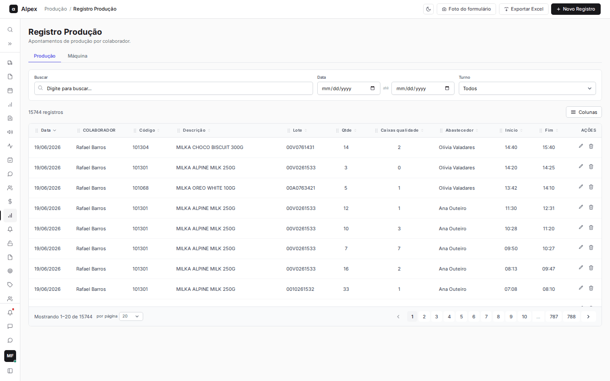

## Buscar e filtrar os registros

<Steps>
  <Step title="Usar a busca">
    No campo **Buscar**, digite parte da descrição do produto, o lote, o nome do abastecedor, o código do produto ou o código do colaborador. A lista se atualiza sozinha enquanto você digita.
  </Step>
  <Step title="Filtrar por data e turno">
    Em **Data**, informe o dia inicial e o dia final do período. Em **Turno**, escolha **Primeiro**, **Segundo** ou **Terceiro**. Os filtros podem ser combinados com a busca.

    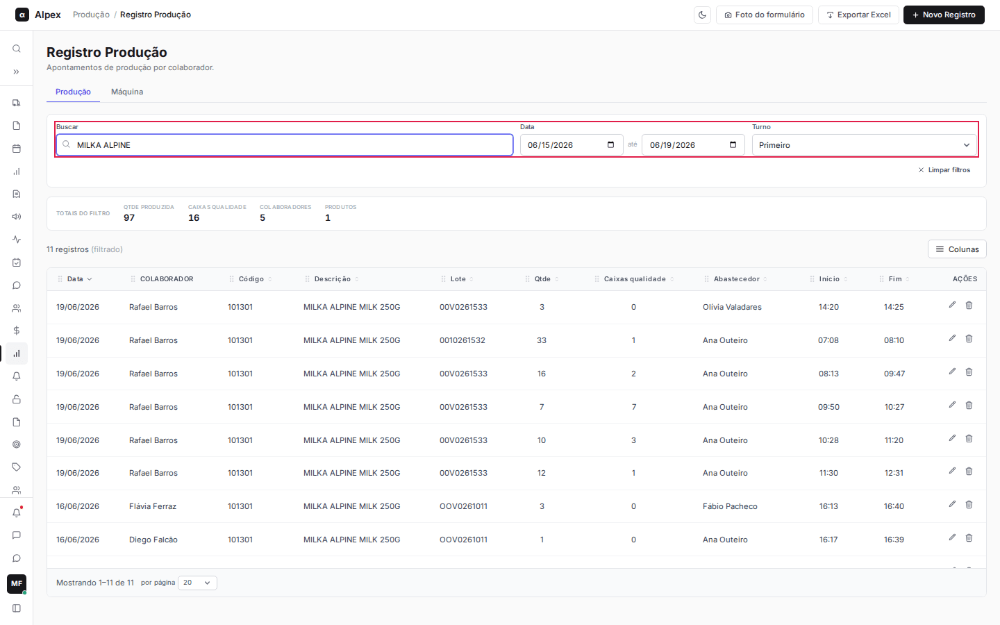
  </Step>
  <Step title="Ler os totais">
    Quando há filtro, aparece a faixa **Totais do filtro** com a quantidade produzida, as caixas de qualidade, o número de colaboradores e o número de produtos do que está na lista. Abaixo dela, o contador mostra quantos registros foram encontrados.
  </Step>
  <Step title="Voltar à lista completa">
    Clique em **Limpar filtros** (canto inferior direito do quadro de filtros) para remover busca, datas e turno.
  </Step>
</Steps>

<Note>
A lista abre ordenada do registro mais recente para o mais antigo. Se nenhum registro combinar com os filtros, a tela mostra "Nenhum registro corresponde aos filtros aplicados.".
</Note>

## Ordenar a lista e escolher as colunas

<Steps>
  <Step title="Ordenar">
    Clique no título de uma coluna (por exemplo **Qtde**) para ordenar do menor para o maior. Clique de novo para inverter. A seta ao lado do título mostra a ordem atual. A coluna **Colaborador** não ordena.

    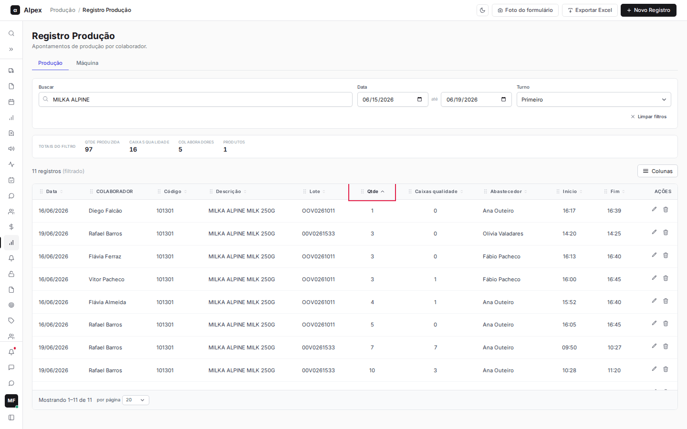
  </Step>
  <Step title="Escolher as colunas">
    Clique em **Colunas** e marque ou desmarque as que deseja ver. Por padrão ficam escondidas **Turno** e **Registrado em**; marque-as se precisar. **Resetar** reexibe as colunas.

    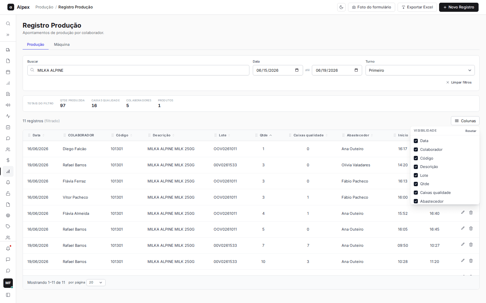
  </Step>
</Steps>

## Navegar pelas páginas

<Steps>
  <Step title="Mudar de página">
    No rodapé da lista, use os números das páginas ou as setas para avançar e voltar. O texto **Mostrando 1–20 de ...** indica quantos registros você está vendo.
  </Step>
  <Step title="Mudar quantos registros aparecem">
    Em **por página**, escolha a quantidade de linhas por página (o padrão é 20).

    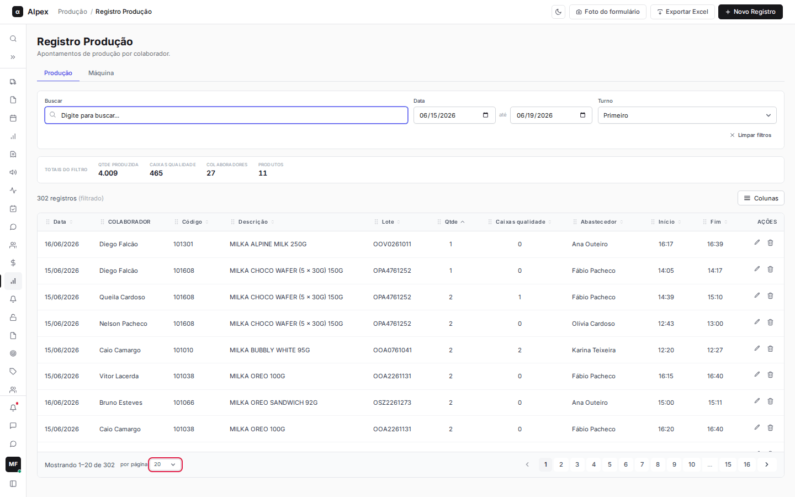
  </Step>
</Steps>

## Lançar um registro de produção

<Steps>
  <Step title="Abrir o formulário">
    Clique em **Novo Registro**, no canto superior direito.

    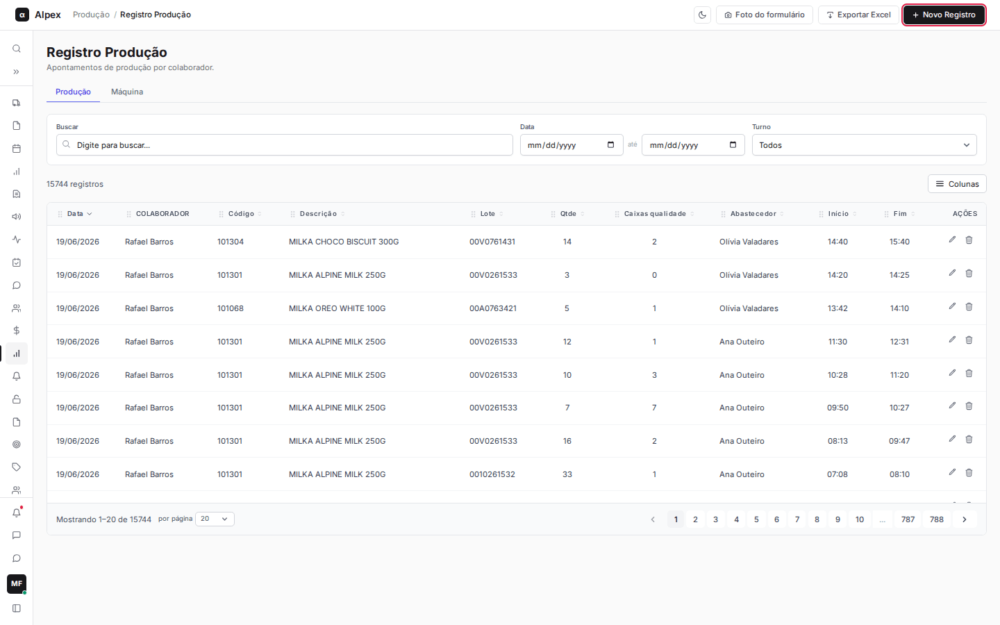
  </Step>
  <Step title="Conferir o formulário">
    Abre a janela **Novo registro**. A **Data** já vem com o dia de hoje. Os campos marcados com asterisco vermelho são obrigatórios: **Colaborador**, **Data**, **Produto** e **Quantidade**.

    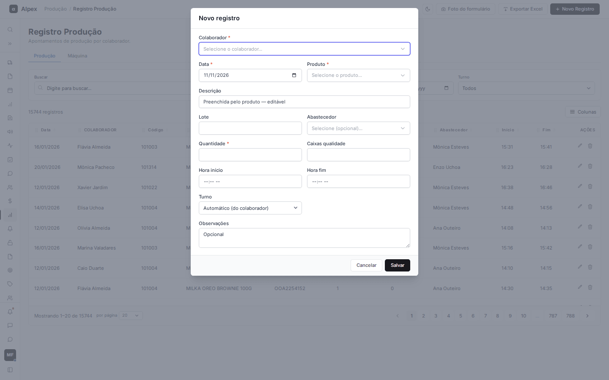
  </Step>
  <Step title="Escolher o colaborador">
    Clique em **Colaborador** e digite parte do nome ou do código para encontrar a pessoa. Clique no nome desejado.

    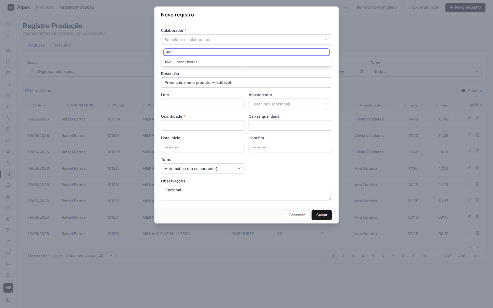
  </Step>
  <Step title="Escolher o produto">
    Clique em **Produto** e busque pelo código ou pela descrição. Ao escolher, o campo **Descrição** é preenchido sozinho; você pode ajustar o texto se precisar.

    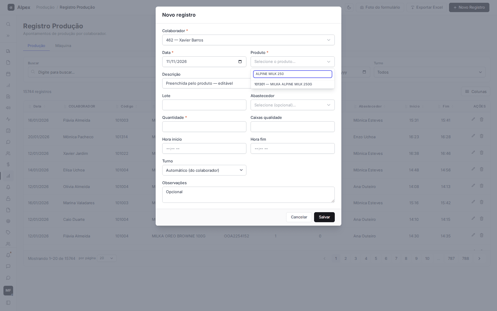
  </Step>
  <Step title="Preencher o restante">
    Informe o **Lote**, escolha o **Abastecedor** (opcional; só aparecem colaboradores cadastrados como abastecedores), a **Quantidade**, as **Caixas qualidade** (opcional), a **Hora início** e a **Hora fim**. Em **Turno**, deixe **Automático (do colaborador)** para usar o turno cadastrado da pessoa, ou escolha **Primeiro**, **Segundo** ou **Terceiro**. Use **Observações** para qualquer anotação.

    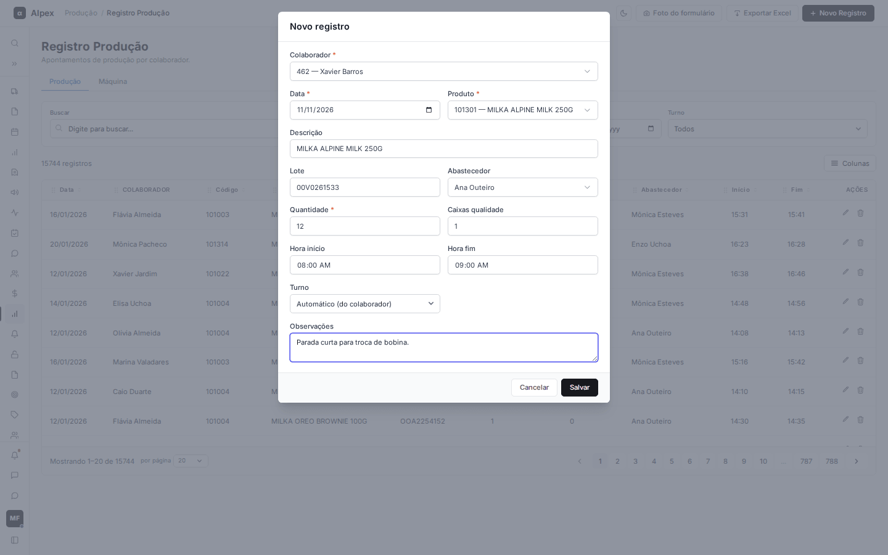
  </Step>
  <Step title="Salvar">
    Clique em **Salvar**. A janela fecha, a lista é atualizada e aparece o aviso "Registro criado com sucesso.". Para desistir, clique em **Cancelar**.

    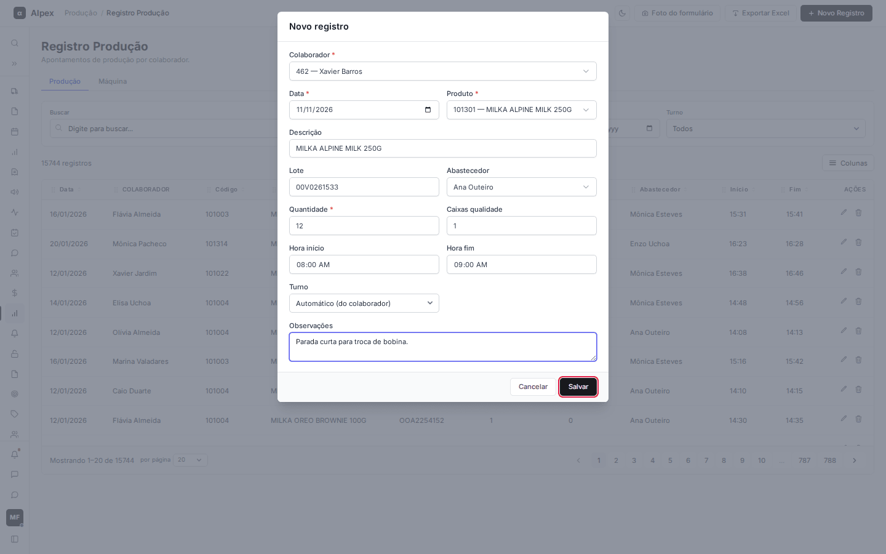
  </Step>
</Steps>

<Note>
Se faltar um campo obrigatório, o formulário não salva e mostra o aviso em vermelho sob o campo (por exemplo "Selecione o colaborador.", "Informe o código do produto." e "Informe a quantidade."). O produto precisa estar cadastrado. O sistema calcula sozinho os minutos trabalhados a partir de **Hora início** e **Hora fim**; se a hora fim for menor que a de início, entende que a produção virou a noite.
</Note>

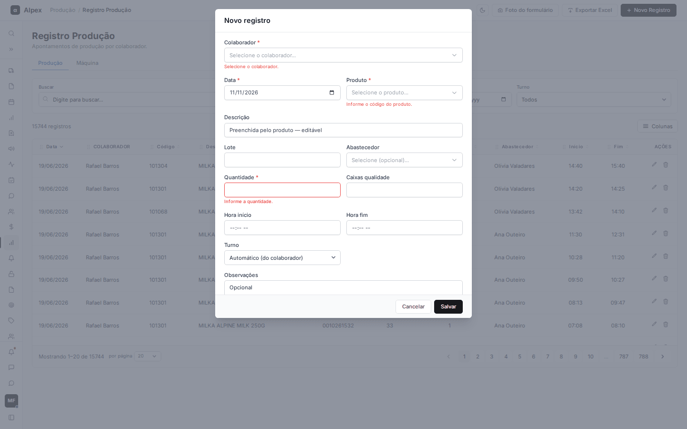

## Editar um registro

<Steps>
  <Step title="Abrir o registro">
    Na linha desejada, clique no ícone de lápis da coluna **Ações**, ou clique sobre a própria linha.

    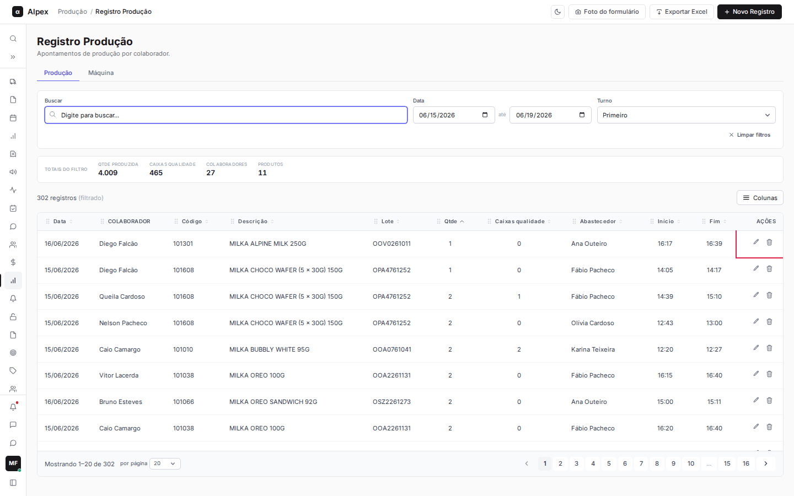
  </Step>
  <Step title="Corrigir e salvar">
    A janela **Editar registro** abre com os dados atuais. Altere o que for preciso e clique em **Salvar**. Aparece "Registro atualizado com sucesso.".

    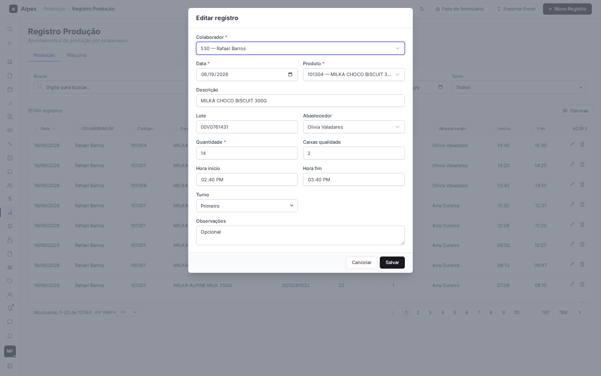
  </Step>
</Steps>

<Note>
As mesmas regras do lançamento valem na edição. **Cancelar** fecha sem alterar nada.
</Note>

## Excluir um registro

<Steps>
  <Step title="Pedir a exclusão">
    Na linha desejada, clique no ícone de lixeira da coluna **Ações**.
  </Step>
  <Step title="Confirmar">
    Aparece a pergunta **Confirmar exclusão** ("O registro de produção será removido permanentemente."). Clique em **Sim, excluir!** para apagar ou em **Cancelar** para manter o registro.

    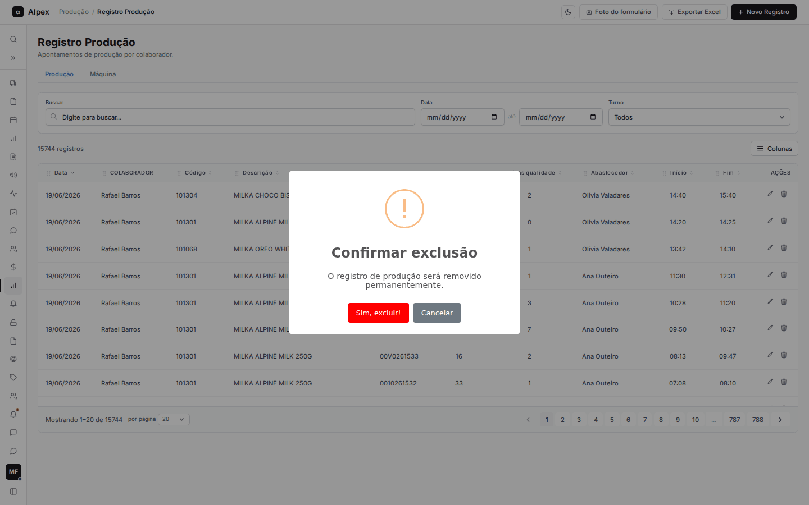
  </Step>
</Steps>

<Warning>
A exclusão é definitiva: não há como recuperar o registro depois de confirmar. Ao confirmar, a lista é atualizada e aparece o aviso "Registro excluído".
</Warning>

## Exportar para Excel

<Steps>
  <Step title="Gerar o arquivo">
    Clique em **Exportar Excel**, no topo da tela. O botão mostra **Gerando...** enquanto o arquivo é preparado e, em seguida, o navegador baixa uma planilha chamada `registros_producao` com a data e a hora da geração.

    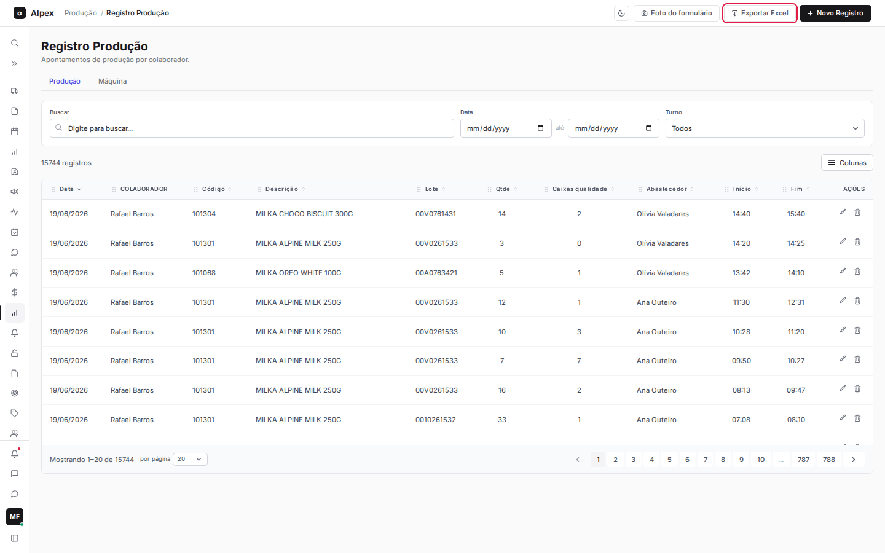
  </Step>
</Steps>

<Note>
A planilha sai com o que está na lista: respeita a busca e os filtros aplicados e traz só as colunas que estão visíveis. Para exportar tudo, limpe os filtros antes.
</Note>

## Lançar vários registros a partir da foto do formulário

Esta função lê automaticamente o formulário em papel **Controle Diário de Produção** a partir de uma foto, usando inteligência artificial, e monta os registros para você conferir. Nada é gravado antes da sua confirmação.

<Steps>
  <Step title="Abrir a janela">
    Clique em **Foto do formulário**, no topo da tela.

    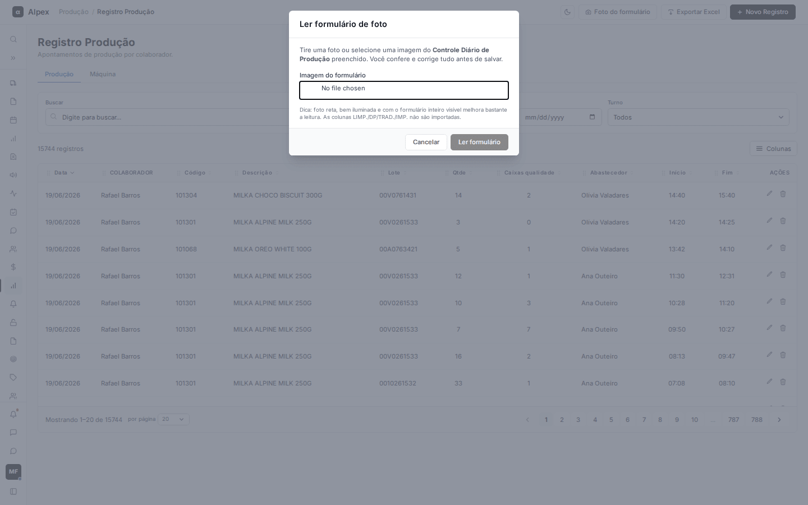
  </Step>
  <Step title="Escolher a imagem">
    Em **Imagem do formulário**, selecione a foto (no celular, o campo abre a câmera). Prefira foto reta, bem iluminada e com o formulário inteiro visível. Uma pré-visualização aparece abaixo do campo. O arquivo precisa ser uma imagem de até 12 MB.
  </Step>
  <Step title="Ler o formulário">
    Clique em **Ler formulário**. A tela mostra "Lendo o formulário… isso pode levar alguns segundos.". As colunas LIMP., DP, TRAD. e IMP. do papel não são aproveitadas.
  </Step>
  <Step title="Conferir e corrigir">
    Se a leitura funcionar, abre a janela **Conferir importação**, com uma tabela editável. No topo ficam os dados do cabeçalho do formulário que valem para todas as linhas: **Colaborador (todas as linhas)**, **Data (todas as linhas)**, **Turno (todas as linhas)** e **Observações (todas as linhas)**. Se o sistema não identificar o colaborador, escolha-o no seletor do topo. Cada linha tem produto, descrição, lote, abastecedor, quantidade, qualidade, início e fim, e uma coluna **Status**. Corrija qualquer célula, remova linhas com o ícone de **Remover linha** ou adicione uma linha manualmente. Quando há muitas linhas, use **Anterior** e **Próxima**.
  </Step>
  <Step title="Gravar">
    Clique no botão **Importar ... válida(s)**. Só as linhas sem erro são gravadas; as linhas com erro são ignoradas. Ao final aparece "Importação concluída" com o total importado.
  </Step>
</Steps>

<Note>
Linhas repetidas (mesmo produto, mesmo início e mesmo fim de outra linha) são marcadas como "Possível duplicata", porque costumam ser erro de leitura; remova as que sobrarem. Um lote fora do padrão de 3 letras + 7 dígitos recebe só um aviso para conferência e não impede a gravação. O produto precisa existir no cadastro, e abastecedor só é mantido se casar com alguém cadastrado. Faltando colaborador ou data no cabeçalho, a importação é barrada com o aviso "Cabeçalho incompleto". Se o serviço de leitura estiver indisponível, a tela avisa e nada é lido; se o formulário for lido por um leitor alternativo, aparece um alerta para conferir as linhas com atenção.
</Note>
