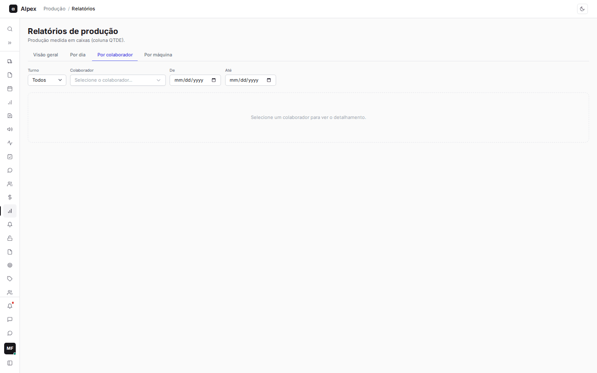
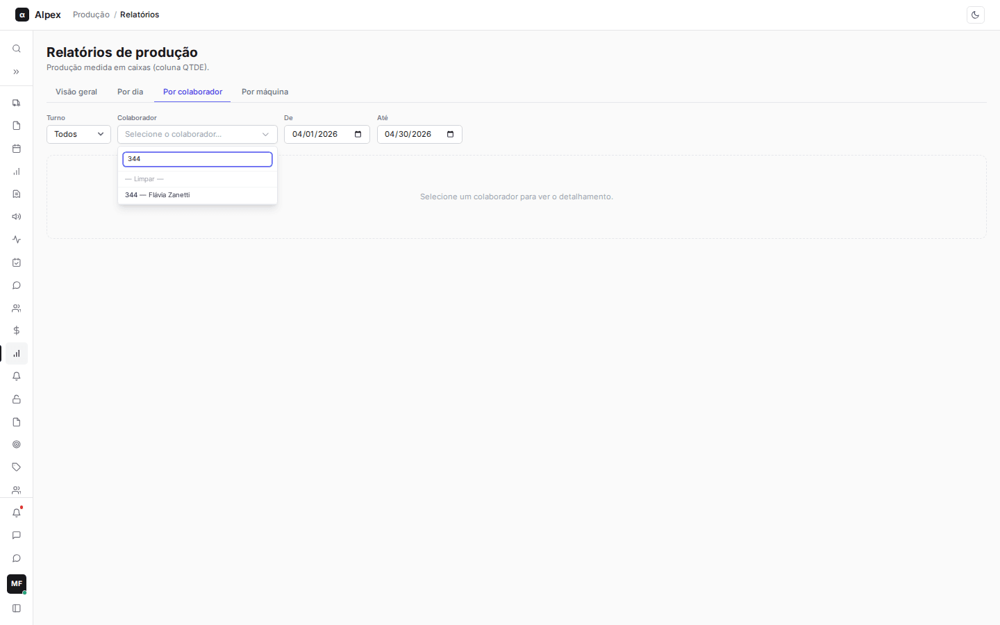
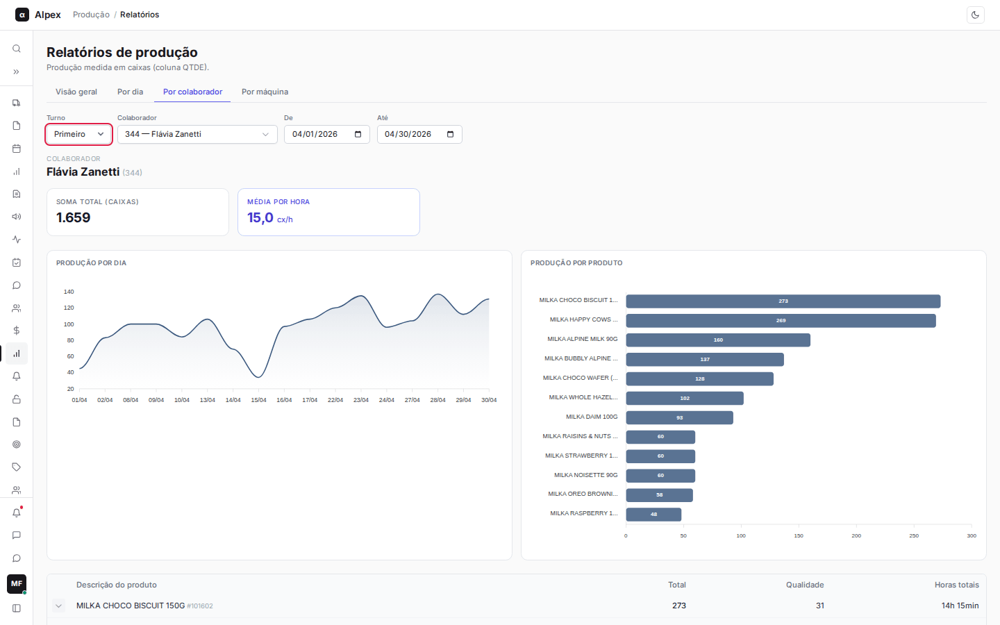
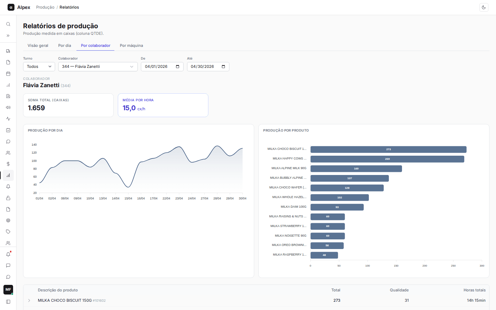
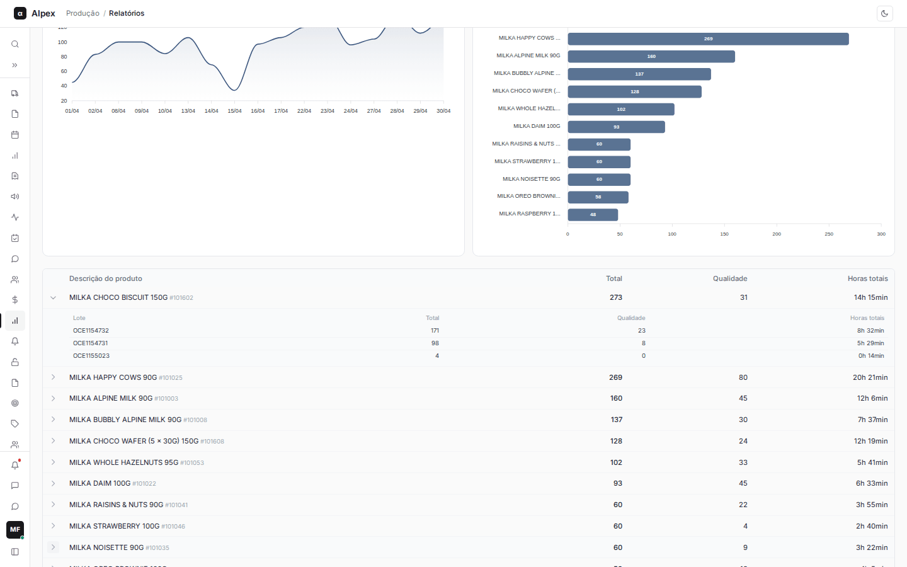
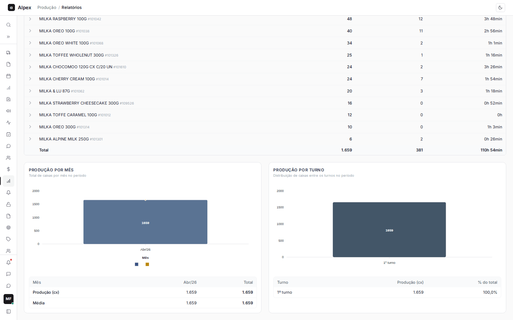

**Menu:** 1204 - Relatórios, aba Por colaborador

A aba **Por colaborador** mostra tudo o que uma pessoa produziu em um período: totais, evolução, produtos e lotes. É usada pelos líderes para acompanhar o desempenho individual.

## Escolher o colaborador e o período

<Steps>
  <Step title="Abrir a aba">
    Na tela de Relatórios, clique em **Por colaborador**. Enquanto nenhuma pessoa é escolhida, a tela mostra "Selecione um colaborador para ver o detalhamento."
  </Step>
  <Step title="Escolher a pessoa">
    Clique no campo **Colaborador** e digite parte do código ou do nome em **Buscar por código ou nome...**. Clique na pessoa desejada. Para voltar a nenhuma seleção, use **— Limpar —**.

    
  </Step>
  <Step title="Definir o período">
    Preencha **De** e **Até**. Se deixar em branco, vale todo o histórico da pessoa.
  </Step>
  <Step title="Filtrar por turno (opcional)">
    Em **Turno**, escolha **Primeiro**, **Segundo** ou **Terceiro** para ver só a produção daquele turno. **Todos** mostra tudo.

    
  </Step>
</Steps>

<Note>
Esta aba usa só os lançamentos de colaboradores; produção de máquina fica na aba **Por máquina**.
</Note>

## Ler o relatório do colaborador

<Steps>
  <Step title="Cartões do topo">
    **Soma total (caixas)** é tudo o que a pessoa produziu no período. **Média por hora** é a produção dividida pelas horas trabalhadas lançadas nos registros, em caixas por hora (cx/h).

    
  </Step>
  <Step title="Gráficos Produção por dia e Produção por produto">
    **Produção por dia** é uma linha com o total de caixas em cada dia trabalhado do período. **Produção por produto** são barras horizontais com até os 12 produtos mais produzidos e o total de caixas de cada um.
  </Step>
  <Step title="Tabela de produtos">
    Cada linha é um produto, do mais produzido ao menos produzido. As colunas são **Descrição do produto**, **Total** (caixas), **Qualidade** (caixas de qualidade) e **Horas totais** trabalhadas naquele produto. A linha **Total** soma tudo.
  </Step>
</Steps>

## Ver os lotes de um produto

<Steps>
  <Step title="Expandir o produto">
    Clique na seta no início da linha do produto. Abaixo aparece uma tabela interna com cada **Lote**, o **Total**, a **Qualidade** e as **Horas totais** daquele lote. Lotes sem número aparecem com um traço.

    
  </Step>
  <Step title="Recolher">
    Clique na seta de novo para fechar.
  </Step>
</Steps>

## Ler os gráficos Produção por mês e Produção por turno

Role a página até o fim para ver os dois últimos blocos.

<Steps>
  <Step title="Produção por mês">
    As barras azuis mostram o total de caixas de cada mês do período (por exemplo **Abr/26**). A linha dourada pontilhada é a **Média do período**: a soma dos meses dividida pelo número de meses com produção. A tabela embaixo tem uma coluna por mês, a coluna **Total** e as linhas **Produção (cx)** e **Média**.
  </Step>
  <Step title="Produção por turno">
    Mostra quantas caixas a pessoa produziu em cada turno (**1º turno**, **2º turno**, **3º turno**, ou **Sem turno** quando o registro não informa). A tabela traz **Turno**, **Produção (cx)** e **% do total**.

    
  </Step>
</Steps>

<Note>
Se os filtros não encontram nada, a tela mostra "Nenhuma produção encontrada para os filtros." Revise o período e o turno.
</Note>
