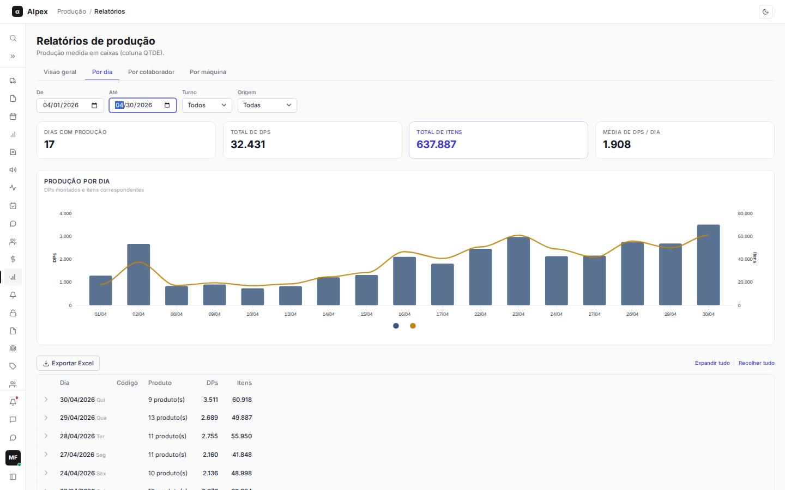
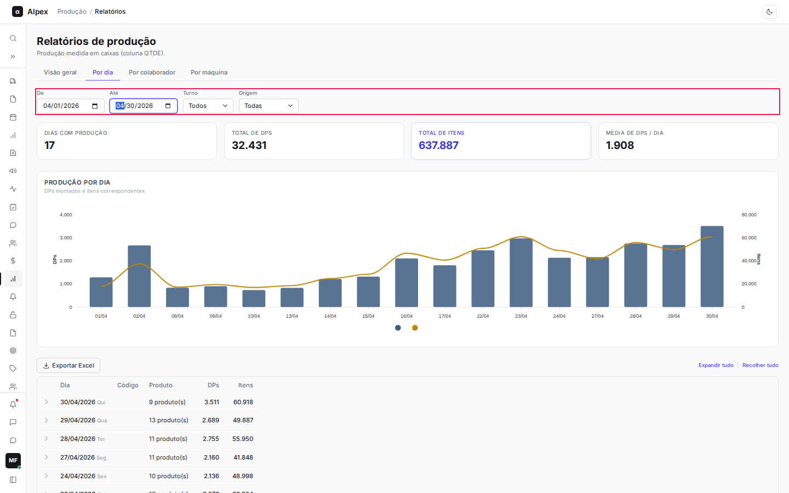
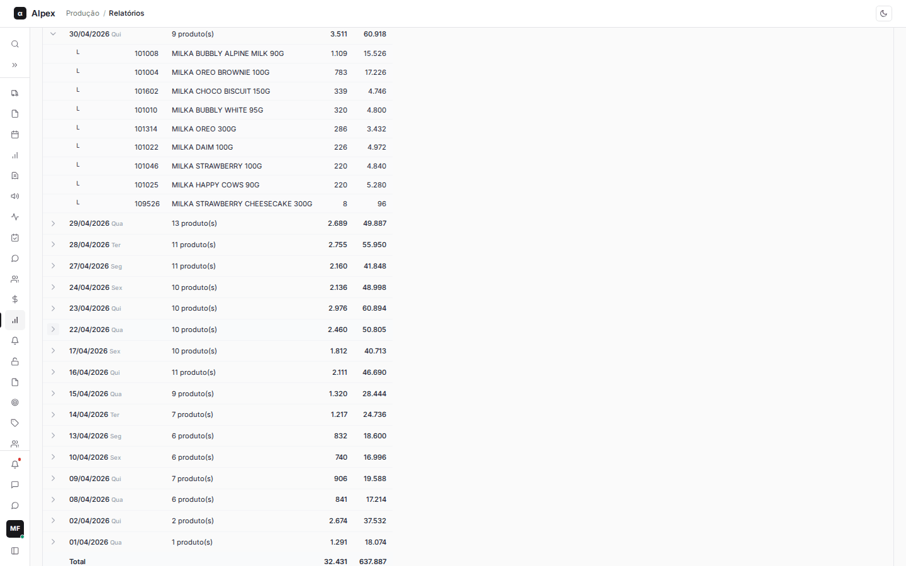
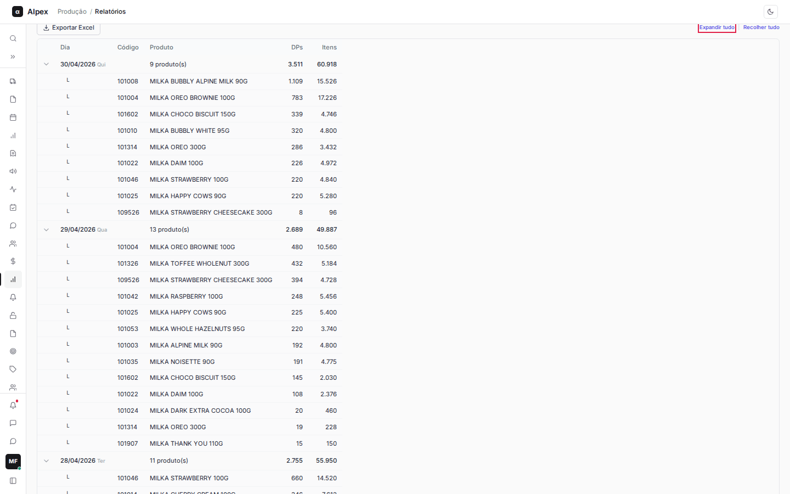
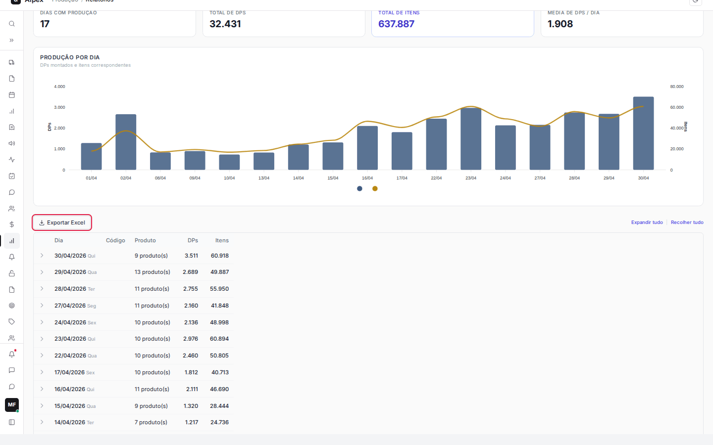

**Menu:** 1204 - Relatórios, aba Por dia

A aba **Por dia** mostra a produção dia a dia em um período, com o detalhe de cada produto. Serve para a liderança e o PCP conferirem o que foi montado e para gerar a planilha do período.

## Filtrar o período, o turno e a origem

<Steps>
  <Step title="Abrir a aba">
    Na tela de Relatórios, clique na aba **Por dia**.
  </Step>
  <Step title="Preencher os filtros">
    Use **De** e **Até** para o período (ao abrir, vai do dia 1 do mês até hoje). Em **Turno**, escolha **Todos**, **Primeiro**, **Segundo** ou **Terceiro**. Em **Origem**, escolha **Todas**, **Colaborador** (produção lançada por pessoas) ou **Máquina** (produção lançada em máquinas).

    
  </Step>
</Steps>

<Note>
Os filtros se aplicam na hora. Mudar qualquer filtro fecha os dias que estavam abertos. Se aparecer o aviso "Há produto sem qtde por caixa no cadastro", os itens desse produto entram como zero no total de itens.
</Note>

## Ler os cartões, o gráfico e a tabela

<Steps>
  <Step title="Cartões de resumo">
    **Dias com produção** conta os dias do período em que houve produção. **Total de DPs** é a soma das caixas montadas (cada DP é uma caixa montada). **Total de itens** é o total de unidades dentro dessas caixas (DPs multiplicados pela quantidade por caixa de cada produto). **Média de DPs / dia** é o total de DPs dividido pelos dias com produção.
  </Step>
  <Step title="Gráfico Produção por dia">
    As barras azuis são os **DPs** de cada dia (escala à esquerda). A linha dourada são os **Itens** do dia (escala à direita). Os dias aparecem em ordem, do mais antigo ao mais recente, e só entram dias com produção.
  </Step>
  <Step title="Tabela">
    Cada linha é um dia, do mais recente ao mais antigo, com o dia da semana, a quantidade de produtos, os **DPs** e os **Itens**. A linha **Total** no fim soma o período.
  </Step>
</Steps>

## Ver o detalhe por produto de um dia

<Steps>
  <Step title="Expandir um dia">
    Clique na seta no início da linha do dia. Abaixo dele aparecem os produtos, com **Código**, **Produto**, **DPs** e **Itens**, do que mais produziu para o que menos produziu.

    
  </Step>
  <Step title="Expandir ou recolher tudo">
    Use **Expandir tudo** para abrir todos os dias de uma vez e **Recolher tudo** para fechar. Os dois ficam acima da tabela, à direita.

    
  </Step>
</Steps>

## Exportar para Excel

<Steps>
  <Step title="Ajustar o recorte">
    Escolha o período e os filtros que você quer na planilha. O arquivo sai com exatamente o que está na tela.
  </Step>
  <Step title="Exportar">
    Clique em **Exportar Excel** (acima da tabela, à esquerda). O botão mostra **Gerando...** por alguns segundos e o navegador baixa o arquivo `producao_por_dia_<início>_a_<fim>.xlsx`.

    
  </Step>
</Steps>

<Note>
A planilha traz uma linha de contexto com o período, o turno e a origem usados, o dia à esquerda e os produtos à direita, com os totais. Se o período não tem produção, o botão não aparece e nada é baixado.
</Note>
