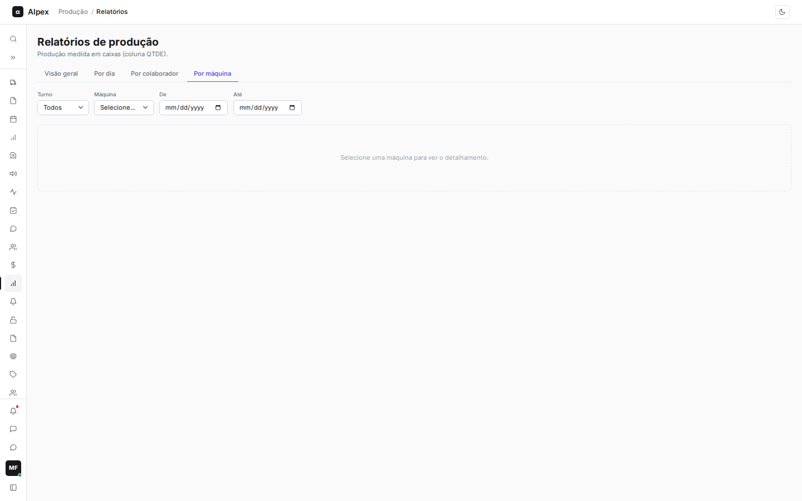
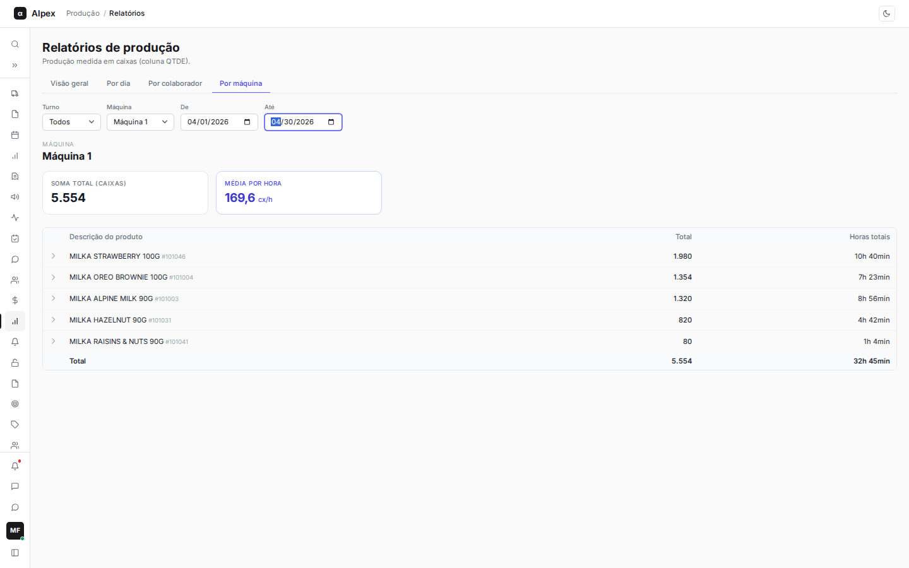
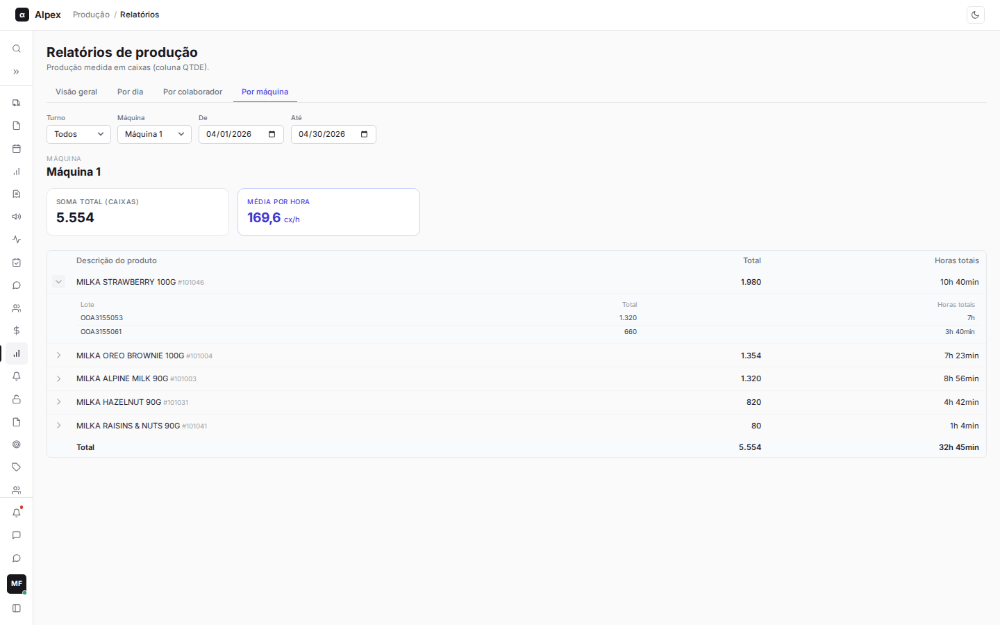

**Menu:** 1204 - Relatórios, aba Por máquina

A aba **Por máquina** funciona como a aba por colaborador, mas para as máquinas: mostra o que cada máquina produziu em um período, por produto e por lote.

## Escolher a máquina e o período

<Steps>
  <Step title="Abrir a aba">
    Na tela de Relatórios, clique em **Por máquina**.
  </Step>
  <Step title="Escolher a máquina">
    No campo **Máquina**, escolha **Máquina 1**, **Máquina 2** ou **Máquina 3**. Enquanto nenhuma é escolhida, a tela pede para selecionar uma.
  </Step>
  <Step title="Definir período e turno">
    Preencha **De** e **Até** (em branco vale todo o histórico). Em **Turno**, escolha **Primeiro**, **Segundo** ou **Terceiro**, ou **Todos**.
  </Step>
</Steps>

## Ler o relatório da máquina e ver os lotes

<Steps>
  <Step title="Cartões e tabela">
    **Soma total (caixas)** é a produção da máquina no período e **Média por hora** é essa produção dividida pelas horas trabalhadas, em cx/h. A tabela lista os produtos, do mais produzido ao menos produzido, com **Descrição do produto**, **Total** e **Horas totais**, e uma linha **Total** no fim. Diferente da aba por colaborador, aqui não há coluna de qualidade nem gráficos.

    
  </Step>
  <Step title="Ver os lotes">
    Clique na seta no início da linha de um produto para abrir os lotes, com **Lote**, **Total** e **Horas totais**. Clique de novo para fechar.

    
  </Step>
</Steps>

<Note>
Se os filtros não encontram nada, a tela mostra "Nenhuma produção encontrada para os filtros."
</Note>
