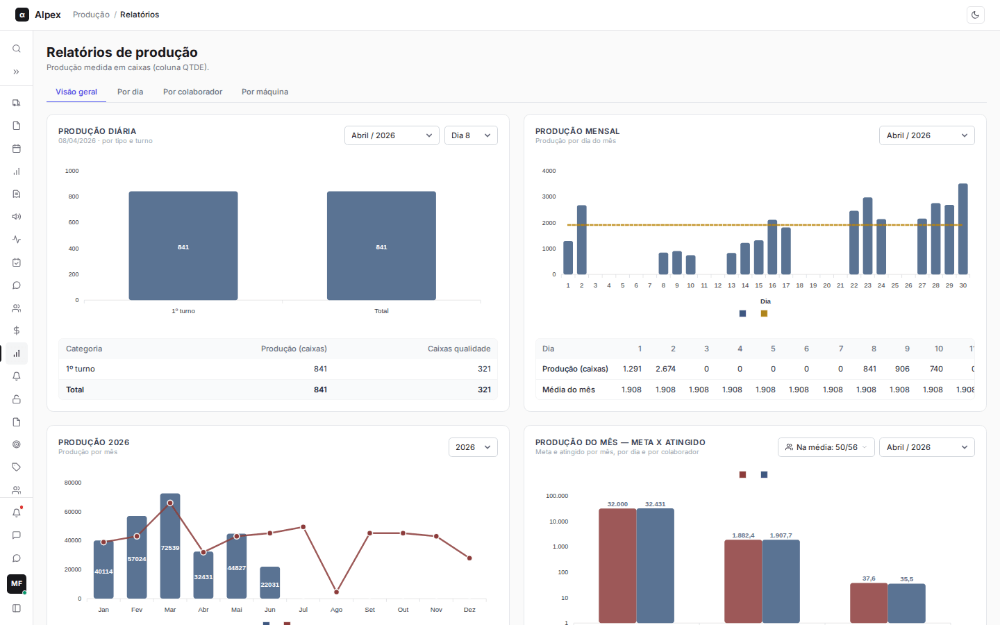
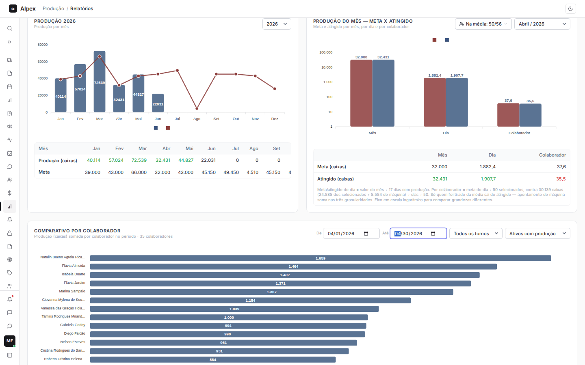
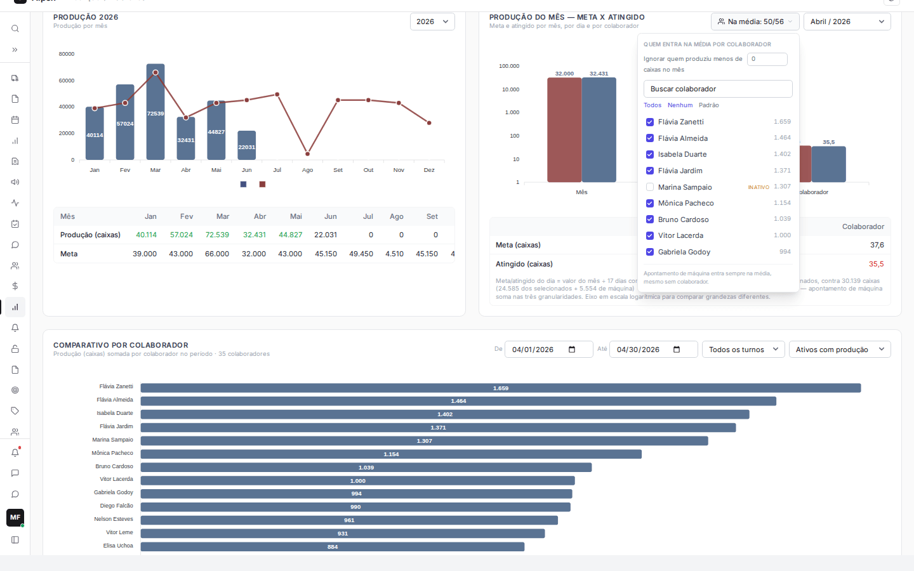
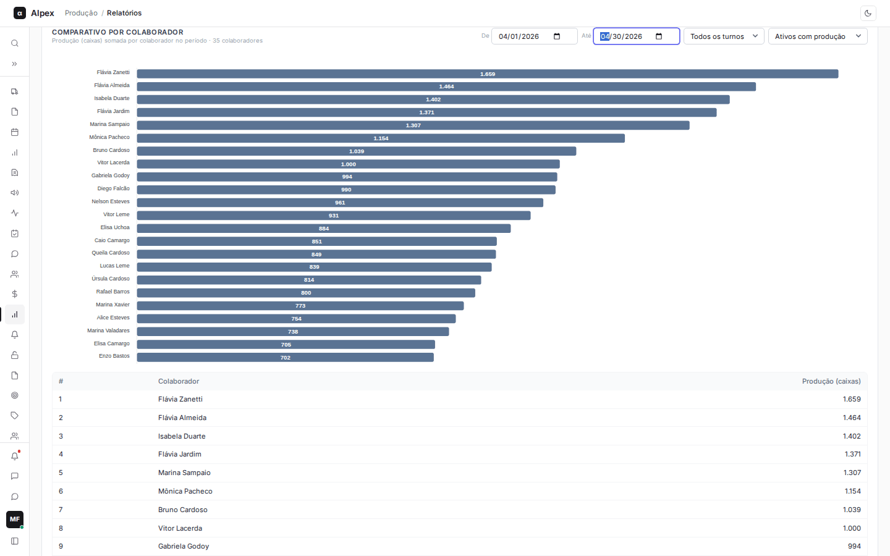

**Menu:** 1204 - Relatórios, aba Visão geral

A tela **Relatórios de produção** reúne os números da fábrica em gráficos e tabelas. A aba **Visão geral** mostra cinco blocos: produção do dia, do mês, do ano, meta x atingido e um comparativo entre colaboradores. É usada por líderes e pelo PCP para acompanhar se a produção está no ritmo da meta. Toda a produção é medida em **caixas** (a quantidade lançada no campo QTDE do registro de produção).

No topo ficam as quatro abas: **Visão geral**, **Por dia**, **Por colaborador** e **Por máquina**. Cada bloco da Visão geral tem o seu próprio seletor de período e funciona de forma independente dos outros.

<Note>
Quem tem a permissão especial "Ver apenas diário" não vê as abas da Visão geral, de colaborador e de máquina: a tela abre direto na aba **Por dia**. Se você não encontra as outras abas, peça a liberação ao administrador.
</Note>

## Escolher o período de cada bloco

<Steps>
  <Step title="Localizar os seletores do bloco">
    Cada bloco tem seletores no canto superior direito. **Produção diária** tem o mês e o dia (**Dia 1**, **Dia 2**...). **Produção mensal** e **Produção do mês — meta x atingido** têm o mês. **Produção do ano** tem o ano (os últimos cinco anos).

    
  </Step>
  <Step title="Escolher o período">
    Abra o seletor e escolha o mês, o dia ou o ano. O bloco é atualizado na hora, junto com a tabela que fica embaixo do gráfico.
  </Step>
</Steps>

<Note>
A tela abre sempre no mês atual. Se o período escolhido não tem produção, o bloco mostra a mensagem "Sem produção registrada nesse dia" (ou mês, ou ano). Nesse caso, escolha outro período. O bloco de meta mostra "Sem meta cadastrada para esse mês" quando o mês não tem meta. As metas são cadastradas em **1205 - Metas**.
</Note>

## Ler os blocos Produção diária e Produção mensal

<Steps>
  <Step title="Produção diária">
    O gráfico tem uma barra para cada grupo de trabalho do dia escolhido: o turno (**1º turno**, **2º turno**, **3º turno**), o grupo de **Estagiário** do turno e o grupo de **Máquina** do turno, mais a barra **Total** no final. O número dentro da barra é a produção em caixas.

    A tabela embaixo repete os valores em três colunas: **Categoria**, **Produção (caixas)** e **Caixas qualidade**. A linha **Total** soma tudo.
  </Step>
  <Step title="Produção mensal">
    O gráfico mostra uma barra azul por dia do mês, com o número do dia embaixo. A linha pontilhada dourada é a **Média do mês**: o total produzido dividido apenas pelos dias em que houve produção (dias parados não entram na conta).

    A tabela embaixo tem uma coluna por dia, a coluna **Total** à direita e duas linhas: **Produção (caixas)** e **Média do mês**. Role a tabela para o lado para ver todos os dias.
  </Step>
</Steps>

<Note>
Passe o mouse sobre uma barra para ver o valor exato daquele dia ou categoria.
</Note>

## Ler os blocos Produção do ano e meta x atingido

<Steps>
  <Step title="Produção do ano">
    O gráfico tem uma barra azul por mês (**Jan** a **Dez**) com o total de caixas. Quando o mês tem meta cadastrada, uma linha vermelha mostra a **Meta** de cada mês. Barra acima da linha significa que a meta do mês foi batida.

    A tabela traz as linhas **Produção (caixas)** e **Meta**. O valor de produção aparece em verde quando é igual ou maior que a meta do mês. Meses sem meta mostram um traço.

    
  </Step>
  <Step title="Produção do mês: meta x atingido">
    O gráfico compara duas barras em três grupos. A barra vermelha é a **Meta** e a azul é o **Atingido**:

    - **Mês**: a meta do mês contra o total produzido no mês.
    - **Dia**: a meta e o total do mês divididos pelos dias com produção. É a meta e a produção de um dia médio.
    - **Colaborador**: a meta do dia dividida pelo número de colaboradores que entram na média, contra a produção do dia dividida pelo mesmo número. É a meta e a produção de uma pessoa em um dia médio.

    A escala vertical é logarítmica (1, 10, 100, 1.000...) para que valores muito diferentes caibam no mesmo gráfico. Por isso, compare sempre as duas barras do mesmo grupo, nunca as alturas entre grupos.
  </Step>
  <Step title="Conferir na tabela">
    A tabela embaixo mostra **Meta (caixas)** e **Atingido (caixas)** para **Mês**, **Dia** e **Colaborador**. O atingido aparece em verde quando alcançou a meta e em vermelho quando ficou abaixo. O texto pequeno no rodapé do bloco explica a conta com os números do mês escolhido: quantos dias com produção, quantos colaboradores estão na média e quantas caixas entram no cálculo.
  </Step>
</Steps>

<Note>
Apontamentos de máquina (produção lançada em uma máquina, sem colaborador) sempre entram no atingido, nos três grupos. Isso porque a meta do mês é da operação inteira, máquinas incluídas.
</Note>

## Escolher quem entra na média por colaborador

Na média por colaborador, quem produziu muito pouco no mês puxa o resultado para baixo. O botão **Na média** permite escolher quem conta.

<Steps>
  <Step title="Abrir a lista">
    No bloco **Produção do mês — meta x atingido**, clique no botão **Na média: X/Y** (X é quantos estão incluídos e Y é o total de candidatos do mês).

    
  </Step>
  <Step title="Marcar ou desmarcar pessoas">
    Cada linha mostra o nome e o total de caixas do colaborador no mês. Marque ou desmarque a caixa de seleção para incluir ou tirar a pessoa da média. Para achar alguém, digite no campo **Buscar colaborador**. Colaboradores inativos que produziram no mês aparecem com a etiqueta **INATIVO** e começam desmarcados, mas você pode incluí-los.
  </Step>
  <Step title="Usar o corte por volume (opcional)">
    No campo **Ignorar quem produziu menos de ... caixas no mês**, digite um número. Quem produziu menos que isso fica fora da média automaticamente. Com 0, não há corte.
  </Step>
  <Step title="Usar os atalhos">
    **Todos** inclui todo mundo e zera o corte. **Nenhum** tira todos (a barra Colaborador do gráfico fica zerada e a tela avisa). **Padrão** desfaz as marcações manuais e mantém só o corte por volume.
  </Step>
  <Step title="Fechar">
    Clique fora da lista. O gráfico e a tabela já foram recalculados.
  </Step>
</Steps>

<Note>
Sem ajuste, entram na média os colaboradores ativos do cadastro. Marcar manualmente vale mais que o corte por volume, e desmarcar manualmente vale mais que tudo. Sua escolha fica guardada neste navegador e é restaurada na próxima vez que você abrir a tela. Apontamento de máquina entra sempre na média, mesmo sem colaborador.
</Note>

## Usar o Comparativo por colaborador

No fim da Visão geral, o bloco **Comparativo por colaborador** ordena as pessoas da que mais produziu para a que menos produziu em um período.

<Steps>
  <Step title="Definir o período">
    Preencha **De** e **Até** com as datas. Ao abrir a tela, os dois campos começam no dia de hoje; se hoje não tem produção, no último dia com produção registrada.
  </Step>
  <Step title="Filtrar por turno e por quem aparece">
    No seletor de turnos, escolha **Todos os turnos**, **1º turno**, **2º turno** ou **3º turno**. No seletor ao lado, escolha **Ativos com produção** (padrão), **Todos os ativos** (inclui quem não produziu no período) ou **Todos os cadastrados** (inclui também os inativos).
  </Step>
  <Step title="Ler o gráfico e a tabela">
    Cada barra horizontal é um colaborador e o número é o total de caixas no período. O subtítulo informa quantos colaboradores aparecem. A tabela embaixo lista a posição (**#**), o **Colaborador** e a **Produção (caixas)**, com a linha **Total** no fim. Quando há muitos colaboradores, role o gráfico para ver todos.

    
  </Step>
</Steps>
